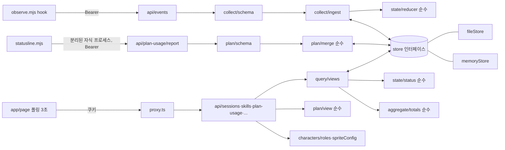
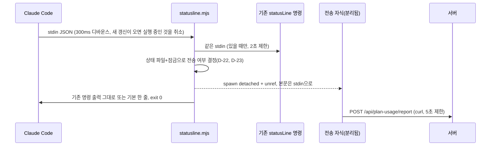

# 인수인계: agent-observer

상태: 결정된 내용과 1단계 범위. 아직 구현된 것은 없습니다.

이 문서는 `/task docs/HANDOFF.md 읽고 관찰 서버 1단계 진행`의 입력입니다. 이전 대화(BOT 세트 설계, Pixel Agent Desk 검토)에서 정한 내용을 정리했습니다.

## 목표

여러 프로젝트에서 도는 Claude Code 세션과 dev-team-kit BOT(책임자, planner, architect, designer, developer, qa, security, devops)의 활동을 한 화면에서 본다. 클라우드 세션도 포함하고, 휴대폰과 다른 PC에서도 본다.

- 픽셀 사무실 화면에서 BOT마다 지정한 캐릭터가 움직인다.
- BOT별 사용한 스킬, 승인 대기 상태를 본다.
- Claude 플랜 사용량(5시간·주간 한도 대비 %)을 본다. 원래 목적이던 사용량 측정은 BOT별 토큰 대신 플랜 사용량으로 한다(사용자 결정 2026-11-11).

## 결정 사항

| 항목 | 결정 | 이유 |
|---|---|---|
| 구조 | 각 세션이 hook으로 서버에 이벤트를 보낸다(push) | 클라우드 세션은 사용자 PC의 앱에 닿지 못하고, 서버가 컨테이너 파일을 읽을 수 없다 |
| 서버 | Next.js, Vercel 배포 | 사용자가 Next.js·Vercel에 익숙하다 |
| 데스크톱 | Electron 창이 배포된 웹 화면을 띄운다(`desktop/`). 항상 위 작은 창, 트레이, 승인 대기 알림 | PWA보다 Electron을 선택함 |
| 오프라인 | 지원하지 않는다 | 인터넷 없는 환경이 거의 없음 |
| 저장소 공개 | 개발 중 공개, 배포 전 비공개로 전환 | |
| 캐릭터 | 사용자가 그림 파일을 넣고 BOT마다 지정한다 | |
| 사무실 그림 | 캐릭터가 정해진 뒤 Claude가 새로 그린다 | 원본 그림은 라이선스상 쓸 수 없다 |
| 원본 코드 | Pixel Agent Desk의 일부 코드만 출처를 표시해 가져온다 | Electron·로컬 파일 기반 부분은 이 구조에서 쓸 수 없다 |

## 데이터 수집 (이미 구현됨, dev-team-kit)

[dev-team-kit](https://github.com/winterairy/dev-team-kit)의 `kit/team/observe/observe.mjs`가 모든 hook 이벤트에서 `POST {AGENT_OBSERVER_URL}/api/events`로 JSON을 보낸다. 인증은 `Authorization: Bearer <토큰>`(클라우드에서는 Network secret이 붙여 준다).

payload (v1):

```jsonc
{
  "v": 1,
  "event": "PreToolUse",            // SessionStart, SessionEnd, UserPromptSubmit, UserPromptExpansion,
                                     // PreToolUse, PostToolUse, Notification, Stop, SubagentStart, SubagentStop
  "ts": "2026-11-10T14:53:12.190Z",
  "session_id": "0c09…",             // Claude Code 세션
  "agent_id": "a2cc…" | null,        // 서브에이전트 안에서 난 이벤트면 그 에이전트 ID
  "agent_type": "qa" | null,         // 서브에이전트 이름. null이면 메인 세션(책임자)
  "project": "winterairy/epub-editor",
  "branch": "feature/ui-prototype",
  "remote": true,                    // 클라우드 세션 여부
  "remote_session_id": null,
  "tool": "Skill",                   // 도구 이벤트일 때
  "skill": "playwright-cli",         // Skill 도구일 때
  "subagent_type": "developer",      // Agent 도구로 BOT을 부를 때
  "notification_type": "permission_prompt", // Notification일 때
  "source": "startup", "model": "…", // SessionStart일 때
  "reason": "…",                     // SessionEnd일 때
  "usage": {                         // PostToolUse, Stop, SubagentStop, SessionEnd: 이 에이전트의 누적 합계
    "input": 6, "output": 398, "cache_creation": 12285, "cache_read": 100229,
    "model": "claude-haiku-5-5", "messages": 3
  },
  "subagent": {                      // 부모의 Agent 도구가 끝났을 때: 그 서브에이전트의 누적 합계
    "agent_id": "a2cc…", "agent_type": "qa", "status": "completed", "usage": { … }
  }
}
```

- **1단계에서 `usage`와 `subagent.usage`는 저장하지 않는다(사용자 결정 2026-11-11).** observe.mjs는 지금처럼 계속 보내므로 서버는 이 필드가 와도 요청을 거부하지 않고 버린다. `subagent`의 나머지 필드(`agent_id`, `agent_type`, `status`)는 BOT 호출 기록에 쓸 수 있다.
- (참고, 저장하지 않음) `usage`는 에이전트별 누적값이다.
- 프롬프트, 응답, 도구 입력 내용은 오지 않는다. 서버도 저장하지 않는다.
- Claude Code 2.1.322의 실제 hook 데이터로 확인했다.

### 플랜 사용량 (1단계에서 dev-team-kit에 추가, T1-8)

- hook 입력에는 플랜 사용량이 없다. **statusLine 명령의 stdin JSON**에 구독 사용자일 때만 `rate_limits`가 있다(책임자가 Claude Code 2.1.322에서 확인, 2026-11-11).

```jsonc
"rate_limits": {
  "five_hour": { "used_percentage": 42, "resets_at": 1762862400 },  // 0~100, Unix epoch 초
  "seven_day": { "used_percentage": 13, "resets_at": 1763251200 }
}
```

- 각 창(`five_hour`, `seven_day`)은 API가 보고했고 `resets_at`이 아직 지나지 않은 동안만 있다. 세션의 첫 API 응답 이후에 나온다. 둘 중 하나만 있을 수 있다.
- 계정 단위 값이다(세션·프로젝트·BOT별 값이 아니다).
- 클라우드 세션에서 statusLine이 실행되는지는 확인되지 않았다.

## 1단계 범위 (이번 과업)

로컬에서 돌아가는 서버와 화면. Vercel 배포와 DB 연결은 하지 않는다.

1. **수집 API** `POST /api/events`
   - Bearer 토큰 확인(환경 변수 `OBSERVER_TOKEN`), payload 검증(v1), 크기 제한
   - 저장소는 인터페이스로 분리한다. 1단계 구현은 로컬 파일(메모리 구현은 테스트용). 나중에 Postgres·Redis 구현으로 바꿀 수 있게 한다.
2. **상태 계산**: 이벤트에서 세션·에이전트 상태를 만든다.
   - 상태: 작업 중(도구 사용), 생각 중, 승인 대기(Notification permission_prompt), 완료, 종료
   - 일정 시간 이벤트가 없으면 끝난 것으로 본다(프로세스 확인 대신)
   - 스킬 사용 기록, BOT 호출 기록
3. **조회 API**와 **웹 화면**
   - 프로젝트 필터, 세션 목록, 세션 안의 BOT 목록과 상태, 사용한 스킬
   - 플랜 사용량(7번)
   - 픽셀 사무실 화면은 임시 그림(단색 사각형 등)으로 동작만 확인한다. 진짜 그림은 3단계.
   - 화면 갱신은 2~3초 폴링으로 충분하다.
4. **로그인**: 화면과 조회 API 보호. 1단계는 간단한 방식(예: 환경 변수 비밀번호 + 쿠키)이면 된다.
5. **캐릭터 설정**
   - `roles.json`: 역할 키(`lead`, `planner` …) → 표시 이름, 캐릭터 ID
   - 캐릭터마다 설정 파일: 그림 파일, 한 칸 크기, 줄별 방향·동작, 프레임 수. 없는 동작은 가까운 동작으로 대신한다(예: sit_work 없으면 idle).
   - 그림 파일은 `.gitignore`된 폴더에 둔다. 저장소에는 예시 설정만 커밋한다.
6. **테스트**: 수집 API 검증·인증, 상태 계산(이벤트 순서별), 스킬 기록, 플랜 사용량. dev-team-kit의 observe 스크립트로 실제 전송하는 통합 테스트 하나.
7. **플랜 사용량**: dev-team-kit에 statusLine 스크립트를 추가해 `rate_limits`를 서버로 보내고, 서버는 계정 단위 마지막 값을 저장해 화면에 5시간·주간 막대로 보여 준다(T1-8).

1단계에서 BOT별 토큰 사용량과 API 환산 비용은 다루지 않는다(사용자 결정 2026-11-11).

## 이후 단계 (이번 범위 아님)

- 2단계: Vercel 배포, DB 연결(Neon Postgres 또는 Upstash Redis), Electron 창(`desktop/`), 휴대폰 푸시 알림(웹 푸시. 승인 대기가 생기면 휴대폰으로 알림)
- 3단계: 캐릭터를 받은 뒤 사무실 그림 제작, 사무실 좌표·이동 영역을 데이터 파일로 정의

## 참고 코드

`vendor/pixel-agent-desk/`에 출처 표시와 함께 있다(README 참고). 바로 쓰지 말고 필요한 부분을 옮겨 고친다.
- `src/office/`: 브라우저용 사무실 렌더러, 캐릭터 이동, 길찾기, 좌석 배정. 좌표·충돌 정보를 원본 그림에서 읽으므로 데이터 파일 방식으로 바꿔야 한다.
- `src/roleConfig.js`: 역할 매핑. 플러그인 접두사(`plugin:planner`) 처리 포함.
- `src/pricing.js`: 모델별 단가. 1단계에서는 쓰지 않는다(토큰·비용 범위 제외).

## 주의

- 저장소가 공개인 동안 캐릭터 그림, 토큰, 실제 수집 데이터를 커밋하지 않는다.
- 원본 Pixel Agent Desk 그림을 쓰거나 본떠 그리지 않는다.
- 로그인한 사용자만 화면을 볼 수 있어야 한다.

## 1단계 Task

위 "1단계 범위" 7개 항목을 Task로 나눈 것이다. 기술 구현 방식(파일 구조, 라이브러리)은 설계 문서에서 정한다. `[사용자 확인]`은 이 클라우드 환경에서 검증할 수 없는 조건, `(결정 필요 D-n)`은 기본값을 제안했지만 확정되지 않은 값이다. 목록은 절 끝에 모았다.

### 1단계 범위가 아닌 것

- Vercel 배포, 실제 도메인·HTTPS 설정 (2단계)
- DB 연결(Neon Postgres, Upstash Redis). 1단계는 로컬 파일 저장만 한다 (2단계)
- Electron 창(`desktop/`), 트레이, 데스크톱 알림, 휴대폰 푸시 알림 (2단계)
- 진짜 사무실 그림, 사무실 좌표·이동 영역 데이터, 캐릭터 길찾기 (3단계). 1단계는 단색 사각형 등 임시 그림
- 여러 사용자 계정, 권한 구분, 회원가입
- 프롬프트·응답·도구 입력 내용 표시(수집하지 않는다)
- BOT별·역할별·프로젝트별 토큰 사용량, API 환산 비용, 모델 단가표 (사용자 결정 2026-11-11로 제외. 플랜 사용량으로 대신한다)
- 플랜 사용량 이력·그래프(마지막 값만 보여 준다)
- dev-team-kit `observe.mjs` 수정. payload v1을 그대로 받는다(`usage`가 계속 와도 저장하지 않는다).

dev-team-kit 변경은 1단계 범위에 **들어간다**: 별도 저장소 [winterairy/dev-team-kit](https://github.com/winterairy/dev-team-kit)에 statusLine 스크립트와 설치 방법을 추가한다(T1-8). 이 저장소(agent-observer)에는 설치한 사본을 둔다(observe.mjs가 `.claude/team/observe/`에 있는 것과 같은 방식).

### Task 목록

| ID | 이름 | 우선순위 | 의존 |
|---|---|---|---|
| T1-1 | 수집 API와 저장소 인터페이스 | Must | 없음 |
| T1-2 | 상태 계산(세션·에이전트 상태, 종료 판정) | Must | T1-1 |
| T1-3 | 스킬·BOT 호출 기록 | Must | T1-1 |
| T1-4 | 로그인 | Must | 없음 |
| T1-5 | 조회 API와 웹 화면(목록, 스킬, 임시 사무실) | Must | T1-2, T1-3, T1-4, T1-6 |
| T1-6 | 캐릭터 설정(roles.json, 캐릭터 설정 파일, 동작 대체) | Must | 없음 |
| T1-7 | 테스트(단위·통합) | Must | T1-1~T1-6, T1-8 (각 Task와 함께 작성 가능) |
| T1-8 | 플랜 사용량(dev-team-kit statusLine 수집, 서버 저장, 화면) | Must | T1-1, T1-4, T1-5 |

변경 이력: 2026-11-11 사용자 결정으로 T1-3에서 토큰 누적·API 환산 비용을, T1-5에서 토큰·비용 표시와 합계를 지웠고, T1-8을 추가했다.

### T1-1. 수집 API와 저장소 인터페이스

요구사항
- `POST /api/events`가 payload v1 JSON을 받는다.
- `Authorization: Bearer <OBSERVER_TOKEN>`이 맞을 때만 받는다. `OBSERVER_TOKEN`이 설정되지 않았으면 모든 요청을 거부한다(열린 상태로 시작하지 않는다).
- 검증: `v`가 1, `event`가 정의된 10종 중 하나, `ts`가 ISO 8601, `session_id`가 비어 있지 않은 문자열, `project`가 문자열. 나머지 필드는 선택이며 타입이 맞지 않으면 거부한다.
- 정의되지 않은 필드는 저장하지 않고 버린다. 특히 프롬프트·응답·도구 입력으로 보이는 필드(`prompt`, `tool_input`, `tool_response` 등)가 와도 저장하지 않는다.
- `usage`와 `subagent.usage`는 받되 저장하지 않는다. 이 필드 때문에 요청을 거부하지 않는다(형식 검사 여부는 결정 필요 D-21).
- 요청 본문 크기 제한: 기본 16KB (결정 필요 D-1). 문자열 필드 길이 제한: 기본 256자 (결정 필요 D-2).
- 저장소는 인터페이스로 분리하고 1단계 구현은 로컬 파일이고, 메모리 구현은 테스트용으로 둔다 (D-3). 저장 위치는 gitignore된 폴더.
- 이벤트 보관 한도: 세션당 최근 이벤트 기본 500개, 전체 기본 7일 (결정 필요 D-4). 스킬 횟수·BOT 호출 기록은 보관 한도와 별개로 유지한다.

수용 기준
- [ ] 올바른 토큰과 올바른 payload를 보내면 2xx가 오고 이벤트가 저장된다.
- [ ] Authorization 헤더가 없거나 토큰이 다르면 401이 오고 아무것도 저장되지 않는다.
- [ ] 서버의 `OBSERVER_TOKEN`이 비어 있거나 16자보다 짧으면 어떤 토큰으로 보내도 401이 오고, 응답에 "서버 수집 토큰이 설정되지 않았거나 16자보다 짧다"는 오류 메시지(`error: "server_token_invalid"`)가 있다. 토큰 값은 응답·로그에 나오지 않는다.
- [ ] 보낸 토큰이 틀린 경우는 `error: "unauthorized"`로만 답하고 이유를 구분하지 않는다.
- [ ] `ts`가 서버 시각보다 5분 넘게 미래이면 서버 시각으로 바뀌어 저장된다.
- [ ] `v`가 1이 아니거나, `event`가 목록에 없거나, `ts`·`session_id`가 없거나 형식이 틀리면 400이 오고 저장되지 않는다.
- [ ] JSON이 아닌 본문은 400이 온다.
- [ ] 본문이 크기 제한을 넘으면 413이 오고 저장되지 않는다.
- [ ] payload에 `prompt`, `tool_input` 같은 정의되지 않은 필드를 넣어 보내면 저장된 데이터·조회 결과 어디에도 그 값이 없다.
- [ ] `usage`와 `subagent.usage`가 들어 있는 payload(위 예시 그대로)를 보내면 2xx가 오고, 저장된 데이터·조회 결과 어디에도 토큰 수(`input`, `output`, `cache_creation`, `cache_read`, `messages`)가 없다.
- [ ] 같은 요청을 저장소 구현만 바꿔(메모리 ↔ 다른 구현 또는 테스트용 가짜 구현) 실행해도 API 동작이 같다. 저장소 구현 교체 시 수집·상태 계산 코드를 고치지 않아도 된다(설계 리뷰로 확인).
- [ ] 에러 응답에 토큰 값이나 내부 스택이 나오지 않는다.
- [ ] GET 등 다른 메서드는 405가 온다.

### T1-2. 상태 계산

요구사항
- 세션과 에이전트(메인 세션 = 책임자 `lead`, 서브에이전트 = `agent_id`별)마다 상태를 하나 가진다: 작업 중, 생각 중, 승인 대기, 완료, 종료.
- 이벤트는 `agent_id`가 null이면 메인 세션(책임자)에, 아니면 그 서브에이전트에 적용한다.
- 세션 상태는 그 세션 에이전트 상태 중 가장 활동적인 것으로 정한다. 우선순위: 승인 대기 > 작업 중 > 생각 중 > 완료 > 종료 (결정 필요 D-5).
- 마지막 이벤트 후 일정 시간 이벤트가 없으면 종료로 본다. 기본값: 완료 상태에서 30분, 작업 중·생각 중에서 10분 (D-6). 종료 판정은 조회 시점 기준으로 계산해도 된다.
- **승인 대기는 시간이 지나도 종료로 보지 않는다.** Claude Code는 권한 프롬프트에서 사용자 답을 무기한 기다리므로 이벤트가 없는 것이 정상이다. 승인 대기는 다음 이벤트(승인·거절 후 PostToolUse 등) 또는 SessionEnd로만 풀린다.
  - 승인 대기를 시작한 시각을 남겨 화면에 기다린 시간(예: "승인 대기 · 2시간째")을 보여 준다. permission_prompt 외 Notification(R6)은 이 시각을 바꾸지 않는다.
  - 24시간 넘게 승인 대기이면 "승인 대기 (응답 없음)"으로 표시만 바꾼다(SessionEnd 없이 터미널이 꺼지거나 클라우드 컨테이너가 회수된 경우 대비). 상태와 데이터는 그대로이고 자동으로 지우지 않는다.
  - 사용자는 화면에서 세션을 "정리"해 목록에서 숨길 수 있다. 숨긴 세션에 새 이벤트가 오면 다시 보인다.
  - 숨긴 세션은 "숨긴 세션 보기"에서 볼 수 있고 "다시 표시"로 원래 목록에 되돌린다(이미 끝나 새 이벤트가 오지 않는 세션도 다시 볼 수 있어야 한다).
- 종료된 세션에 새 이벤트가 오면 다시 살아난다(표의 규칙대로 상태가 바뀐다).
- 이벤트 순서: 도착 순서가 아니라 `ts` 순서로 계산한다. `ts`가 같으면 도착 순서 (결정 필요 D-7).
- 상태와 함께 마지막 이벤트 시각, 현재 사용 중인 도구 이름(작업 중일 때)을 남긴다.

상태 전이 규칙(에이전트 단위). "이전 상태"가 "모두"이면 이전 상태와 관계없다.

| # | 이벤트 | 조건 | 이전 상태 | 다음 상태 |
|---|---|---|---|---|
| R1 | SessionStart | 메인 | 없음/모두 | 완료(입력 대기) (결정 필요 D-8) |
| R2 | UserPromptSubmit, UserPromptExpansion | 메인 | 모두 | 생각 중 |
| R3 | PreToolUse | | 모두 | 작업 중 (도구 이름 기록) |
| R4 | PostToolUse | | 작업 중/승인 대기 | 생각 중 |
| R5 | Notification | `notification_type` = `permission_prompt` | 모두 | 승인 대기 |
| R6 | Notification | 그 외 타입(예: `idle_prompt`) | 모두 | 변화 없음 (결정 필요 D-9) |
| R7 | Stop | 메인 | 모두 | 완료 |
| R8 | SubagentStart | `agent_id` 있음 | 없음 | 해당 서브에이전트 생성, 생각 중 |
| R9 | SubagentStop | `agent_id` 있음 | 모두 | 해당 서브에이전트 완료 |
| R10 | SessionEnd | | 모두 | 세션과 모든 에이전트 종료 |
| R11 | (시간 경과) | D-6 시간 초과 | 작업 중·생각 중·완료 | 종료 |
| R11a | (시간 경과) | 승인 대기 시작 후 24시간 초과 | 승인 대기 | 승인 대기 유지, "응답 없음" 표시 |
| R12 | 처음 보는 `agent_id`의 아무 이벤트 | SubagentStart 없이 | 없음 | 서브에이전트를 만들고 그 이벤트 규칙 적용 |
| R13 | 처음 보는 `session_id`의 아무 이벤트 | SessionStart 없이 | 없음 | 세션을 만들고 그 이벤트 규칙 적용 |

QA용 이벤트 순서별 기대 상태. 세션 S1, 서브에이전트 A1(`agent_type`=qa). 시간은 첫 이벤트 기준 경과.

| 시나리오 | 이벤트 순서 | 기대 결과 |
|---|---|---|
| S-01 기본 흐름 | SessionStart → UserPromptSubmit → PreToolUse(Read) → PostToolUse → Stop | 각 단계 후 lead: 완료 → 생각 중 → 작업 중(Read) → 생각 중 → 완료 |
| S-02 승인 대기 | UserPromptSubmit → PreToolUse(Bash) → Notification(permission_prompt) → PostToolUse | lead: 생각 중 → 작업 중 → 승인 대기 → 생각 중 |
| S-03 승인 대기 중 세션 상태 | S-02의 승인 대기 시점, A1은 작업 중 | 세션 상태 = 승인 대기 |
| S-04 다른 알림 | Stop → Notification(idle_prompt) | lead 완료 유지 |
| S-05 서브에이전트 | UserPromptSubmit → PreToolUse(Agent, subagent_type=qa) → SubagentStart(A1) → PreToolUse(A1, Bash) → PostToolUse(A1) → SubagentStop(A1) → PostToolUse(lead, subagent 필드) → Stop | lead: 생각 중 → 작업 중 … → 생각 중 → 완료. A1: 생각 중 → 작업 중 → 생각 중 → 완료. 마지막에 A1은 목록에 남고 상태 완료 |
| S-06 SubagentStart 없이 이벤트 | PreToolUse(A1) 먼저 도착 | A1이 생성되고 작업 중 |
| S-07 SessionStart 없이 이벤트 | 새 session_id로 PreToolUse | 세션 생성, lead 작업 중 |
| S-08 SessionEnd | 작업 중인 lead와 A1 → SessionEnd | 세션·lead·A1 모두 종료 |
| S-09 시간 초과(작업 중) | PreToolUse 후 이벤트 없음 | 9분 59초: 작업 중, 10분 1초: 종료 |
| S-10 시간 초과(완료) | Stop 후 이벤트 없음 | 29분: 완료, 31분: 종료 |
| S-11 승인 대기 장기 | Notification(permission_prompt) 후 이벤트 없음 | 61분: 승인 대기, 23시간 59분: 승인 대기, 24시간 1분: 승인 대기(응답 없음). 어느 시점에도 종료가 아니다 |
| S-11b 승인 대기 중 다른 알림 | Notification(permission_prompt) → 30분 뒤 Notification(idle_prompt) | 승인 대기 유지, 기다린 시간은 첫 알림 기준 |
| S-11c 응답 없음 후 재개 | S-11의 24시간 1분 시점 → PostToolUse | 생각 중, "응답 없음" 표시 사라짐 |
| S-12 종료 후 재개 | S-09로 종료 → UserPromptSubmit | lead 생각 중, 세션 다시 활성 |
| S-13 순서 뒤바뀜 | ts 10:00:02 Stop이 먼저 도착, ts 10:00:01 PreToolUse가 나중에 도착 | lead 완료 (ts 순서 적용) |
| S-14 프로젝트 구분 | 같은 이벤트를 project P1, P2로 각각 보냄 | 두 세션이 각 프로젝트에 따로 보인다 |

수용 기준
- [ ] 위 시나리오 S-01~S-14(S-11b, S-11c 포함)가 단위 테스트로 있고 모두 통과한다.
- [ ] 위 전이표 R1~R13(R11a 포함) 각각을 최소 1개 테스트가 다룬다.
- [ ] 시간 초과 판정은 테스트에서 시각을 바꿔 검증할 수 있다(실제로 기다리지 않는다).
- [ ] 같은 이벤트를 두 번 받아도 상태가 달라지지 않는다(예: PreToolUse 두 번 → 작업 중).

### T1-3. 스킬·BOT 호출 기록

(2026-11-11 범위 변경: 토큰 누적, API 환산 비용, 단가표 요구와 수용 기준을 지웠다. 사용량은 T1-8 플랜 사용량으로 본다.)

요구사항
- 스킬 기록: PreToolUse에서 `tool`=`Skill`이면 세션, 에이전트, 역할(`agent_type`, null이면 `lead`), `skill`, 시각을 기록한다. 같은 스킬을 여러 번 쓰면 횟수가 늘어난다.
- BOT 호출 기록(Should): PreToolUse에서 `tool`이 `Agent`(또는 `Task`)이면 세션, 부른 에이전트, 부른 BOT 종류(`subagent_type`), 시각을 기록한다.
- 서브에이전트가 끝나거나 세션이 종료돼도 기록을 지우지 않는다. 이벤트 보관 한도(D-4)와 별개로 유지한다.
- 집계: 세션별, 역할별, 프로젝트별 스킬 횟수.

수용 기준
- [ ] Skill 도구 PreToolUse 3번(같은 스킬 2번, 다른 스킬 1번) 후 스킬 기록이 스킬별 횟수 2, 1로 조회된다.
- [ ] qa 에이전트가 쓴 스킬은 qa 역할로, `agent_id`가 null인 이벤트의 스킬은 lead로 집계된다.
- [ ] 프로젝트 P1·P2 세션의 스킬 기록이 프로젝트별 집계에 섞이지 않는다.
- [ ] SubagentStop·SessionEnd 후에도 스킬 기록이 남아 있다.
- [ ] (Should) PreToolUse(Agent, `subagent_type`=qa)를 보내면 그 세션의 BOT 호출 기록에 qa 1회가 보인다.

### T1-4. 로그인

요구사항
- 환경 변수 비밀번호(기본 이름 `OBSERVER_PASSWORD`) 하나로 로그인한다. 사용자 이름은 없다 (결정 필요 D-13).
- 로그인한 사용자만 모든 기능을 쓸 수 있다. 공개되는 것은 로그인 화면과 로그인 API, 수집 API(Bearer 토큰)뿐이다. 웹 화면, 조회 API, 정리, 캐릭터 설정 조회와 캐릭터 그림은 모두 쿠키가 있어야 한다. 수집 API는 쿠키가 아니라 Bearer 토큰만 쓴다.
- 쿠키는 HttpOnly, SameSite=Lax, 서버가 위조를 알아챌 수 있는 값(서명 등). 유효 기간 기본 30일 (결정 필요 D-14). 로컬 http에서도 동작해야 하므로 Secure는 https일 때만 (가정).
- 로그아웃하면 쿠키가 지워진다.
- 비밀번호가 설정되지 않았으면 로그인할 수 없다(열린 상태로 시작하지 않는다).
- 연속 실패 제한: 기본 1분에 5회 (결정 필요 D-15).

수용 기준
- [ ] 로그인하지 않고 웹 화면에 접속하면 로그인 화면으로 이동한다.
- [ ] 로그인하지 않고 조회 API를 부르면 401이 오고 데이터가 없다.
- [ ] 로그인하지 않고 `/api/characters`, 캐릭터 그림 주소, 정리·다시 표시 API를 부르면 401이 온다. 캐릭터 그림은 `public/` 같은 정적 경로로도 받을 수 없다.
- [ ] 틀린 비밀번호는 실패 메시지가 나오고 쿠키가 생기지 않는다.
- [ ] 맞는 비밀번호로 로그인하면 화면과 조회 API가 열린다.
- [ ] 쿠키 값을 임의로 바꾸면 로그인 안 된 상태로 처리된다.
- [ ] 로그아웃 후 조회 API가 다시 401이다.
- [ ] `OBSERVER_PASSWORD`가 비어 있으면 어떤 비밀번호로도 로그인되지 않는다.
- [ ] Bearer 토큰으로 조회 API를 불러도 열리지 않는다(쿠키와 토큰의 역할이 섞이지 않는다) (결정 필요 D-16).
- [ ] 1분 안에 6번째 실패 시도는 거부된다(429).
- [ ] IP와 관계없이 전체 실패가 1분에 20회를 넘으면 거부된다.
- [ ] 로그인·정리·다시 표시 등 쿠키로 상태를 바꾸는 POST 요청은 `Origin`이 다른 호스트면 거부된다(403).
- [ ] 휴대폰 브라우저에서 로그인이 유지된다 `[사용자 확인]`

### T1-5. 조회 API와 웹 화면

요구사항
- 조회 API로 다음을 얻는다: 프로젝트 목록, 세션 목록(프로젝트 필터, 상태, 브랜치, 클라우드 여부, 마지막 이벤트 시각), 세션 안 에이전트 목록(역할, 표시 이름, 캐릭터, 상태, 현재 도구), 스킬 사용 기록, 플랜 사용량(T1-8).
- 화면
  - 프로젝트 필터(전체 + 프로젝트별). 선택은 새로고침 후에도 유지된다(Should).
  - 세션 목록: 활성 세션이 위, 종료 세션은 아래 또는 접기. 종료 세션 표시 기간 기본 24시간 (결정 필요 D-17).
  - 세션 상세: BOT 목록과 상태, 사용한 스킬.
  - 플랜 사용량 영역(T1-8). 프로젝트 필터와 관계없이 보인다(계정 단위 값).
  - 토큰 수와 비용은 어디에도 표시하지 않는다.
  - 승인 대기 중인 BOT이 있으면 눈에 띄게 표시한다(색·문구. 색만으로 구분하지 않는다).
  - 임시 픽셀 사무실: BOT마다 단색 사각형(또는 임시 캐릭터)과 이름이 보이고, 상태에 따라 위치나 동작이 바뀐다(예: 작업 중 = 책상, 승인 대기 = 표시 아이콘, 종료 = 사라짐). 캐릭터 설정(T1-6)이 있으면 그 그림의 프레임을 쓴다.
  - 2~3초 간격 폴링으로 갱신한다. 기본 3초 (결정 필요 D-18). 탭이 보이지 않을 때는 폴링을 멈춘다(Should).
- 화면에 프롬프트·응답·도구 입력 내용은 나오지 않는다(수집하지 않으므로).

수용 기준
- [ ] 이벤트를 보낸 뒤 3초(폴링 간격) + 1초 안에 화면에 상태 변화가 보인다.
- [ ] 프로젝트 필터에서 P1을 고르면 P2 세션이 목록에서 사라진다.
- [ ] S-05 시나리오를 보낸 뒤 세션 상세에 lead와 qa가 보이고 qa는 완료 상태로 목록에 남아 있다.
- [ ] 승인 대기 BOT은 문구(예: "승인 대기")와 기다린 시간으로 표시되고, 승인 대기 세션이 목록 맨 위에 온다.
- [ ] 24시간 넘은 승인 대기는 "승인 대기 (응답 없음)"으로 표시된다.
- [ ] 세션을 "정리"하면 목록에서 사라지고, 그 세션에 새 이벤트가 오면 다시 보인다.
- [ ] 숨긴 세션은 "숨긴 세션 N개 보기"에서 목록으로 보인다(종료된 세션 포함).
- [ ] "다시 표시"를 누르면 그 세션이 원래 목록으로 돌아가고 숨긴 세션 목록에서 빠진다.
- [ ] 세션 상세의 스킬별 횟수가 조회 API 값과 같다.
- [ ] `usage`가 든 이벤트를 보낸 뒤에도 화면과 조회 API 어디에도 토큰 수나 비용(금액)이 나오지 않는다.
- [ ] 임시 사무실에서 BOT 수만큼 캐릭터(사각형)가 보이고, 상태 변화에 따라 표시가 바뀐다.
- [ ] 너비 390px와 1280px에서 가로 스크롤 없이 목록과 상세를 볼 수 있다(Playwright 스크린샷).
- [ ] 세션이 하나도 없으면 빈 상태 안내가 나온다.
- [ ] 조회 API 응답에 인증 토큰·비밀번호·쿠키 비밀값이 없다.
- [ ] 키보드만으로 필터와 세션 선택을 할 수 있다.
- [ ] 실제 휴대폰에서 화면이 보인다 `[사용자 확인]`

### T1-6. 캐릭터 설정

요구사항
- `roles.json`: 역할 키(`lead`, `planner`, `architect`, `designer`, `developer`, `qa`, `security`, `devops`) → 표시 이름, 캐릭터 ID. 저장소에는 예시(`roles.example.json` 등)만 커밋한다.
- 역할 매핑: `agent_type`이 null이면 `lead`. 플러그인 접두사(예: `plugin:planner`)는 접두사를 떼고 찾는다(`vendor/pixel-agent-desk/src/roleConfig.js` 참고). 매핑에 없는 역할은 기본 캐릭터와 `agent_type` 원문 이름으로 보인다.
- 캐릭터 설정 파일(캐릭터마다): 그림 파일, 한 칸 크기(가로·세로), 줄별 방향·동작, 동작별 프레임 수(그리고 재생 속도, Should).
- 없는 동작은 정해진 대체 순서로 바꾼다. 대체 순서(D-19): 같은 동작의 요청 방향 → 같은 동작의 down 방향 → 동작 체인(`sit_work → sit → idle`, `walk → idle`, 그 외 → `idle`)의 각 동작에 같은 방향 규칙. 끝까지 없으면 임시 사각형.
- 그림 파일과 실제 설정은 gitignore된 `characters/` 폴더에 두고, 로그인한 사용자에게만 인증된 API로 보낸다. `public/`에는 두지 않는다(Next가 인증 없이 공개함). 예시 설정만 커밋한다.
- 설정 파일이 없거나 잘못되면 화면이 깨지지 않고 임시 사각형으로 보이며, 원인이 서버 로그에 남는다.
- 설정 변경 반영: 서버 재시작 없이 새로고침으로 반영 (결정 필요 D-20, 기본: 재시작 필요해도 허용).

수용 기준
- [ ] 예시 roles 파일과 예시 캐릭터 설정이 저장소에 있고, 실제 그림 파일은 커밋되지 않는다(`git status`·`.gitignore` 확인).
- [ ] `agent_type` null → lead, `plugin:planner` → planner, `unknown-bot` → 기본 캐릭터로 매핑된다(단위 테스트).
- [ ] sit_work가 없는 캐릭터 설정에서 sit_work를 요청하면 idle 줄·프레임이 돌아온다(단위 테스트).
- [ ] 그림 파일 경로가 없거나 JSON이 깨진 설정이면 해당 BOT이 임시 사각형으로 보이고 화면 다른 부분은 정상이다.
- [ ] 설정의 한 칸 크기·프레임 수대로 프레임을 잘라 보여 준다(임시 테스트 그림으로 확인. 테스트 그림도 원본 Pixel Agent Desk 그림이 아니다).
- [ ] 사용자가 자기 그림을 넣고 BOT에 지정해 화면에 보인다 `[사용자 확인]`

### T1-7. 테스트

요구사항
- 단위·API 테스트: T1-1 수용 기준(인증, 검증, 크기 제한, 미저장 필드), T1-2 시나리오 S-01~S-14, T1-3 스킬·BOT 호출 기록, T1-4 로그인, T1-6 매핑과 동작 대체, T1-8 플랜 사용량(수신·저장·만료·오래됨 판정, statusLine 스크립트의 전송 조건).
- 통합 테스트 1개: 로컬 서버를 띄우고 이 저장소에 설치된 `.claude/team/observe/observe.mjs`(dev-team-kit의 `kit/team/observe/observe.mjs`를 설치한 것)에 hook 입력을 넣어 실제로 전송한 뒤, 조회 API에서 세션·상태가 보이는지 확인한다.
- 플랜 사용량 통합 테스트 1개: 이 저장소에 설치한 statusLine 스크립트 사본에 `rate_limits`가 든 stdin JSON을 넣어 실제로 전송한 뒤, 조회 API에서 플랜 사용량이 보이는지 확인한다(T1-8).
- 화면 확인: Playwright로 로그인 → 목록 → 상세 흐름 1개, 390·1280 스크린샷.
- 테스트는 실제 토큰·비밀번호·수집 데이터를 커밋하지 않는다(테스트용 값은 테스트 안에서 만든다).

수용 기준
- [ ] 테스트 명령 하나로 단위·API 테스트가 모두 돌고 통과한다.
- [ ] 통합 테스트에서 observe.mjs로 SessionStart → PreToolUse → PostToolUse(usage 포함) → Stop을 보내면 조회 API에 해당 세션이 완료 상태로 나오고, 조회 결과에 usage의 토큰 수가 없다.
- [ ] 통합 테스트에서 statusLine 스크립트로 `five_hour` 42%, `seven_day` 13%를 보내면 조회 API의 플랜 사용량이 같은 값과 `resets_at`으로 나온다.
- [ ] 통합 테스트에서 틀린 토큰으로 보내면 세션이 생기지 않는다.
- [ ] Playwright 흐름 테스트가 통과하고 스크린샷 2장이 `docs/team/reports/screens/qa/`에 남는다.
- [ ] 저장소에 `.env` 파일이나 실제 토큰 값이 없다.
- [ ] 실제 로컬 Claude Code 세션에서 hook으로 보낸 이벤트가 화면에 보인다 `[사용자 확인]` (클라우드 세션 확인은 2단계 배포 후)

### T1-8. 플랜 사용량

배경: 원래 목적은 사용량 측정이었다. BOT별 토큰·API 환산 비용 대신 Claude 플랜의 5시간·주간 한도 사용률을 본다(사용자 결정 2026-11-11). 값은 hook이 아니라 statusLine 명령의 stdin `rate_limits`에서만 얻을 수 있다(위 "플랜 사용량" 절).

작업 위치: (가) 수집 스크립트는 별도 저장소 winterairy/dev-team-kit에 추가하고, 이 저장소에는 설치한 사본을 둔다. (나) 서버 저장과 (다) 화면은 이 저장소.

요구사항

(가) 수집: dev-team-kit statusLine 스크립트
- dev-team-kit에 statusLine용 스크립트와 설치 방법(설정 예시, 설치 스크립트가 있으면 그 안에서)을 추가한다. 기존 `observe.mjs`와 같은 환경 변수(`AGENT_OBSERVER_URL`, `AGENT_OBSERVER_TOKEN`, `AGENT_OBSERVER_DISABLE`, `AGENT_OBSERVER_DEBUG`)를 쓴다. `AGENT_OBSERVER_URL`이 없거나 `AGENT_OBSERVER_DISABLE=1`이면 전송하지 않는다(화면 출력은 한다).
- stdin JSON의 `rate_limits`에서 `five_hour`, `seven_day` 각각의 `used_percentage`, `resets_at`만 읽어 보낸다. 함께 보내는 것은 보낸 시각과 클라우드 여부(`CLAUDE_CODE_REMOTE`)뿐이다. stdin의 다른 값(작업 폴더, transcript 경로, 모델, 세션 비용 등)은 보내지 않는다.
- `rate_limits`가 없거나 두 창이 모두 없으면 보내지 않는다. 한 창만 있으면 그 창만 보낸다. 없는 창을 0%로 보내지 않는다.
- 전송 조건: 마지막으로 보낸 값과 다를 때만(어느 창이든 `used_percentage` 또는 `resets_at`이 바뀜), 그리고 같은 PC에서 **최대 1분에 1회**. 같은 PC의 여러 세션이 이 간격을 함께 쓴다. 1분 안에 생긴 변경은 그 뒤 첫 실행 때 보낸다(D-22). 변경이 없을 때의 재전송은 결정 필요 D-23.
- 화면 출력을 막지 않는다: 전송을 기다리지 않고 출력한 뒤 끝난다. 전송 실패·서버 무응답·잘못된 stdin에도 오류 없이 끝나고(exit 0) Claude Code 작업을 막지 않는다.
- 기존 사용자 statusLine을 깨뜨리지 않는다(방안은 D-25). 기존 설정이 있는 사용자가 설치해도 기존 statusLine 출력이 그대로 보인다. 설치 과정이 기존 설정을 말없이 덮어쓰지 않는다.
- 기존 설정이 없을 때 스크립트가 보여 줄 기본 한 줄(D-26).

(나) 서버 저장
- 수집 API와 같은 Bearer 토큰(`OBSERVER_TOKEN`) 인증, 같은 크기 제한·잘못된 요청 처리(401·400·413)를 따른다. 수신 경로(기존 `/api/events`에 새 종류로 받을지, 별도 경로일지)는 설계에서 정한다.
- 검증: `used_percentage`는 0~100 숫자, `resets_at`은 0보다 큰 정수(Unix epoch 초). 창이 하나도 없으면 400.
- 계정 단위로 창별 **마지막 값 하나**만 저장한다: `used_percentage`, `resets_at`, 서버 수신 시각. 이력은 남기지 않는다. 서버를 재시작해도 유지된다(1단계 파일 저장소).
- 한 창만 온 요청은 그 창만 갱신하고 다른 창의 저장값은 그대로 둔다.
- 여러 PC·여러 세션에서 값이 올 때의 병합 규칙은 D-27, 여러 계정은 D-28.
- 조회 API로 창별 값, `resets_at`, 마지막 수신 시각과 서버가 계산한 표시 상태(정상 / 오래됨 / 만료 / 없음)를 얻는다. 로그인 쿠키가 있어야 한다(T1-4).

(다) 화면
- 대시보드에 "플랜 사용량" 영역을 둔다. 프로젝트 필터와 관계없이 같은 값을 보여 준다.
- 5시간 창과 주간 창을 막대 두 개로 보여 준다. 각각 사용률 숫자(예: "42%")와 초기화 시각(브라우저 시간대의 날짜·시각 + 남은 시간, 예: "18:00 초기화 · 2시간 13분 후")을 쓴다.
- 경고: 사용률이 D-30 기준 이상이면 문구와 색으로 표시한다(색만으로 구분하지 않는다).
- 오래된 값: 마지막 수신 후 D-24 시간이 지나면 값은 그대로 두고 "N분 전 값"처럼 마지막 수신 시각을 함께 표시한다.
- 만료: 현재 시각이 그 창의 `resets_at`을 지나면 사용률 대신 "초기화됨 · 새 값 대기"로 표시하고 막대를 비운다. 새 값이 오면 다시 정상 표시.
- 없음: 받은 값이 한 번도 없으면 "플랜 사용량 정보 없음"과 안내(구독 계정에서 statusLine을 설정해야 하고, 세션의 첫 응답 이후에 값이 생긴다)를 보여 준다. 한 창만 있으면 다른 창은 "정보 없음".
- 화면 갱신은 기존 폴링(D-18)을 따른다. 만료·오래됨 판정은 폴링 시점의 현재 시각 기준이다.
- 토큰 수·비용은 보여 주지 않는다.

수용 기준

수집 스크립트(stdin 입력을 넣어 이 환경에서 검증)
- [ ] `rate_limits`가 든 stdin으로 처음 실행하면 1회 전송된다. 같은 값으로 1분 안에 다시 실행하면 전송되지 않는다.
- [ ] 값이 바뀐 stdin으로 1분 안에 다시 실행하면 전송되지 않고, 1분이 지난 뒤 실행하면 바뀐 값이 1회 전송된다(테스트에서 시각을 바꿔 검증).
- [ ] 1분이 지나도 값이 같으면 전송되지 않는다(D-23 재전송 주기 이전).
- [ ] (D-23 기본값 채택 시) 마지막 전송 후 10분이 지나 같은 값으로 실행하면 1회 재전송된다.
- [ ] `rate_limits`가 없는 stdin, JSON이 아닌 stdin이면 전송되지 않고 exit 0으로 끝난다.
- [ ] `seven_day`만 있는 stdin이면 `seven_day`만 보내고 `five_hour`는 보내지 않는다.
- [ ] 보낸 본문(`AGENT_OBSERVER_DEBUG=1` 출력)에 stdin의 작업 폴더, transcript 경로, 모델, 비용 값이 없다.
- [ ] 응답하지 않는 서버 주소로 설정해도 스크립트가 1초 안에 출력하고 exit 0으로 끝난다(감싼 기존 명령의 실행 시간은 제외).
- [ ] `AGENT_OBSERVER_URL`이 없거나 `AGENT_OBSERVER_DISABLE=1`이면 전송하지 않고 출력은 한다.
- [ ] 기존 statusLine 명령이 설정된 상태에서 설치하면, 설치 후 출력에 기존 명령의 출력이 그대로(같은 문자열) 들어 있다(D-25 방식으로).
- [ ] 기존 statusLine 명령이 실패하거나 D-25의 제한 시간을 넘겨도 스크립트는 exit 0으로 끝나고 전송 조건은 그대로 동작한다.
- [ ] dev-team-kit 저장소에 스크립트, 설치 방법, 기존 statusLine과 함께 쓰는 방법이 문서로 있다.

서버
- [ ] 올바른 토큰으로 `five_hour` 42% / `seven_day` 13%를 보내면 2xx가 오고 조회 API가 같은 `used_percentage`·`resets_at`과 수신 시각을 돌려준다.
- [ ] 토큰이 없거나 틀리면 401이고 저장값이 바뀌지 않는다.
- [ ] `used_percentage`가 -1, 101, 문자열이거나 `resets_at`이 정수가 아니거나 창이 하나도 없으면 400이고 저장값이 바뀌지 않는다.
- [ ] `five_hour`만 보내면 `seven_day` 저장값은 그대로다.
- [ ] 서버를 재시작해도 마지막 값이 조회된다(파일 저장소).
- [ ] D-27 규칙: 같은 `resets_at`으로 50% 다음 40%가 오면 50%가 남는다. 더 늦은 `resets_at`으로 5%가 오면 5%로 바뀐다.
- [ ] 로그인 쿠키 없이 플랜 사용량 조회 API를 부르면 401이다.

화면(Playwright, 시각은 테스트에서 조절)
- [ ] 값을 보낸 뒤 폴링 간격 + 1초 안에 5시간·주간 막대에 "42%", "13%"와 각 초기화 시각·남은 시간이 보인다.
- [ ] 마지막 수신 후 D-24 시간이 지나면 "N분 전 값" 표시가 나오고 사용률은 그대로 보인다.
- [ ] 현재 시각이 `resets_at`을 지나면 그 창은 "초기화됨 · 새 값 대기"로 바뀌고 사용률 숫자가 사라진다. 새 값을 보내면 다시 사용률이 보인다.
- [ ] 값이 한 번도 오지 않았으면 "플랜 사용량 정보 없음"과 설정 안내가 보인다.
- [ ] D-30 기준 이상이면 경고 문구가 보인다(색만이 아니라 글자로).
- [ ] 프로젝트 필터를 바꿔도 플랜 사용량 값이 같다.
- [ ] 너비 390px와 1280px에서 가로 스크롤 없이 플랜 사용량 영역이 보인다.
- [ ] 막대마다 사용률이 글자로도 있다(스크린 리더가 읽을 수 있다).

사용자 확인
- [ ] 구독 계정의 실제 로컬 Claude Code 세션에서 statusLine으로 보낸 값이 화면에 보이고, Claude Code 자체 `/usage` 등의 값과 같다 `[사용자 확인]`
- [ ] 기존에 쓰던 statusLine이 있는 PC에 설치해도 원래 상태 줄이 그대로 보인다 `[사용자 확인]`
- [ ] 클라우드 세션에서 statusLine이 실행돼 값이 오는지 `[사용자 확인]` (2단계 배포 후. D-29)

### 가정

- 사용자는 한 명이다. 여러 사람이 각자 데이터를 보는 기능은 없다.
- 플랜 사용량은 Claude 계정 하나 기준이다(D-28).
- `rate_limits`의 형식은 Claude Code 2.1.322 기준이다. 형식이 바뀌면 수집 스크립트가 보내지 않고(잘못된 입력으로 처리) 화면은 "오래됨"·"없음"으로 보인다.
- 1단계 서버는 로컬(127.0.0.1)에서 돈다. 클라우드 세션이 로컬 서버로 보내는 경로(터널 등)는 1단계 필수 범위가 아니다.
- 서버를 재시작해도 데이터는 로컬 파일에 유지된다. 테스트용 메모리 저장소는 재시작하면 사라진다.
- payload v1 필드는 위 "데이터 수집" 절이 기준이다. 새 필드가 생기면 버린다.

### 결정 필요

| ID | 항목 | 제안 기본값 |
|---|---|---|
| D-1 | 요청 본문 크기 제한 | 16KB |
| D-2 | 문자열 필드 최대 길이 | 256자 (넘으면 400) |
| D-3 | 1단계 저장소 구현 | 메모리 + 선택적 로컬 파일(재시작 후 유지) 중 하나. 제안: 로컬 파일 |
| D-4 | 이벤트 보관 한도 | 세션당 최근 500개, 7일. 스킬 횟수·BOT 호출 기록은 유지 |
| D-5 | 세션 상태 우선순위 | 승인 대기 > 작업 중 > 생각 중 > 완료 > 종료 |
| D-6 | 이벤트 없을 때 종료 판정 시간 | 작업 중·생각 중 10분, 완료 30분. 승인 대기는 종료하지 않고 24시간 뒤 "응답 없음" 표시 (사용자 결정 2026-11-11) |
| D-7 | 이벤트 순서 기준 | `ts` 순, 같으면 도착 순 |
| D-8 | SessionStart 직후 상태 | 완료(입력 대기). 별도 "대기" 상태를 두지 않는다 |
| D-9 | permission_prompt 외 Notification 처리 | 상태 변화 없음(마지막 이벤트 시각만 갱신) |
| D-10 | (삭제) API 환산 비용 단가 갱신 대상 모델 | 2026-11-11 범위 변경으로 삭제. 번호는 다시 쓰지 않는다 |
| D-11 | (삭제) 단가 없는 모델의 환산 비용 | 2026-11-11 범위 변경으로 삭제 |
| D-12 | (삭제) 한 에이전트에서 모델이 바뀐 경우 | 2026-11-11 범위 변경으로 삭제 |
| D-13 | 로그인 방식 | 환경 변수 비밀번호 하나(`OBSERVER_PASSWORD`), 사용자 이름 없음 |
| D-14 | 로그인 쿠키 유효 기간 | 30일 |
| D-15 | 로그인 실패 제한 | 1분에 5회 |
| D-16 | 조회 API에 Bearer 토큰 허용 여부 | 허용하지 않음(쿠키만). 2단계 Electron에서 다시 검토 |
| D-17 | 종료 세션 화면 표시 기간 | 24시간 |
| D-18 | 화면 폴링 간격 | 3초 |
| D-19 | 동작 대체 순서 | 요청 방향 → down 방향 → 동작 체인(sit_work → sit → idle, walk → idle, 그 외 → idle) |
| D-20 | 캐릭터 설정 변경 반영 | 새로고침으로 반영(Should), 재시작 필요해도 허용 |
| D-21 | payload의 `usage`·`subagent.usage` 형식 검사 | 검사하지 않고 버린다. 형식이 틀려도 이 필드 때문에 400을 내지 않는다(observe.mjs 버전 차이로 수집이 끊기지 않게) |
| D-22 | statusLine 전송 간격 | 값이 바뀌었을 때만, 같은 PC에서 최대 1분 1회. 1분 안의 변경은 다음 실행 때 보낸다 |
| D-23 | 값이 그대로일 때 재전송 | 10분마다 1회 재전송(statusLine이 실행될 때만). 서버가 "아직 같은 값"인지 알 수 있게 한다. 재전송하지 않으면 D-24 "오래됨"이 값이 안 바뀐 정상 상황에도 뜬다 |
| D-24 | 오래된 값 기준 시간 | 마지막 수신 후 15분(D-23 10분 + 여유). 넘으면 값은 두고 "N분 전 값" 표시 |
| D-25 | 기존 사용자 statusLine 처리 | 감싸기: 설치 시 기존 명령을 보존하고, kit 스크립트가 같은 stdin으로 기존 명령을 실행해 그 출력을 그대로 보여 준다(제한 시간 2초, 넘거나 실패하면 kit 기본 한 줄). 설치는 기존 설정을 바꾸기 전에 사용자에게 알리고 원래 값을 되돌릴 수 있게 남긴다 |
| D-26 | 기존 statusLine이 없을 때 기본 출력 | 한 줄 `5h 42% · 7d 13%`. 값이 없으면 빈 줄 |
| D-27 | 여러 PC·여러 세션에서 값이 올 때 | 창별로 `resets_at`이 더 늦은 값이 이긴다. `resets_at`이 같으면 `used_percentage`가 큰 값을 남긴다(사용률은 창 안에서 줄지 않으므로 늦게 도착한 옛 값 무시). 수신 시각은 마지막 수신으로 갱신 |
| D-28 | 여러 계정에서 값이 올 때 | 1단계는 계정 하나만 가정하고 구분하지 않는다. 다른 계정 값은 D-27 규칙으로 섞일 수 있음을 알려진 한계로 둔다. statusLine 입력에 계정 식별 정보가 있는지는 설계에서 확인하고, 있어도 원문을 저장하지 않는다 |
| D-29 | 클라우드 세션 미확인 처리 | 스크립트는 클라우드에서도 같은 환경 변수·Network secret으로 보내도록 만들되, 1단계 검증은 로컬만 한다. 클라우드 동작 확인은 2단계 배포 후 `[사용자 확인]`. 클라우드에서 실행되지 않아도 로컬 값으로 같은 계정 사용률을 보므로 1단계 완료를 막지 않는다 |
| D-30 | 사용률 경고 기준 | 80% 이상 경고 문구(예: "한도 가까움"), 100%는 "한도 도달" |

## 1단계 설계

작성: architect, 2026-11-11. 개정: 2026-11-11 범위 변경(토큰·API 환산 비용 제외, 플랜 사용량 T1-8 추가)과 개발 2차에서 설계와 달라진 점을 반영했다. 전제: D-1~D-9, D-13~D-30은 모두 제안 기본값을 쓴다(D-10~D-12는 삭제됨). 기본값을 바꾸면 설계가 크게 달라지는 항목에는 **[D-n 민감]** 표시를 붙였다.
고정 조건: Next.js(App Router) + TypeScript, pnpm, 로컬 실행만(Vercel·DB·Electron 없음), 단위 테스트 Vitest, E2E·통합 테스트 Playwright.

개발 BOT이 이번 개정에서 볼 곳: **16절 "토큰·비용 코드 제거 대상"**(이미 구현된 코드에서 지울 것)과 **6절 "플랜 사용량"**(새로 만들 것). 나머지 절은 바뀐 부분만 고쳤다.

### 1. 디렉터리와 모듈 경계

```
app/
  layout.tsx, page.tsx            # 대시보드(클라이언트 컴포넌트로 폴링)
  login/page.tsx                  # 로그인 화면
  api/events/route.ts             # POST 수집 (T1-1)
  api/auth/login/route.ts         # POST 로그인 (T1-4)
  api/auth/logout/route.ts        # POST 로그아웃
  api/projects/route.ts           # GET 조회 (T1-5)
  api/sessions/route.ts
  api/sessions/[key]/route.ts
  api/sessions/[key]/dismiss/route.ts, restore/route.ts   # POST 정리·다시 표시 (쿠키)
  api/skills/route.ts
  api/plan-usage/route.ts         # GET 플랜 사용량 조회 (쿠키, T1-8)
  api/plan-usage/report/route.ts  # POST 플랜 사용량 수집 (Bearer, T1-8)
  api/characters/route.ts         # GET 역할·캐릭터 설정 (T1-6)
  api/characters/[id]/image/route.ts  # GET 캐릭터 그림(로그인 필요)
proxy.ts                          # 인증 보호(Next 15는 middleware.ts. 아래 4절)
src/
  domain/      types.ts           # 이벤트·세션·에이전트·플랜 사용량 타입 (외부 의존 없음)
  collect/     schema.ts          # payload v1 검증(zod) → NormalizedEvent
               ingest.ts          # 검증된 이벤트를 저장소에 적용하는 유스케이스
  state/       reducer.ts         # 순수 함수: applyEvent(session, event) → session
               status.ts          # 순수 함수: effectiveStatus(agent, now), sessionStatus(...)
  aggregate/   totals.ts          # 순수 함수: 스킬 집계, 부른 BOT 목록 (토큰·비용 합계 없음)
  plan/        schema.ts          # 플랜 사용량 수집 payload 검증(zod) → PlanReport (6절)
               merge.ts           # 순수 함수: mergePlanUsage(prev, report, now) (D-27)
               view.ts            # 순수 함수: planUsageView(state, now) → 정상/오래됨/만료/없음, 경고
  store/       Store.ts           # 저장소 인터페이스
               core.ts            # memory·file 공통 메모리 상태, 뮤텍스
               memoryStore.ts     # 메모리 구현(테스트용)
               fileStore.ts       # 1단계 기본 구현(로컬 JSON 파일)
               index.ts           # getStore(): 환경 변수로 구현 선택, 프로세스당 1개
  auth/        token.ts           # Bearer 비교(상수 시간)
               cookie.ts          # 서명 쿠키 만들기·검증(Web Crypto HMAC)
               rateLimit.ts       # 로그인 실패 제한(메모리)
               session.ts         # requireSession, checkSameOrigin, verifyPassword
  http/        response.ts        # json·noContent·methodNotAllowed·readLimited(본문 크기 제한 읽기)
  query/       views.ts           # 저장소 → 조회 API 응답(DTO) 변환, 시각 now·RoleResolver 주입
               hide.ts            # 정리·다시 표시 공통 처리
  characters/  roles.ts           # roles.json 읽기·역할 매핑 → RoleResolver 제공
               spriteConfig.ts    # 캐릭터 설정 검증, 동작 대체(resolveAction)
  ui/          *.tsx              # 목록, 상세, 플랜 사용량, 임시 사무실(div)
config/
  roles.example.json              # 커밋함
  characters.example/             # 예시 캐릭터 설정(JSON) + 직접 만든 테스트 그림(원본 아님)
characters/                       # 실제 설정·그림 (gitignore 됨)
.data/                            # 파일 저장소 (gitignore 됨)
.claude/team/observe/
  observe.mjs                     # dev-team-kit 설치 사본(hook). 이 저장소에서 고치지 않는다
  statusline.mjs                  # dev-team-kit 설치 사본(statusLine, T1-8). 이 저장소에서 고치지 않는다
tests/unit/**.test.ts             # Vitest
tests/api/**.test.ts              # Vitest: route handler를 직접 호출
tests/script/**.test.ts           # Vitest: statusline.mjs를 자식 프로세스로 실행(6.6절). vitest include에 추가
e2e/**.spec.ts                    # Playwright: 화면 흐름 + observe.mjs·statusline.mjs 통합
```



경계 규칙
- `domain`, `state`, `aggregate`, `plan/merge`, `plan/view`, `characters/spriteConfig`의 대체 함수는 순수 함수다. Next.js·fs·Date.now를 직접 쓰지 않는다(시각은 인자 `now`로 받는다 → S-09~S-11, 플랜 사용량 만료·오래됨을 기다리지 않고 테스트).
- route handler는 얇게 둔다: 인증 → 검증 → 유스케이스 호출 → 응답. 저장소는 `getStore()`로만 얻는다.
- 수집·상태 계산 코드는 `Store` 인터페이스만 안다(T1-1 "구현만 바꿔도 같은 동작"). API 테스트는 같은 테스트를 memoryStore와 fileStore(임시 폴더) 두 구현으로 돌린다.
- 역할 매핑은 `query/views.ts`가 `RoleResolver` 인자(`ViewContext.roles`)로 받는다. 기본값은 `null → lead("책임자")`, 그 외 원문, 캐릭터 없음. T1-6의 `characters/roles.ts`가 `roleKeyFor`로 `RoleResolver`를 만들어 조회 route가 넘긴다(개발 2차 반영).
- `vendor/` 코드는 import하지 않는다. `roles.ts`, 사무실 렌더러에 옮긴 부분은 파일 머리에 출처 주석을 달고 `THIRD_PARTY_NOTICES.md`에 적는다.

### 2. 데이터 모델 (`src/domain/types.ts`)

```ts
type EventName = 'SessionStart'|'SessionEnd'|'UserPromptSubmit'|'UserPromptExpansion'|'PreToolUse'
  |'PostToolUse'|'Notification'|'Stop'|'SubagentStart'|'SubagentStop';

interface NormalizedEvent {                          // 검증 후 허용 필드만 남긴 것. 이것만 저장한다
  v: 1; event: EventName; ts: string /*ISO*/; tsMs: number; seq: number /*도착 순번, 저장소가 부여*/;
  session_id: string; agent_id: string | null; agent_type: string | null;
  project: string; branch: string | null; remote: boolean; remote_session_id: string | null;
  tool?: string; skill?: string | null; subagent_type?: string | null; command?: string | null;
  notification_type?: string | null; source?: string | null; model?: string | null; reason?: string | null;
  subagent?: { agent_id: string; agent_type: string | null; status: string | null };  // usage는 없다(D-21)
}

type AgentStatus = 'working' | 'thinking' | 'waiting' | 'done' | 'ended';
// 화면 문구: 작업 중 / 생각 중 / 승인 대기 / 완료 / 종료

interface AgentState {
  agentId: string | null;          // null = lead(메인 세션)
  agentType: string | null;        // 원문. 역할 키는 조회 시 roles.ts로 계산
  status: AgentStatus;             // 저장된 상태(시간 초과 미반영)
  currentTool: string | null;      // working일 때만
  waitingSinceTs: number | null;   // waiting으로 바뀐 시각. waiting이 아니면 null. R6은 바꾸지 않음
  lastEventTs: number;             // 상태 전이에 반영된 마지막 ts (ms)
  lastSeq: number;
  firstSeenTs: number;
}

interface SessionState {
  key: string;                     // sessionKey(project, session_id) — 아래 참고 [S-14]
  sessionId: string; project: string; branch: string | null;
  remote: boolean; remoteSessionId: string | null;
  model: string | null;            // SessionStart.model
  ended: boolean;                  // SessionEnd(R10) 받음. 이후 이벤트가 오면 false로 (S-12)
  dismissedAtTs: number | null;    // 사용자가 "정리"한 시각. 이후 이벤트가 오면 null로
  restoredAtTs: number | null;     // 사용자가 "다시 표시"한 시각(종료 세션 24시간 표시 기준에 포함)
  lastEventTs: number;             // 세션 내 최대 ts
  agents: Record<string, AgentState>;   // 키: agent_id 또는 '__lead__'
  skills: Record<string /*agentKey*/, Record<string /*skill*/, { count: number; lastTs: number }>>;
  agentCalls: Record<string /*agentKey*/, Record<string /*subagent_type*/, number>>;  // Should
}

interface SkillUse { project: string; sessionKey: string; agentKey: string; role: string; skill: string; count: number; lastTs: number }

// 플랜 사용량(T1-8, 6절). 계정 단위 하나. 세션·프로젝트와 관계없다
type PlanWindowName = 'five_hour' | 'seven_day';
interface PlanWindowState {
  usedPercentage: number;          // 0~100
  resetsAtSec: number;             // Unix epoch 초(원문 단위 그대로)
  receivedTs: number;              // 이 창이 마지막으로 보고된 서버 수신 시각(ms). D-27: 진 값이 와도 갱신
  remote: boolean;                 // 저장된 값을 보낸 요청이 클라우드 세션이었는지
}
interface PlanUsageState { five_hour: PlanWindowState | null; seven_day: PlanWindowState | null }
interface PlanReport {             // 검증된 수집 요청(plan/schema 결과)
  remote: boolean;
  windows: Partial<Record<PlanWindowName, { usedPercentage: number; resetsAtSec: number }>>;  // 1개 이상
}
```
- 토큰 관련 타입(`Usage`, `Totals`, `RoleTotal`, `ProjectTotal`, `AgentState.usage`, `emptyUsage`)은 없다(16절에서 지운다).

- 세션 키: `sessionKey = base64url(project + "\n" + session_id)`. S-14가 "같은 이벤트를 P1·P2로 보냄"이므로 session_id만으로는 구분할 수 없다. URL에 그대로 쓸 수 있게 base64url로 만든다.
- 스냅숏 방식: 세션 상태는 이벤트를 받을 때마다 `applyEvent`로 갱신해 저장한다. 원본 이벤트는 보관 한도(D-4)만큼 따로 남기고(디버그·향후 재계산용), 스킬 횟수·BOT 호출 기록은 스냅숏에 있으므로 이벤트를 지워도 사라지지 않는다.
- 버전: 저장 파일 최상위에 `schemaVersion: 2`(개정 전 구현은 1). 마이그레이션은 3절 fileStore 참고. 알 수 없는 버전이거나 JSON이 깨졌으면 서버 로그에 남기고 파일을 `state.json.bak-<시각>`으로 옮긴 뒤 빈 상태로 시작한다(지금 구현 그대로).

#### 상태 계산 규칙 (reducer)
- 대상 에이전트: `agent_id`가 null이면 lead, 아니면 그 ID(R12: 없으면 생성, R13: 세션 없으면 생성). SubagentStart/Stop은 observe.mjs가 subagent의 `agent_id`를 넣어 보낸다.
- **순서(D-7) [D-7 민감]**: 재생(replay) 대신 에이전트별 `(lastEventTs, lastSeq)` 비교로 처리한다. 이벤트의 `(tsMs, seq)`가 에이전트의 마지막 값보다 작으면 **상태 전이는 하지 않고** 스킬·BOT 호출 기록과 `lastEventTs` 최대값 갱신만 한다. S-13(늦게 도착한 옛 PreToolUse)은 완료로 남는다. 늦게 온 이벤트가 끼어들어 중간 상태가 바뀌는 경우는 화면에 의미가 없어 무시한다. D-7을 "도착 순"으로 바꾸면 이 비교만 빼면 된다.
- R10 SessionEnd: 모든 에이전트 `ended`, `session.ended = true`. 이후 같은 세션에 이벤트가 오면 `ended=false`로 되돌리고 그 이벤트 규칙을 적용한다.
- R6, D-9: 상태는 그대로, `lastEventTs`만 갱신(시간 초과 기준도 늘어난다).
- 멱등성: 같은 PreToolUse 두 번 → 작업 중 그대로. 스킬 횟수는 중복 전송이면 두 번 센다(이벤트 ID가 payload에 없어 구분 불가 — 리스크 절).
- **시간 초과(R11, D-6) [D-6 민감]**: 저장하지 않고 조회 시 `effectiveStatus(agent, now)`로 계산한다. `now - lastEventTs`가 working/thinking 10분, done 30분을 넘으면 `ended`. 경계는 "초과"(정확히 10분은 아직 작업 중). **waiting은 시간 초과로 ended가 되지 않는다.** 대신 `now - waitingSinceTs`가 24시간을 넘으면 DTO에 `stale: true`("승인 대기 (응답 없음)")를 붙인다. 세션 상태는 `effectiveStatus`들 중 D-5 우선순위 최대값.
- `usage`·`subagent.usage`는 검증 단계에서 버려지므로 reducer에 오지 않는다(D-21, 5절).
- `subagent`(부모의 Agent 도구 PostToolUse): `subagent.agent_id` 에이전트가 없으면 `subagent.agent_type`으로 만들고 상태는 `done`(개발 1차 그대로), 있으면 `agentType`이 비었을 때만 채운다. 상태 전이는 하지 않는다.
- 스킬: `event=PreToolUse && tool=Skill && skill` 일 때 `skills[agentKey][skill].count++`. `tool in (Agent, Task) && subagent_type` 이면 `agentCalls` 증가.

### 3. 저장소

```ts
interface Store {
  /** 원자적으로 세션 스냅숏을 갱신하고 이벤트를 보관한다. fn은 순수 reducer. */
  applyEvent(ev: Omit<NormalizedEvent,'seq'>, fn: (s: SessionState | null, ev: NormalizedEvent) => SessionState): Promise<SessionState>;
  getSession(key: string): Promise<SessionState | null>;
  listSessions(filter?: { project?: string; sinceTs?: number }): Promise<SessionState[]>;
  listProjects(): Promise<string[]>;
  recentEvents(key: string, limit: number): Promise<NormalizedEvent[]>;   // 디버그용, API로 노출 안 함
  dismiss(key: string, now: number): Promise<void>;
  restore(key: string, now: number): Promise<void>;  // "다시 표시": dismissedAtTs를 null로, restoredAtTs = now   // "정리": dismissedAtTs 기록. reducer는 새 이벤트에서 null로 되돌림
  prune(now: number): Promise<void>;     // D-4: 세션당 500개, 7일 지난 이벤트 삭제(스냅숏은 유지)
  // T1-8 추가(6.4절)
  getPlanUsage(): Promise<PlanUsageState>;                     // 받은 적 없으면 {five_hour:null, seven_day:null}
  applyPlanUsage(report: PlanReport, now: number,
    fn: (prev: PlanUsageState, report: PlanReport, now: number) => PlanUsageState): Promise<PlanUsageState>;
}
```
- 스킬 집계는 저장하지 않고 조회 때 `aggregate/totals.ts`가 스냅숏에서 계산한다(1단계 규모: 세션 수백 개 이하).
- `applyPlanUsage`도 `applyEvent`처럼 "읽기-병합-쓰기"를 뮤텍스 안에서 한 번에 한다(여러 PC의 보고가 동시에 와도 D-27 규칙이 깨지지 않게). `fn`은 `plan/merge.ts`의 순수 함수.
- `applyEvent`가 "읽기-계산-쓰기"를 한 번에 하게 한 이유: Redis(WATCH/Lua)·Postgres(트랜잭션, `SELECT … FOR UPDATE`)로 옮길 때 같은 경계를 그대로 쓸 수 있다.
- 구현 선택: `OBSERVER_STORE=file`(기본) | `memory`.

fileStore (D-3 = 로컬 파일) **[D-3 민감: 메모리를 고르면 이 항목 전부 불필요]**
- 위치: `OBSERVER_DATA_DIR`(기본 `<프로젝트 루트>/.data`). 파일 `state.json` 하나: `{ schemaVersion: 2, seq, sessions: {key: SessionState}, events: {key: NormalizedEvent[]}, planUsage: PlanUsageState }`.
- 마이그레이션 v1 → v2(읽을 때 한 번, 메모리에서 바꾸고 다음 쓰기 때 저장): 모든 `sessions[*].agents[*].usage`, `events[*][*].usage`, `events[*][*].subagent.usage`를 지우고 `planUsage = {five_hour:null, seven_day:null}`을 넣는다. 개정 전 개발 서버 데이터를 잃지 않으면서 "저장된 데이터 어디에도 토큰 수가 없다"(T1-1)를 맞추기 위해서다. 서버 로그에 "schemaVersion 1 → 2 변환" 한 줄. 그 외 버전·깨진 JSON은 지금처럼 `.bak-<시각>`으로 옮긴다.
  - 예전 `.bak-*` 파일과, 변환 후 첫 쓰기 전의 `.data/state.json`에는 토큰 값이 남아 있을 수 있다. 자동으로 지우지 않고 README에 "개정 전 `.data/`는 지워도 된다"고 적는다(gitignore라 커밋되지 않음).
- `.gitignore`에 `.data/`를 추가한다(개발 BOT이 T1-1에서 함께 커밋).
- 동시 쓰기: 1단계는 Next 서버 프로세스 하나라고 가정한다. 프로세스 안에서는 메모리에 전체 상태를 들고, 모든 `applyEvent`를 Promise 체인 뮤텍스로 직렬화한다. 디스크 쓰기는 250ms 디바운스로 모아 `state.json.tmp`에 쓰고 `rename`(같은 폴더라 원자적). 서버 시작 시 한 번 읽는다. `next dev`의 핫 리로드로 모듈이 다시 로드돼도 인스턴스가 하나가 되도록 `globalThis`에 보관한다.
- 종료 직전 디바운스 중인 쓰기는 최대 250ms 분량을 잃을 수 있다(허용). `prune`은 쓰기 때마다 해당 세션에만, 전체는 시작 시와 1시간마다.
- 파일 권한: 0600으로 만든다.

### 4. 인증

수집(Bearer)
- `/api/events`와 `/api/plan-usage/report`(T1-8) 두 곳만. 같은 함수(`auth/token.ts`)를 쓴다. `OBSERVER_TOKEN`이 비었거나 16자 미만이면 모든 요청 401 `{"error":"server_token_invalid","message":"서버 수집 토큰(OBSERVER_TOKEN)이 설정되지 않았거나 16자보다 짧습니다"}` + 서버 시작 시 경고 로그. 보낸 토큰이 틀린 경우는 401 `{"error":"unauthorized"}`로만 답하고 이유를 구분하지 않는다. 비교는 `crypto.timingSafeEqual`(길이가 다르면 바로 실패).
- 쿠키는 보지 않는다.

화면·조회(비밀번호 + 서명 쿠키)
- `POST /api/auth/login`이 `OBSERVER_PASSWORD`와 상수 시간 비교(양쪽을 SHA-256 한 뒤 비교해 길이 노출 방지). 비었으면 항상 401.
- 쿠키 이름 `obs_session`, 값 `v1.<만료 epoch초>.<base64url HMAC-SHA256("v1."+만료)>`. 키는 `OBSERVER_SESSION_SECRET`(32자 이상 권장). 없으면 `HMAC(OBSERVER_PASSWORD, "agent-observer-cookie")`로 만든다 → 비밀번호를 바꾸면 기존 쿠키가 모두 무효가 된다. **`OBSERVER_PASSWORD`가 비어 있으면 `OBSERVER_SESSION_SECRET`이 있어도 쿠키 검증은 항상 실패한다**(비밀번호를 지워 잠근 서버가 예전 쿠키로 열리지 않게. 개발 2차 반영). HttpOnly, SameSite=Lax, Path=/, Max-Age 30일(D-14), Secure는 요청이 https(`x-forwarded-proto` 또는 URL)일 때만.
- 검증은 Web Crypto(`crypto.subtle`)로 해서 proxy/middleware 런타임과 무관하게 같은 코드를 쓴다.
- 실패 제한(D-15): 메모리 슬라이딩 윈도. 키는 클라이언트 IP(`x-forwarded-for` 첫 값, 없으면 `"local"`) + 전역 카운터 하나. 1분 안 실패 5회 넘으면 429 + `Retry-After`. 성공 시 그 IP 카운터 초기화. 서버 재시작 시 초기화(허용).
- 로그아웃: `POST /api/auth/logout` → 같은 이름 쿠키를 Max-Age=0으로. 쿠키가 없어도 204이므로 proxy 공개 경로다(쿠키를 지우기만 해서 공개해도 위험 없음. Origin 검사는 한다). (서명 쿠키라 서버 쪽 무효화 목록은 없음 — 리스크 절)
- Origin 검사(`checkSameOrigin`, 쿠키로 상태를 바꾸는 POST 전부: 로그인, 로그아웃, 정리, 다시 표시): `Origin` 헤더의 host(포트 포함)를 요청의 `Host` 헤더와 비교해 다르면 403 `{"error":"forbidden_origin"}`. `Origin: null`이나 URL로 해석할 수 없는 값도 403. **`Origin` 헤더가 아예 없으면 통과**시킨다(브라우저는 POST에 Origin을 붙이므로 CSRF는 막히고, curl·테스트 같은 비브라우저 클라이언트는 쓸 수 있게. 개발 2차 반영). 이 규칙은 보안 검토 대상이다(15절).
- 수집 API 두 곳은 Origin을 보지 않는다(Bearer만).

보호 범위 (`proxy.ts`. Next 16에서는 `proxy.ts`, Next 15에서는 `middleware.ts`로 같은 내용. 설치한 버전에 맞춘다)
| 경로 | 보호 |
|---|---|
| `/api/events`, `/api/plan-usage/report` | proxy 통과, route에서 Bearer 검사(쿠키는 보지 않음) |
| `/api/auth/login`, `/api/auth/logout`, `/login`, `/_next/static/*`, `/_next/image/*`, `/favicon.ico` | 공개 |
| `/api/*` 나머지 | 쿠키 없거나 무효 → 401 JSON. Bearer 헤더는 무시(D-16) |
| 그 외 화면 경로 | 쿠키 없거나 무효 → `/login?next=<경로>`로 302 (`next`는 `/`로 시작하는 내부 경로만 허용) |
- 조회 route handler 안에서도 `requireSession(req)`를 한 번 더 부른다(proxy 설정 실수 대비 이중 방어).
- 캐릭터 그림은 `public/`에 두지 않고 `characters/`(gitignore)에서 `GET /api/characters/[id]/image`로 보낸다 → 그림도 로그인 뒤에만 보인다. `public/characters/*`는 Next가 인증 없이 정적 제공하므로 쓰지 않는다(사용자 결정 2026-11-11: 캐릭터 적용을 포함한 모든 기능은 로그인 후에만. .gitignore 항목은 실수 방지용으로 남긴다).

### 5. API 명세

공통: 응답은 JSON, 오류 형식 `{ "error": "<코드>", "message": "<한국어 짧은 설명>" }`. 스택·토큰·비밀번호·내부 경로를 넣지 않는다. 처리 안 된 예외는 500 `{"error":"internal"}` + 서버 로그.

#### POST /api/events (F: T1-1, 인증 Bearer)
요청: `Content-Type: application/json`, 본문 payload v1(위 "데이터 수집" 절).
처리 순서: ① 메서드 ② Bearer ③ `Content-Length` > 16KB면 바로 413, 없으면 스트림을 16KB까지만 읽고 넘으면 413 ④ JSON 파싱 ⑤ zod 검증 ⑥ 허용 필드만 골라 NormalizedEvent ⑦ `store.applyEvent`.
검증 규칙(zod, `strip` 모드 = 정의 안 된 키는 버림):
- 필수: `v === 1`, `event` 10종, `ts` ISO 8601(`Date.parse` 가능 + 정규식 `^\d{4}-\d{2}-\d{2}T`), `session_id` 1~256자, `project` 0~256자 문자열.
  - `project`가 빈 문자열이면 `"(unknown)"`으로 저장한다(observe.mjs는 git 없으면 폴더 이름을 넣으므로 드묾).
- 선택(null 허용): `agent_id`, `agent_type`, `branch`, `remote_session_id`, `tool`, `skill`, `subagent_type`, `command`, `notification_type`, `source`, `model`, `reason`: 문자열 ≤256자(D-2). `remote`: boolean. `subagent`: `{agent_id: 문자열 필수, agent_type, status: 문자열|null}`.
- **`usage`, `subagent.usage`는 스키마에 넣지 않는다(D-21).** strip 모드라 어떤 형식으로 와도 검사 없이 버려지고, 이 필드 때문에 400이 나지 않는다. 저장·로그·응답 어디에도 남지 않는다.
- `command`는 observe.mjs가 UserPromptExpansion에 넣는 필드(슬래시 명령 이름, 120자로 잘림)다. 위 payload 예시에 없지만 허용 필드에 넣는다(사용자 결정 2026-11-11, 부작용 확인함). observe.mjs는 hook 입력의 `command_name`만 보내고 명령 인자(프롬프트 일부가 될 수 있음)는 보내지 않는다. 원본 이벤트에만 저장하고 상태 계산·합계에는 쓰지 않는다.
- 그 외(`prompt`, `tool_input`, `tool_response`, `message` 등)는 모두 버린다. 저장·로그 어디에도 남기지 않는다(검증 실패 로그에도 값 대신 경로만).
- `ts`가 서버 시각보다 5분 넘게 미래면 서버 시각으로 바꾼다(시간 초과 계산이 멈추는 것 방지).

응답
| 코드 | 경우 | 본문 예 |
|---|---|---|
| 202 | 저장됨 | `{"ok":true,"session":"UDEKMGMwOQ"}` |
| 400 | JSON 아님, 검증 실패 | `{"error":"invalid_payload","message":"…","issues":["ts","subagent.agent_id"]}` (필드 경로만) |
| 401 | 헤더 없음·토큰 틀림 | `{"error":"unauthorized"}` |
| 401 | 서버 `OBSERVER_TOKEN` 미설정·16자 미만 | `{"error":"server_token_invalid","message":"…"}` |
| 405 | POST 외 | `Allow: POST` 헤더 |
| 413 | 16KB 초과 | `{"error":"payload_too_large"}` |
| 500 | 저장 실패 | `{"error":"internal"}` |

#### POST /api/auth/login (T1-4, 공개)
요청 `{"password":"…"}` (JSON 또는 `application/x-www-form-urlencoded`, 본문 4KB 제한). 응답 204 + `Set-Cookie: obs_session=…`. 실패 401 `{"error":"invalid_password"}`, 429 `{"error":"too_many_attempts"}` + `Retry-After: <초>`, 405.

#### POST /api/auth/logout (쿠키)
204 + 쿠키 삭제. 쿠키가 없어도 204.

#### GET /api/projects (쿠키)
`{"projects":[{"project":"winterairy/epub-editor","sessions":3,"active":1}]}`

#### GET /api/sessions?project=<이름>&ended=<recent|none|all> (쿠키)
- `ended` 기본 `recent` = 종료 세션은 `max(lastEventTs, restoredAtTs)`가 24시간 안인 것만(D-17). 다시 표시한 세션은 다시 표시한 때부터 24시간 보인다.
- 응답 최상위에 `hiddenCount`(같은 project 필터 기준 숨긴 세션 수)를 넣는다. 화면은 이 값으로 "숨긴 세션 N개 보기"를 그리고, 펼쳤을 때만 `hidden=only`를 부른다.
- `hidden=only`는 `project` 필터와 함께 쓸 수 있다.
- 정렬: 승인 대기 세션 먼저(기다린 시간이 긴 순), 그다음 다른 활성 세션(`lastEventTs` 내림차순), **종료 세션은 맨 뒤**(그 안에서 `lastEventTs` 내림차순. 개발 2차 반영). `dismissedAtTs`가 있는 세션은 `ended=all`일 때만 포함.
- `ended`가 `recent|none|all` 밖이거나 `hidden`이 `only` 밖의 값이면 400 `{"error":"invalid_query"}`(개발 2차 반영).
- 항목의 `dismissedAt`(ISO|null): `ended=all`에는 숨긴 세션도 섞이므로 화면이 구분할 수 있게 넣는다(개발 2차 반영).
```json
{ "now": "2026-11-11T10:00:03Z", "hiddenCount": 0,
  "sessions": [{
    "key": "UDEKMGMwOQ", "sessionId": "0c09…", "project": "P1", "branch": "main", "remote": true,
    "status": "waiting", "waitingSince": "2026-11-11T08:00:01Z", "stale": false, "lastEventAt": "2026-11-11T10:00:01Z",
    "dismissedAt": null, "agentCount": 2, "waitingCount": 1
  }] }
```

#### GET /api/sessions/[key] (쿠키)
404 `{"error":"not_found"}` 가능.
```json
{ "session": { "...목록 항목과 같은 필드": "", "model": "…", "endedByEvent": false },
  "agents": [{
    "agentKey": "__lead__", "agentId": null, "agentType": null, "role": "lead", "displayName": "책임자",
    "characterId": "lead", "status": "working", "currentTool": "Bash", "waitingSince": null, "stale": false, "lastEventAt": "…",
    "skills": [{"skill":"playwright-cli","count":2,"lastAt":"…"}],
    "calledAgents": [{"subagentType":"qa","count":1}]
  }] }
```
- 응답 어디에도 `usage`, `cost`, `totals`, `pricing`이 없다(조회 API 공통).
- `role`·`displayName`·`characterId`는 `RoleResolver`가 정한다. T1-6 전에는 lead만 "책임자", 나머지는 `agentType` 원문, `characterId` null.
- 에이전트 정렬: lead 먼저, 나머지는 `firstSeenTs` 순. 종료된 에이전트도 목록에 남긴다(스킬 기록 유지). 에이전트 `skills`는 횟수 내림차순, 같으면 이름순.

#### POST /api/sessions/[key]/dismiss (쿠키)
"정리" 버튼. 204, 없는 키는 404. 쿠키는 SameSite=Lax라 다른 사이트에서의 POST에는 실리지 않지만, `Origin` 헤더가 같은 호스트인지도 확인한다(로그인 API도 같은 검사).

#### POST /api/sessions/[key]/restore (쿠키)
"다시 표시" 버튼. 204, 없는 키는 404. Origin 검사는 dismiss와 같다. 숨긴 세션 목록은 `GET /api/sessions?hidden=only`(숨긴 세션만, 종료 세션 24시간 제한을 적용하지 않음).

#### (삭제) GET /api/summary
토큰·비용 합계용이었으므로 만들지 않는다(개발 2차에서도 만들지 않음). 역할별·프로젝트별 스킬 횟수는 `/api/skills`의 `byRole`과 `project` 필터로 얻는다.

#### GET /api/skills?project=&session=<key> (쿠키)
`{"skills":[{"skill":"playwright-cli","count":2,"byRole":{"qa":2},"lastAt":"…"}]}` (스킬별 합. 세션 상세에는 에이전트별이 이미 있음). 역할 키는 `RoleResolver`의 `role`(T1-6 후 `plugin:qa` → qa).

#### POST /api/plan-usage/report (T1-8, 인증 Bearer), GET /api/plan-usage (T1-8, 쿠키)
6.3절·6.4절.

#### GET /api/characters (쿠키)
```json
{ "roles": {"lead":{"displayName":"책임자","characterId":"lead"}},
  "default": {"characterId": null},
  "characters": {"lead": {"ok": true, "image": "/api/characters/lead/image", "frameWidth":48, "frameHeight":64,
      "actions": {"idle_down":{"row":0,"frames":4,"fps":4}, "...": ""}},
    "qa": {"ok": false}} }
```
- `ok:false`면 화면은 임시 사각형. 원인은 서버 로그에만(응답에 경로·오류 메시지 안 넣음).

#### GET /api/characters/[id]/image (쿠키)
`id`는 `^[a-z0-9_-]{1,64}$`만. 설정의 `image` 파일명은 `characters/<id>/` 안의 파일만(`path.resolve` 후 접두사 확인으로 경로 이탈 차단). png/webp만, `Cache-Control: private, max-age=60`. 없으면 404.

### 6. 플랜 사용량 (T1-8)

(이전 6절 "API 환산 비용"은 2026-11-11 범위 변경으로 삭제했다. D-10~D-12 참조도 없다.)

구성: (가) dev-team-kit의 statusLine 스크립트 `statusline.mjs`가 stdin의 `rate_limits`를 골라 보낸다 → (나) 서버 `POST /api/plan-usage/report`가 계정 단위 마지막 값을 D-27 규칙으로 저장 → (다) `GET /api/plan-usage`가 조회 시각 기준 판정을 붙여 돌려주고 화면이 막대로 그린다.



#### 6.1 수집 스크립트 `statusline.mjs` (dev-team-kit)

위치: dev-team-kit `kit/team/observe/statusline.mjs` → 설치 시 `.claude/team/observe/statusline.mjs`(observe.mjs와 같은 폴더, 같은 설치 방식). Node 내장 모듈만 쓴다(의존성 없음). observe.mjs는 고치지 않는다(1단계 범위 밖).

호출 형식(설치기가 넣는 값. statusLine은 hook과 달리 `args`가 없고 셸 문자열 하나다):
```json
"statusLine": { "type": "command", "command": "node \"${CLAUDE_PROJECT_DIR:-.}/.claude/team/observe/statusline.mjs\"" }
```
- **[구현 시 확인 필요]** statusLine 명령 환경에 `CLAUDE_PROJECT_DIR`가 있는지 공식 문서에 적혀 있지 않다. 개발 BOT은 이 환경의 Claude Code에서 확인하고(스크립트가 `process.env.CLAUDE_PROJECT_DIR`와 `process.cwd()`를 디버그 파일에 적게 해 본다), 없으면 `.`(Claude Code가 띄운 폴더 = statusLine의 작업 폴더)로 동작하는지 확인한다. 둘 다 안 되면 설치기가 프로젝트 절대 경로를 넣지 말고(클라우드·다른 PC에서 깨짐) 책임자에게 보고한다. 스크립트 파일을 못 찾으면 상태 줄이 빈칸이 되어 기존 statusLine까지 안 보이게 되므로 반드시 확인한다(15절).

실행 순서(`main(env)`). 모든 단계는 `try/catch`로 감싸고 어떤 경우에도 exit 0.
1. **stdin 읽기**: 최대 64KB, 1초 안에 끝나지 않으면 그때까지 읽은 것으로 진행. `JSON.parse` 실패나 객체가 아니면 `input = null`(전송 안 함, 출력은 함).
2. **감쌀 명령 결정**(D-25) — `resolveWrapCommand(env, scriptDir)`, 위에서부터 처음 찾은 것:
   1. `env.AGENT_OBSERVER_STATUSLINE_INNER === '1'`이면 감싸지 않는다(자기 자신을 감싼 경우의 무한 실행 방지). 이때는 전송도 하지 않는다.
   2. 스크립트 옆 `statusline.json`의 `wrap.command`(설치기가 프로젝트의 기존 statusLine을 옮겨 둔 것, 6.2절).
   3. 사용자 설정 `${CLAUDE_CONFIG_DIR || ~/.claude}/settings.json`의 `statusLine`(`type`이 `command`일 때 `command`). 이유: 프로젝트 설정의 statusLine이 사용자 설정보다 우선이라, kit을 설치하면 사용자 설정에 있던 상태 줄이 이 프로젝트에서 사라진다. 설치 시 복사하지 않고 실행할 때마다 읽어 사용자가 나중에 바꿔도 따라간다.
   4. 없으면 감싸지 않는다.
   - 찾은 명령 문자열에 `/.claude/team/observe/statusline.mjs`가 들어 있으면 자기 자신이므로 버린다(다음 후보로).
3. **감싼 명령 실행**(있을 때, 4단계와 동시에): `spawn(command, { shell: true, cwd: process.cwd(), env: {...env, AGENT_OBSERVER_STATUSLINE_INNER: '1'}, detached: POSIX만 true })`, stdin에 원래 stdin 원문을 그대로 쓴다. stdout을 최대 64KB 모은다. **2초**(D-25) 안에 exit 0으로 끝나면 그 stdout을 **바꾸지 않고** 그대로 출력한다(앞뒤 공백·줄바꿈·ANSI 포함). exit 코드가 0이 아니거나, 2초를 넘거나(POSIX는 `process.kill(-pid, 'SIGKILL')`로 셸과 그 자식까지, Windows는 `child.kill()`), 실행 자체가 실패하면 기본 한 줄(D-26)을 출력한다. stderr는 버린다.
4. **전송 여부 결정**(D-22, D-23). 전송 조건이 아니면 건너뛴다: `AGENT_OBSERVER_DISABLE=1`, `AGENT_OBSERVER_URL` 없음, `input`이 null, 꺼낸 창이 0개, INNER 실행.
   - `extractRateLimits(input)` → `{ five_hour?: {used_percentage, resets_at}, seven_day?: {…} }`. 창마다 `used_percentage`가 0~100 유한수, `resets_at`이 0보다 큰 정수일 때만 넣는다(서버 검증과 같은 규칙. 틀린 창은 없는 것으로 본다). `spend_limit` 등 다른 키는 읽지 않는다.
   - 상태 파일: `path.join(os.tmpdir(), 'dev-team-kit-observe', 'plan-usage.json')`(observe.mjs와 같은 폴더 → 같은 OS 사용자의 모든 세션이 함께 쓴다 = "같은 PC") 형식 `{ "v": 1, "lastSentAt": <ms>, "lastSent": { "five_hour": {"used_percentage":42,"resets_at":1794398400}, … } }`.
   - 순수 함수 `decideSend(state, current, nowMs, { minIntervalMs: 60_000, resendMs: 600_000 })`:
     - `elapsed = state ? nowMs - state.lastSentAt : Infinity`. `elapsed < 0`(시계가 뒤로 감)이면 `Infinity`로 본다.
     - `elapsed < minIntervalMs`면 false(1분 1회).
     - `changed` = state가 없거나, `current`의 창 중 하나라도 `lastSent`에 없거나 `used_percentage`·`resets_at`이 다르면 true. (`current`에 없는 창은 비교하지 않는다. 창이 사라진 것은 Claude Code가 초기화 시각이 지나 뺀 것이라 변경으로 보지 않는다.)
     - 결과 = `changed || elapsed >= resendMs`. 1분 안에 바뀐 값은 `lastSent`와 계속 다르므로 1분이 지난 뒤 첫 실행 때 보내진다(D-22). 같은 값은 10분마다 1회(D-23).
   - 동시 실행 처리: 잠금 파일 `plan-usage.lock`을 `fs.openSync(…, 'wx')`로 만든다. 이미 있으면 그 파일 mtime이 10초 안이면 **이번 실행은 보내지 않는다**(다음 실행이 보냄), 10초보다 오래됐으면 지우고 한 번만 다시 시도. 잠금을 얻으면 상태 파일을 **다시 읽어** `decideSend`를 한 번 더 판단하고, 보낼 때는 상태 파일을 먼저 갱신(`.tmp`에 쓰고 rename)한 뒤 잠금을 지운다(finally).
   - 상태 파일은 **보내기 전에** 갱신한다. 전송이 실패해도 재시도하지 않고 다음 조건(값 변경 + 1분, 또는 10분)을 기다린다(서버가 잠깐 꺼져도 최대 10분 뒤 다시 감).
5. **전송**(분리된 자식 프로세스): 본문을 만든다.
   ```json
   { "v": 1, "ts": "2026-11-11T10:00:01.234Z", "remote": false,
     "rate_limits": { "five_hour": { "used_percentage": 42, "resets_at": 1794398400 },
                      "seven_day": { "used_percentage": 13, "resets_at": 1794700800 } } }
   ```
   - `remote` = `env.CLAUDE_CODE_REMOTE === 'true'`(observe.mjs와 같은 규칙). stdin의 작업 폴더, transcript 경로, 모델, 세션 비용, session_id 등은 넣지 않는다(본문은 위 키만으로 새로 만든다. stdin 객체를 복사해 지우는 방식 금지).
   - `AGENT_OBSERVER_DEBUG=1`이면 본문을 stderr에 한 줄로 쓴다(테스트가 "보내기로 결정함"을 확인하는 용도).
   - `spawn(process.execPath, [scriptPath, '--send'], { detached: true, stdio: ['pipe', 'ignore', 'ignore'], windowsHide: true, env })`로 자식을 띄우고 본문을 자식 stdin에 쓴 뒤 `end()`, stdin의 `finish`(최대 200ms 대기) 후 `child.unref()`. 부모는 자식을 기다리지 않는다.
   - 분리하는 이유: Claude Code는 새 갱신이 오면 실행 중인 statusLine 명령을 취소하고, 출력을 명령이 끝난 뒤에만 보여 준다. 부모에서 보내면 출력이 최대 5초 늦어지고 취소될 때 전송도 끊긴다. 토큰은 인자가 아니라 환경 변수로만 자식에 넘어간다.
   - 자식(`--send` 모드): stdin에서 본문을 읽고 `send(`${base}/api/plan-usage/report`, token, body)` 후 exit 0. `send`·`fetchFallback`은 observe.mjs와 **같은 코드를 복사**한다(curl `-sS -m 5 -o /dev/null -X POST -H 'Content-Type: application/json' [-H 'Authorization: Bearer …'] --data-binary @-`, curl이 없으면 `fetch` 5초). 파일 머리에 "observe.mjs의 send와 같게 유지" 주석. (observe.mjs에서 export해 import하는 방법은 observe.mjs 수정이라 1단계 범위 밖. 2단계에 공통 `transport.mjs`로 합치기를 제안)
   - 환경 변수 처리는 observe.mjs와 같다: `AGENT_OBSERVER_URL`(끝 `/` 제거), `AGENT_OBSERVER_TOKEN`(비었으면 Authorization 헤더 없음 — 클라우드에서는 Network secret이 붙임), `AGENT_OBSERVER_DISABLE`, `AGENT_OBSERVER_DEBUG`. 프록시: curl이 `HTTPS_PROXY`·`NO_PROXY`·`no_proxy`를 스스로 따르므로 스크립트는 따로 처리하지 않는다. 로컬 서버로 보내는 PC에 프록시 환경 변수가 있으면 사용자가 `NO_PROXY=127.0.0.1,localhost`를 둔다(README에 적음. 테스트는 자식 env에 넣는다).
6. **출력**: 3단계 결과(감싼 명령 출력 또는 기본 한 줄)를 stdout에 쓰고 exit 0. 감싼 명령이 없으면 바로 기본 한 줄. 4·5단계 자체는 출력을 기다리게 하지 않는다(파일 몇 개 읽고 쓰기 + spawn. 목표 100ms 안).

기본 출력(D-26) `formatDefault(current)`: 있는 창만 `5h 42% · 7d 13%`(`Math.round`), 한 창만 있으면 `7d 13%`, 없으면 빈 줄(`\n`). 색·ANSI는 쓰지 않는다.

내보내는 함수(테스트용 export): `extractRateLimits`, `decideSend`, `formatDefault`, `resolveWrapCommand`, `buildBody`, `main`. 파일 끝은 observe.mjs와 같은 "직접 실행일 때만 main" 패턴.

#### 6.2 설치기 변경 (dev-team-kit `bin/cli.mjs`)

지금 설치기: `kit/team` → `.claude/team` 파일 복사(manifest 해시로 사용자 수정 보호), `kit/settings.json` 조각을 `mergeSettings`(순수)로 병합(hook 그룹 교체, `permissions.deny` 합집합), settings.json 백업 없음.

바꿀 것
- `kit/team/observe/statusline.mjs`를 추가한다(기존 복사 경로를 그대로 탄다).
- statusLine은 `kit/settings.json` 조각에 넣지 **않는다**(넣으면 기존 값을 말없이 덮는다). `mergeSettings`에 statusLine 처리를 따로 넣는다. 시그니처 제안: `mergeSettings(existing, fragment, { statusLine: 'auto' | 'wrap' | 'skip' }) → { settings, statusLineAction, wrapSaved, notices }`(순수 유지, 파일 쓰기는 호출하는 쪽).
  | 프로젝트 `.claude/settings.json`의 statusLine | 동작 |
  |---|---|
  | 없음 | kit 명령을 넣는다(`statusLineAction: 'install'`) |
  | 이미 kit 명령(`command`에 `/.claude/team/observe/statusline.mjs` 포함) | 그대로 둔다. 명령 문자열만 최신 형식으로 맞춘다 |
  | 다른 명령 | **감싸기**: 원래 statusLine 객체 전체를 `.claude/team/observe/statusline.json`에 `{ "v": 1, "savedAt": "<ISO>", "wrap": { …원래 객체… } }`로 저장하고, statusLine을 `{ type: 'command', command: <kit 명령>, …원래 객체의 command·type 외 필드(padding, refreshInterval 등) }`로 바꾼다 |
  | `type`이 command가 아님 | 건드리지 않고 알림만 |
- 감싸기는 사용자 확인 후에만 한다(D-25 "바꾸기 전에 알린다"): `--statusline=wrap`이면 바로, `--statusline=skip`이면 statusLine을 건드리지 않음, 지정 없음(`auto`)이면 TTY에서 "기존 statusLine `<명령>`을 감싸서 그대로 보이게 하고 플랜 사용량을 보냅니다. 계속할까요? [y/N]"을 묻고, TTY가 아니면 건너뛰고 `--statusline=wrap`으로 다시 실행하라고 출력한다. `--dry-run`은 무엇을 할지만 출력한다.
- 알림(쓰기 전에 출력):
  - `.claude/settings.local.json`에 statusLine이 있으면 그것이 우선이라 kit 스크립트가 실행되지 않는다고 알린다. local 파일은 고치지 않는다.
  - 사용자 설정(`~/.claude/settings.json`)에 statusLine이 있으면 "실행 때 감싸서 그대로 보인다"고 알린다(6.1의 2-3). 사용자 설정은 고치지 않는다.
- 되돌리기: `statusline.json`이 원래 값을 갖고 있다. 설치 완료 메시지와 kit README에 되돌리는 방법(settings.json의 statusLine을 `statusline.json`의 `wrap` 값으로 바꾸고 파일 삭제)을 적는다. (Should) `dev-team-kit restore-statusline [--target]` 명령으로 이를 자동으로 한다.
- `statusline.json`은 설치기가 만드는 파일이라 kit이 배포하는 파일이 아니다 → manifest에 넣지 않고, 업데이트 때 지우거나 덮지 않는다. 이미 있고 현재 statusLine이 kit 명령이면 다시 설치해도 그대로 둔다.
- kit README: statusLine 설명(보내는 값, 전송 간격, 환경 변수, 기존 statusLine과 함께 쓰는 방법, 되돌리기, `NO_PROXY`, 구독 계정에서만 값이 있음, 세션 첫 응답 이후에 값이 생김).
- kit 저장소 테스트: `mergeSettings` statusLine 표의 각 행, `--statusline` 세 값, settings.local.json 알림.
- 이 저장소 반영: kit 변경이 dev-team-kit에 머지된 뒤 설치기를 다시 실행해 `.claude/team/observe/statusline.mjs`와 `.claude/settings.json`의 statusLine을 받는다(지금 이 저장소에는 statusLine이 없어 "없음" 행). 이 저장소에서 사본을 손으로 고치지 않는다.

#### 6.3 전송 형식과 수집 API `POST /api/plan-usage/report` (Bearer)

결정: **별도 경로**로 받는다(ADR A9). `/api/events`의 새 event 종류로 넣지 않는다.

검증(`plan/schema.ts`, zod strip):
- `v === 1`(필수).
- `ts`: ISO 8601(이벤트와 같은 규칙), 필수. 형식만 검사하고 저장하지 않는다(서버 수신 시각을 쓴다).
- `remote`: boolean, 선택(없으면 false).
- `rate_limits`: 객체, 필수. 그 안의 `five_hour`, `seven_day`는 각각 선택이고, 있으면:
  - `used_percentage`: 숫자, 유한, 0 이상 100 이하(소수 허용).
  - `resets_at`: 정수, 0 초과, `1e11` 미만(밀리초 값을 잘못 보낸 경우를 거른다).
- 두 창이 모두 없으면 400, `issues: ["rate_limits"]`.
- 정의되지 않은 키(`spend_limit`, 최상위 기타 필드)는 버린다. null 창은 "없음"과 같게 본다.

처리 순서와 응답은 `/api/events`와 같다(같은 helper: Bearer → 크기 16KB → JSON → 검증 → `store.applyPlanUsage(report, now, mergePlanUsage)`).
| 코드 | 경우 | 본문 |
|---|---|---|
| 202 | 저장(병합)됨 | `{"ok":true}` |
| 400 | JSON 아님, 검증 실패 | `{"error":"invalid_payload","message":"…","issues":["rate_limits.five_hour.used_percentage"]}` |
| 401 | 헤더 없음·토큰 틀림 / 서버 토큰 무효 | `{"error":"unauthorized"}` / `{"error":"server_token_invalid","message":"…"}` |
| 405 | POST 외 | `Allow: POST` |
| 413 | 16KB 초과 | `{"error":"payload_too_large"}` |
| 500 | 저장 실패 | `{"error":"internal"}` |
- 쿠키는 보지 않는다(쿠키만 있고 Bearer가 없으면 401).

#### 6.4 서버 저장·병합·조회

저장 모델: `PlanUsageState`(2절) 하나. 계정 구분 없음(D-28). Claude Code statusLine 입력 필드 목록(공식 문서, 2026-11-11 확인)에 계정·조직·이메일 식별자가 없으므로 구분할 수 있는 값이 없고, 따라서 저장할 식별 정보도 없다. 이력은 남기지 않는다.

병합(D-27) `plan/merge.ts`, 순수:
```
mergePlanWindow(old, inc, remote, now):
  old == null                      → { inc 값, receivedTs: now, remote }
  inc.resetsAtSec > old.resetsAtSec → { inc 값, receivedTs: now, remote }          // 새 창
  inc.resetsAtSec == old.resetsAtSec → { usedPercentage: max(old, inc), resetsAtSec 같음, receivedTs: now,
                                         remote: inc가 더 크면 remote, 아니면 old.remote }
  inc.resetsAtSec < old.resetsAtSec → { old 값 그대로, receivedTs: now }           // 늦게 온 옛 값 무시
mergePlanUsage(prev, report, now): report.windows에 있는 창만 mergePlanWindow, 없는 창은 prev 그대로
```
- `receivedTs`는 값이 이기든 지든 갱신한다(D-27 "수신 시각은 마지막 수신으로 갱신"). 의미는 "이 창을 마지막으로 확인한 시각"이다.

판정 `plan/view.ts`, 순수 `planUsageView(state, now, { staleMs: 15분, warnPercent: 80 })`. 창마다 위에서부터:
| 순서 | 조건 | `status` | 비고 |
|---|---|---|---|
| 1 | 값 없음 | `none` | 다른 필드 없음 |
| 2 | `now >= resetsAtSec*1000` | `expired` | 화면: "초기화됨 · 새 값 대기", 막대 비움. `level` 없음(null) |
| 3 | `now - receivedTs > staleMs`(D-24, 초과) | `stale` | 값은 그대로 보이고 "N분 전 값" |
| 4 | 그 외 | `ok` | |
- `level`(ok·stale일 때, D-30): `usedPercentage >= 100` → `reached`("한도 도달"), `>= 80` → `near`("한도 가까움"), 그 외 `normal`.
- 판정은 저장하지 않고 조회할 때마다 `now`로 계산한다(ADR A3과 같은 이유).

`GET /api/plan-usage` (쿠키, `requireSession` 이중 확인, Bearer 무시 — D-16). 프로젝트 필터 인자 없음(계정 단위).
```json
{ "now": "2026-11-11T10:00:03.000Z",
  "staleAfterSec": 900,
  "windows": {
    "five_hour": { "status": "ok", "usedPercentage": 42, "level": "normal",
                   "resetsAt": "2026-11-11T12:00:00.000Z", "resetsAtEpoch": 1794398400,
                   "receivedAt": "2026-11-11T10:00:01.300Z", "remote": false },
    "seven_day": { "status": "none" } } }
```
- `expired`·`stale`도 `usedPercentage`·`resetsAt`·`receivedAt`을 그대로 준다(화면이 표시를 정한다). `expired`이면 `level: null`.
- 화면은 남은 시간("2시간 13분 후")과 "N분 전 값"을 응답의 `now` 기준으로 계산한다(브라우저 시계 차이를 피하고 테스트에서 응답을 고정할 수 있게). 시각 표시는 브라우저 시간대.
- 405(GET 외), 500 `{"error":"internal"}`.

#### 6.5 화면 연결
- 대시보드 상단(프로젝트 필터와 별개 영역)에 "플랜 사용량". 3초 폴링에 `GET /api/plan-usage`를 더한다(8절).
- 막대마다 `<div role="meter" aria-valuemin=0 aria-valuemax=100 aria-valuenow=42 aria-label="5시간 사용량 42%">` + 보이는 글자 "42%". 경고는 글자("한도 가까움"/"한도 도달") + 색. `none` 안내 문구는 T1-8 (다) 그대로. 세부 모양은 designer 산출물을 따른다.

#### 6.6 테스트
단위(`tests/unit/planUsage.test.ts`)
- `mergePlanWindow`: 처음 값, 같은 `resets_at` 50 → 40이면 50, 더 늦은 `resets_at` 5%면 5%, 더 이른 `resets_at`은 무시하되 `receivedTs` 갱신, remote 출처 규칙. `mergePlanUsage`: `five_hour`만 오면 `seven_day` 그대로.
- `planUsageView`: none / `resets_at` 정각(=expired) / 1ms 전(ok) / 수신 후 정확히 15분(ok)·15분+1ms(stale) / expired가 stale보다 우선 / level 79.9·80·99.9·100.
- `plan/schema`: -1, 101, `"42"`, `resets_at` 1.5·0·밀리초 값, 창 0개, `spend_limit`만 있음(= 창 0개 → 400), 모르는 키는 버림.
API(`tests/api/planUsage.test.ts`, memory·file 두 구현)
- 202 후 GET이 같은 값·`resetsAt`·`receivedAt`. 헤더 없음·틀린 토큰·서버 토큰 무효 → 401, 저장값 그대로. 400 표(위 schema 경우)에서 저장값 그대로. 413, 405. D-27 순서 시나리오. 쿠키 없이 GET 401, Bearer만으로 GET 401, 쿠키만으로 POST 401. fileStore: 저장 → `close()` → 같은 폴더로 새 인스턴스 → GET 값 유지. v1 `state.json`(usage 포함)을 넣고 시작 → 토큰 값이 사라지고 세션·스킬은 남음.
- proxy 테스트: `/api/plan-usage/report`는 쿠키 없이 통과, `/api/plan-usage`는 401.
스크립트(`tests/script/statusline.test.ts`, Vitest. `vitest.config.ts` include에 `tests/script` 추가)
- 대상: 이 저장소의 설치 사본 `.claude/team/observe/statusline.mjs`를 `node`로 실행(없으면 이유를 출력하고 실패). 순수 함수(`decideSend`, `extractRateLimits`, `formatDefault`)는 같은 파일을 import해서 직접 테스트한다.
- 받는 쪽: 테스트 안에서 `node:http` 서버를 127.0.0.1 임의 포트로 띄워 요청(경로, Authorization, 본문)을 모은다. 전송은 분리된 자식이 하므로 "보냄"은 최대 3초 폴링으로, "안 보냄"은 디버그 stderr에 본문이 없음 + 1초 기다려 요청 0개로 확인한다.
- 자식 env: `AGENT_OBSERVER_URL=http://127.0.0.1:<포트>`, `AGENT_OBSERVER_TOKEN=<테스트 값>`, `AGENT_OBSERVER_DEBUG=1`, `TMPDIR=<테스트 폴더>/tmp`(상태 파일 격리), `HOME`·`CLAUDE_CONFIG_DIR=<테스트 폴더>/home`(**실제 사용자 statusLine을 감싸지 않게**), `NO_PROXY`·`no_proxy=127.0.0.1,localhost`, `AGENT_OBSERVER_DISABLE`·`CLAUDE_CODE_REMOTE`·`AGENT_OBSERVER_STATUSLINE_INNER` 제거.
- 시각 조절: 스크립트에 시계 주입 환경 변수를 두지 않는다. 테스트가 상태 파일의 `lastSentAt`을 과거로 고쳐 쓴다(예: `now - 61초`, `now - 10분 1초`).
- 경우(T1-8 수집 스크립트 수용 기준과 1:1): 첫 실행 1회 전송 / 같은 값 1분 안 재실행 안 보냄 / 바뀐 값 1분 안 안 보냄 → `lastSentAt` 61초 전으로 → 바뀐 값 1회 / 같은 값 61초 후 안 보냄 / 10분 1초 후 같은 값 1회 / `rate_limits` 없음·JSON 아님 → 안 보냄, exit 0 / `seven_day`만 → 본문에 `seven_day`만 / 본문 키가 정확히 `v, ts, remote, rate_limits`이고 창 안은 `used_percentage, resets_at`뿐(stdin에 `cwd`, `transcript_path`, `model`, `cost`를 넣고 본문에 그 값 문자열이 없음) / 요청을 받고 응답하지 않는 서버로 설정해도 부모가 1초 안에 exit 0 / URL 없음·`DISABLE=1` → 안 보냄, 기본 한 줄 출력 / 동시 3개 실행(바뀐 값) → 전송 최대 1회.
- 감싸기: 설치 사본과 `statusline.json`을 테스트 폴더에 복사해(`statusline.json`이 스크립트 옆에 있어야 하므로. 사본은 읽기만 하고 고치지 않는다) 실행한다. `wrap.command = "printf 'MY-LINE\\n'"` → stdout이 정확히 `MY-LINE\n`이고 전송도 됨 / `exit 3` → 기본 한 줄, 전송 조건 그대로 / `sleep 5` → 2.5초 안에 기본 한 줄, exit 0 / `statusline.json` 없이 `CLAUDE_CONFIG_DIR/settings.json`에 statusLine → 그 출력 / 감쌀 명령이 statusline.mjs 자신 → 무한 실행 없이 끝남.
- POSIX 셸 명령(`printf`, `sleep`)을 쓰므로 Windows에서는 이 묶음을 건너뛴다(`describe.skipIf(process.platform === 'win32')`). 1단계 검증 환경은 Linux.
통합(`e2e/plan-usage.spec.ts`, Playwright webServer 3100): 설치 사본에 `five_hour` 42% / `seven_day` 13% stdin을 넣어 실행 → 로그인 쿠키로 `GET /api/plan-usage`를 5초까지 폴링 → 값·`resetsAtEpoch` 같음 → 화면에 "42%", "13%". 틀린 토큰으로 보내면 값이 바뀌지 않음.
화면 상태(오래됨·만료·없음·경고): 서버 시계는 테스트에서 바꿀 수 없으므로 `page.route('/api/plan-usage', …)`로 정한 `now`와 `status`의 응답을 돌려줘 화면 표시만 확인한다. 판정 규칙 자체는 위 단위·API 테스트가 `now`를 주입해 확인한다.

### 7. 캐릭터 설정 (T1-6)
- 파일 위치: `OBSERVER_CHARACTERS_DIR`(기본 `<루트>/characters`).
  - `characters/roles.json` — 형식 `{ "<역할키>": { "name": "책임자", "character": "lead" } }`. 없으면 `config/roles.example.json`을 읽는다(그림은 없으니 사각형).
  - `characters/<id>/character.json` + 그림 파일.
- 캐릭터 설정 형식(검증은 zod):
```json
{ "image": "sheet.png", "frameWidth": 48, "frameHeight": 64, "fps": 6,
  "rows": [ {"action":"idle","direction":"down","frames":4},
            {"action":"walk","direction":"down","frames":4},
            {"action":"sit_work","direction":"down","frames":4,"fps":8} ] }
```
  `rows`의 순서 = 그림의 줄 번호(0부터). 동작 이름은 `idle|walk|sit|sit_work|done|alert`, 방향 `down|left|right|up`(없으면 down).
- `resolveAction(config, action, direction) → {row, frames, fps} | null`(순수). 대체 순서(D-19): 같은 동작의 요청 방향 → down 방향 → 동작 체인(`sit_work → sit → idle`, `walk → idle`, 그 외 → `idle`) 각각에 같은 방향 규칙. 끝까지 없으면 null → 사각형.
- 상태 → 동작(화면): working=`sit_work`, thinking=`sit`, waiting=`alert`(+ "승인 대기" 문구 배지), done=`idle`(또는 `done`), ended=표시 안 함.
- 반영(D-20): `/api/characters`가 요청마다 파일 `mtime`을 보고 바뀌었으면 다시 읽는다(작은 파일이라 비용 무시) → 새로고침으로 반영.
- 역할 매핑 `roleKeyFor(agentType, roles)`: null → `lead`; 원문 키가 있으면 그것; `split(':').pop()` 키가 있으면 그것; 없으면 원문을 역할 이름으로, 캐릭터는 기본(null = 사각형).

### 8. 화면 (T1-5)
- `/` 하나에 플랜 사용량·필터·세션 목록·세션 상세·임시 사무실. 토큰 수·비용은 어디에도 없다. 상세는 `?session=<key>`로 열어 새로고침·링크에 유지. 프로젝트 필터는 `?project=` + `localStorage`(Should).
- 로그인 화면은 `fetch('/api/auth/login')`로 보내고 204면 `next`(`safeNextPath`로 다시 확인)로 이동한다(로그인 API가 204라 JS 없는 form 제출로는 화면이 바뀌지 않음. 개발 2차 메모).
- 폴링: 클라이언트에서 3초마다 `/api/sessions`, `/api/plan-usage`, (상세가 열려 있으면) `/api/sessions/[key]`. 숨긴 세션 수는 `/api/sessions`의 `hiddenCount`, 펼치면 `?hidden=only`. `document.visibilityState === 'hidden'`이면 멈추고 보이면 즉시 1회. 401이 오면 `/login`으로 이동. 데이터 가져오기 라이브러리(SWR 등)는 쓰지 않는다(`fetch` + `setInterval`로 충분).
- 임시 사무실: `<canvas>` 대신 CSS grid의 `div`(사각형 + 이름 + 상태 문구)로 시작한다. 캐릭터 설정이 있으면 `background-image` + `background-position`으로 프레임을 자른다(`image-rendering: pixelated`). 영역: 책상 줄(working·thinking), 대기 줄(done), 경고 표시(waiting). 길찾기·이동은 3단계.
- 스타일: 별도 UI 라이브러리 없이 CSS Modules(디자인은 designer 산출물을 따른다).

### 9. 주요 흐름

수집
1. observe.mjs → `POST /api/events` (curl, 5초 제한, 실패해도 hook은 exit 0).
2. route: 인증 실패 401 / 크기 413 / 검증 400 → 저장 안 함.
3. `ingest`: `store.applyEvent(ev, reduce)` — 뮤텍스 안에서 seq 부여 → reducer → 메모리 반영 → 디바운스 저장 예약.
4. 202. 디스크 쓰기 실패는 서버 로그 + 다음 쓰기에서 재시도(응답은 이미 202. 메모리 상태는 유지).

조회
1. proxy가 쿠키 검증 → route가 `requireSession` → `store.listSessions` → `views`가 `now`로 effective 상태·스킬 집계·역할 매핑(RoleResolver) 계산 → DTO.

플랜 사용량 수집(6절)
1. Claude Code가 statusLine 명령 실행 → `statusline.mjs`가 감쌀 명령을 2초 제한으로 돌리면서 전송 여부를 결정 → 보낼 때만 분리된 자식이 `POST /api/plan-usage/report` → 부모는 출력하고 exit 0.
2. 실패 시: 감싼 명령 실패·시간 초과 → 기본 한 줄. 서버 무응답·거부 → 자식이 5초 뒤 조용히 끝남, 다음 조건(값 변경 + 1분 또는 10분)에 다시 보냄. 잘못된 stdin → 안 보냄.
3. route: 401 / 413 / 400 → 저장 안 함. 통과하면 `store.applyPlanUsage`(뮤텍스 안 D-27 병합) → 202.

플랜 사용량 조회
1. proxy 쿠키 검증 → `requireSession` → `store.getPlanUsage()` → `planUsageView(state, now)` → DTO.

### 10. 설계 결정 (ADR)
| # | 결정 | 고려한 대안 | 이유 |
|---|---|---|---|
| A1 | 스냅숏 + reducer, 이벤트는 보관용 | 저장된 이벤트를 조회 때마다 재생 | D-4로 이벤트가 지워져도 스킬·BOT 호출 기록이 남아야 함. 재생은 보관 한도와 충돌 |
| A2 | 늦게 온 이벤트는 전이 생략(ts·seq 비교) | 세션 이벤트 전체를 ts로 정렬해 재계산 | S-13을 만족하면서 단순. DB 이식 시에도 행 하나 갱신 |
| A3 | 시간 초과·응답 없음 표시는 조회 시 계산 | 타이머·주기 작업으로 상태 저장 | Vercel 서버리스에 상주 타이머 없음. 테스트에서 `now` 주입 |
| A4 | 파일 저장소는 JSON 한 파일 + 메모리 캐시 + 원자적 rename | SQLite(better-sqlite3), JSONL 추가 쓰기 | 네이티브 의존성 없음. 1단계 데이터 규모 작음. 2단계에 DB로 교체 예정 |
| A5 | 쿠키는 무상태 HMAC 서명 | iron-session·next-auth, 서버 세션 저장 | 사용자 1명·비밀번호 하나. 의존성 0, proxy 런타임에서 Web Crypto로 동작 |
| A6 | 검증은 zod | 손으로 쓴 검증, valibot, ajv | 타입 추론으로 NormalizedEvent와 스키마를 하나로 유지, strip 기본. 서버에서만 쓰므로 크기 부담 없음 |
| A7 | 그림은 인증된 route로 제공 | `public/characters` 정적 제공 | "로그인한 사용자만 화면을 본다" + 공개 저장소 시기의 그림 보호 |
| A8 | 통합 테스트는 Playwright 안에서 | Vitest에서 서버 spawn | 서버 하나(webServer)를 화면 테스트와 공유. 단위·API 테스트(`pnpm test`)는 서버 없이 빠르게. statusline.mjs의 전송 조건 테스트는 서버 대신 테스트 안 `node:http` 수신기로 Vitest에서 한다(6.6) |
| A9 | 플랜 사용량은 별도 경로 `POST /api/plan-usage/report` | `/api/events`에 새 event 종류(`PlanUsage`) 추가 | 이벤트 payload v1은 `session_id`·`project`가 필수이고 reducer가 세션을 만든다. 플랜 사용량은 계정 단위라 가짜 세션이 생기거나 reducer·검증에 예외 분기가 필요하다. v1의 event 10종 목록도 바뀐다. 별도 경로는 검증·저장·테스트가 분리되고 인증·크기 제한 helper는 그대로 함께 쓴다 |
| A10 | 수집 경로와 조회 경로를 나눔(`/report` POST vs GET) | 한 경로에서 POST=Bearer, GET=쿠키 | proxy 공개 규칙이 경로만으로 정해진다(메서드별 예외를 두면 실수로 GET이 열릴 수 있음) |
| A11 | 전송은 분리된 자식 프로세스(detached + unref) | 부모에서 await로 전송, 부모에서 fire-and-forget fetch | Claude Code는 statusLine 명령이 끝나야 출력을 보이고 새 갱신 때 실행 중인 명령을 취소한다. await는 출력 지연, 부모 안 비동기 전송은 부모 종료·취소 때 끊긴다 |
| A12 | 간격 제어는 tmpdir 상태 파일 + O_EXCL 잠금 | 서버 쪽 rate limit만, 세션별 상태 | "같은 PC에서 1분 1회"는 세션 사이에 공유돼야 한다. observe.mjs와 같은 상태 폴더라 테스트에서 `TMPDIR`로 격리된다 |
| A13 | 기존 statusLine은 실행 때 감싼다(프로젝트 값은 `statusline.json`에 보관, 사용자 값은 실행 때 읽음) | 설치 때 기존 명령을 kit 명령 문자열에 이어 붙임(`a; b`), 기존 값을 덮고 안내만 | 출력이 그대로 보여야 하고(D-25) 원래 값을 되돌릴 수 있어야 한다. 셸 문자열 이어 붙이기는 따옴표·OS별 셸 차이로 깨지기 쉽다. 사용자 설정은 나중에 바뀔 수 있어 복사하지 않는다 |
| A14 | 판정(만료·오래됨·경고)은 서버가 조회 때 `now`로 계산, 화면은 응답 `now` 기준 | 화면이 브라우저 시계로 판정 | 기획 (나) "서버가 계산한 표시 상태". 브라우저 시계 차이 영향 없음. Playwright는 응답을 고정해 화면만 확인 |

### 11. 환경 변수
`.env.example`에 이름만 커밋한다(값 없음). 로컬 값은 `.env.local`(gitignore됨).
| 이름 | 필수 | 기본 | 설명 |
|---|---|---|---|
| `OBSERVER_TOKEN` | 예 | 없음 → 수집 전부 401 | 수집 Bearer 토큰. 16자 이상. `openssl rand -hex 32` 권장 |
| `OBSERVER_PASSWORD` | 예 | 없음 → 로그인 불가 | 로그인 비밀번호 |
| `OBSERVER_SESSION_SECRET` | 아니오 | 비밀번호에서 파생 | 쿠키 서명 키 |
| `OBSERVER_STORE` | 아니오 | `file` | `file` \| `memory` |
| `OBSERVER_DATA_DIR` | 아니오 | `./.data` | 파일 저장소 폴더 |
| `OBSERVER_CHARACTERS_DIR` | 아니오 | `./characters` | 역할·캐릭터 설정 폴더 |
상수(환경 변수 아님, `src/config.ts` 한곳): 본문 16KB(플랜 사용량 수집도 같음), 문자열 256자, 이벤트 500개/7일, 시간 초과 10/30분, 승인 대기 응답 없음 24시간, 쿠키 30일, 실패 5회/분, 종료 세션 24시간, 폴링 3초, **플랜 사용량 오래됨 15분(D-24, `planStaleMs`), 경고 80%(D-30, `planWarnPercent`), 도달 100%**.
서버 쪽에 새 환경 변수는 없다.

보내는 PC(observe.mjs와 statusline.mjs가 같은 값을 쓴다)
| 이름 | 설명 |
|---|---|
| `AGENT_OBSERVER_URL` | 예: `http://127.0.0.1:3000`. 없으면 둘 다 보내지 않는다(statusline.mjs는 출력은 한다) |
| `AGENT_OBSERVER_TOKEN` | `OBSERVER_TOKEN`과 같은 값. 클라우드에서는 비우고 Network secret을 쓴다 |
| `AGENT_OBSERVER_DISABLE` | `1`이면 전송 안 함 |
| `AGENT_OBSERVER_DEBUG` | `1`이면 보낼 본문을 stderr에 |
| `NO_PROXY` / `no_proxy` | 프록시 환경에서 로컬 서버로 보낼 때 `127.0.0.1,localhost` (curl이 읽음) |
| `AGENT_OBSERVER_STATUSLINE_INNER` | statusline.mjs가 감싼 명령에 붙이는 내부 표시. 사용자가 설정하지 않는다 |
statusline.mjs 상수(스크립트 안): 최소 전송 간격 60초(D-22), 같은 값 재전송 10분(D-23), 감싼 명령 제한 2초(D-25), stdin 읽기 1초·64KB, 잠금 유효 10초, curl 5초.

### 12. 의존성
버전은 설치 시점의 최신 안정판을 `pnpm add -E`로 **정확한 버전 고정**하고 `pnpm-lock.yaml`을 커밋한다. 아래 메이저는 설계 기준.
| 이름 | 메이저 | 종류 | 이유 |
|---|---|---|---|
| next | 16.x (15.x도 가능, proxy/middleware 파일 이름만 다름) | 실행 | 고정 조건 |
| react, react-dom | next가 요구하는 버전 | 실행 | |
| zod | 4.x | 실행 | payload·캐릭터 설정 검증(A6) |
| typescript, @types/node, @types/react, @types/react-dom | 최신 | 개발 | |
| vitest | 3.x 이상 | 개발 | 단위·API 테스트 |
| @playwright/test | 최신 | 개발 | 화면·통합 테스트(Chromium만 설치: `pnpm exec playwright install chromium`) |
| eslint, eslint-config-next | next와 맞춤 | 개발 | 린트(선택) |
- 그 외 런타임 의존성(인증 라이브러리, 상태 관리, UI 키트, SWR, DB 드라이버)은 추가하지 않는다.
- 2026-11-11 개정(플랜 사용량)으로 늘어나는 의존성은 없다. 서버는 기존 zod, statusline.mjs는 Node 내장 모듈만 쓴다.
- **새 의존성이 생기므로 보안(security) 단계는 필수다.** `pnpm audit` 결과를 보안 보고서에 남긴다.
- Node 22 LTS 이상(`engines`에 적음). `packageManager` 필드에 pnpm 버전 고정.

### 13. 명령과 포트
| 용도 | 명령 |
|---|---|
| 개발 서버 | `pnpm dev` = `next dev -H 127.0.0.1 -p 3000` (포트 3000 고정, 127.0.0.1만 열기. 휴대폰 확인 시에만 사용자가 `-H 0.0.0.0`로 직접 실행 `[사용자 확인]`) |
| 빌드/실행 | `pnpm build`, `pnpm start` = `next start -H 127.0.0.1 -p 3000` |
| 타입 검사 | `pnpm typecheck` = `tsc --noEmit` |
| 단위·API 테스트 | `pnpm test` = `vitest run` (`tests/unit`, `tests/api`. 서버 없이 route handler 직접 호출) |
| 화면·통합 테스트 | `pnpm test:e2e` = `playwright test` (webServer가 `next build && next start -p 3100`을 테스트용 env로 띄움) |
- E2E는 포트 3100(개발 서버 3000과 충돌 방지), `OBSERVER_STORE=file`, `OBSERVER_DATA_DIR=<임시 폴더>`, 테스트 안에서 만든 토큰·비밀번호를 webServer `env`로 넘긴다. `reuseExistingServer: false`.
- 스크린샷(390·1280)은 QA는 `docs/team/reports/screens/qa/`, 디자인 리뷰는 `docs/team/reports/screens/design/`에 저장(실제 수집 데이터가 아니라 테스트 데이터만 보이므로 커밋 가능).
- profile.md "명령" 절은 구현 후 이 값으로 갱신한다.

### 14. observe.mjs 통합 테스트 (T1-7)
가져오는 방법: 이 저장소에 이미 dev-team-kit이 설치한 `.claude/team/observe/observe.mjs`를 **그대로 경로로 실행**한다(복사·수정 안 함. dev-team-kit 업데이트 시 같이 바뀌는 게 의도). 파일이 없으면 테스트를 실패시키고 이유를 출력한다.

`e2e/observe.spec.ts` 절차
1. 임시 폴더 `W`를 만든다. `W/transcript.jsonl`에 assistant 메시지 1~2줄을 쓴다:
   `{"type":"assistant","message":{"id":"m1","model":"claude-haiku-5-5","usage":{"input_tokens":6,"output_tokens":398,"cache_creation_input_tokens":12285,"cache_read_input_tokens":100229}}}`
2. 각 hook 입력을 stdin으로 넣어 `node .claude/team/observe/observe.mjs`를 `child_process.spawn`으로 실행하고 종료를 기다린다(exit 0은 항상이므로 결과는 조회 API로 확인).
   - hook 입력 예: `{"hook_event_name":"SessionStart","session_id":"it-<난수>","cwd":"W","transcript_path":"W/transcript.jsonl","source":"startup","model":"claude-haiku-5-5"}` → `PreToolUse`(`tool_name":"Read"`) → `PostToolUse`(같은 tool, usage 계산됨) → `Stop`.
   - 자식 env: `AGENT_OBSERVER_URL=http://127.0.0.1:3100`, `AGENT_OBSERVER_TOKEN=<테스트 토큰>`, `AGENT_OBSERVER_DISABLE` 제거, `TMPDIR=W/tmp`(observe.mjs의 상태 파일 `os.tmpdir()/dev-team-kit-observe`를 테스트마다 격리), **`NO_PROXY=127.0.0.1,localhost`와 `no_proxy` 같은 값**(클라우드 환경의 `HTTPS_PROXY`를 curl이 따라가 로컬 요청이 프록시로 가는 것 방지), `CLAUDE_CODE_REMOTE` 제거.
   - `cwd`는 git 저장소가 아니므로 `project` = 폴더 이름(`path.basename(W)`), `branch` = null. 조회 시 이 값으로 필터한다.
   - observe.mjs의 ts는 `new Date()`라 연속 실행에서 같은 ms가 될 수 있다 → 서버의 seq(도착 순, D-7)로 순서가 보장됨을 함께 확인하는 셈이다.
3. 로그인 API로 쿠키를 받아 `GET /api/sessions?project=<basename>` → 세션 1개, 상태 `done`. `GET /api/sessions/[key]` → lead가 있고 상태 `done`. 두 응답 본문(텍스트)에 `usage`, `cost`, `cache_read`, `398`, `100229`(transcript에 넣은 토큰 수)가 없다(T1-7 "조회 결과에 usage의 토큰 수가 없다"). 1단계의 transcript는 observe.mjs가 PostToolUse에 `usage`를 실제로 넣어 보내게 하려고 그대로 쓴다(서버가 버리는지 확인하는 용도).
4. 틀린 토큰 케이스: 새 session_id로 `AGENT_OBSERVER_TOKEN=wrong`로 SessionStart를 보내고, 조회에 그 세션이 없는지 확인.
- 전제: 실행 환경에 `curl`이 있어야 한다(없으면 observe.mjs가 `fetch`로 대체하므로 동작은 같음).
- 주의: 이 저장소의 `.claude/settings.json` hook도 observe.mjs를 부른다. 개발 중 셸에 `AGENT_OBSERVER_URL`이 설정돼 있으면 개발 BOT 자신의 활동이 개발 서버로 들어간다(무해하지만 테스트 데이터와 섞이지 않게 E2E는 별도 포트·데이터 폴더를 쓴다).

### 15. 리스크
| 리스크 | 영향 | 대응 |
|---|---|---|
| 같은 이벤트 중복 전송 시 스킬 횟수 이중 계산 | 횟수 부정확 | payload에 이벤트 ID가 없어 1단계는 허용. 2단계에 observe.mjs에 이벤트 ID 추가를 제안(이번 범위 밖) |
| 파일 저장소 디바운스 중 프로세스 종료 | 최대 250ms 이벤트·플랜 사용량 손실 | 허용. 상태는 다음 이벤트로, 플랜 사용량은 다음 전송(최대 10분)으로 회복됨 |
| v1 → v2 저장 파일 변환 실패 | 개정 전 개발 데이터 손실 | 변환 실패 시 지금처럼 `.bak-<시각>`으로 옮기고 빈 상태로 시작(1단계 개발 데이터라 허용) |
| 여러 프로세스가 같은 `.data` 사용(dev와 start 동시 실행) | 서로 덮어씀 | 문서로 금지. 시작 시 `.data/lock`(pid) 확인 후 다른 프로세스가 살아 있으면 경고 로그 |
| 서명 쿠키는 로그아웃해도 값이 유출되면 만료까지 유효 | 세션 탈취 | HttpOnly·SameSite. 강제 무효화는 비밀번호(또는 SECRET) 변경. 로컬 1단계에서 허용 |
| 로그인 시도 제한이 메모리 | 재시작으로 초기화 | 허용(로컬). 2단계에 Redis로 |
| 미래 ts | 종료 판정 지연 | 서버 시각+5분으로 보정 |
| **(보안 검토 대상)** Origin 헤더 없는 POST 통과 | Origin을 붙이지 않는 오래된 브라우저·도구에서 CSRF 가능성 | 쿠키 SameSite=Lax로 다른 사이트 POST에는 쿠키가 실리지 않음, 현대 브라우저는 POST에 Origin을 붙임, 로컬 127.0.0.1만 열기. `Origin: null`·해석 불가 값은 403. 비교 기준이 `Host` 헤더라 프록시 뒤(2단계 Vercel)에서는 `x-forwarded-host`와의 관계를 다시 본다. security BOT이 이 규칙을 확인한다 |
| statusLine 명령 환경에 `CLAUDE_PROJECT_DIR`가 없을 수 있음(문서 미기재) | 스크립트를 못 찾아 상태 줄이 빈칸 → **기존 statusLine까지 안 보임** | 6.1 [구현 시 확인 필요]. 확인 전에는 이 저장소의 settings.json에만 넣고 사용자 PC 설치는 확인 후 `[사용자 확인]` |
| 프로젝트 statusLine이 사용자 설정 statusLine보다 우선 | kit 설치 후 사용자 상태 줄이 사라짐 | 실행 때 사용자 설정 statusLine을 읽어 감싼다(6.1 2-3) |
| `.claude/settings.local.json`의 statusLine이 우선 | kit 스크립트가 실행되지 않아 플랜 사용량이 안 옴 | 설치기가 알림. local 파일은 고치지 않음 |
| 감싼 명령 2초 제한 | 원래 2초 넘게 걸리던 statusLine은 기본 한 줄로 바뀜 | D-25 결정. README에 적음 |
| 감싼 명령이 다시 statusline.mjs를 부름 | 무한 실행 | `AGENT_OBSERVER_STATUSLINE_INNER` 표시 + 명령 문자열 검사 |
| 전송 실패 시 재시도 없음 | 최대 10분 값 지연, 15분 넘으면 "오래됨" | 허용. statusLine은 세션 이벤트가 있을 때만 실행되므로 한가한 세션에서는 값이 그대로여도 "오래됨"이 뜰 수 있다(의도: "최근 확인 못 함") |
| 같은 PC 여러 세션 동시 실행 | 1분 1회 초과 전송 | O_EXCL 잠금, 잠금 실패 시 이번 실행은 보내지 않음. 서버 병합은 같은 값에 대해 멱등 |
| 토큰이 curl 인자로 보임(`ps`) | 같은 PC의 다른 사용자가 토큰을 볼 수 있음 | observe.mjs와 같은 수준(기존 리스크). 2단계 공통 transport에서 `-H @파일` 또는 fetch로 바꾸기를 제안 |
| 여러 계정 값 섞임(D-28) | 다른 계정 사용률이 보임 | 입력에 계정 식별자가 없어 구분 불가. 알려진 한계 |
| `resets_at`이 보고마다 몇 초씩 흔들림 | 더 늦은 `resets_at`의 작은 값이 이겨 사용률이 잠깐 줄어 보일 수 있음 | D-27 그대로 구현. 실제로 흔들리면 "60초 안 차이는 같은 창" 허용 범위를 기획에 제안 |
| Windows: 셸(cmd.exe), 프로세스 그룹 kill 없음, detached 콘솔 창 | 감싼 명령 시간 초과 시 손자 프로세스가 남을 수 있음, 창 깜빡임 | `windowsHide: true`, `child.kill()`만. 1단계 검증은 Linux, Windows·macOS는 `[사용자 확인]` |
| 클라우드 세션에서 statusLine 미실행 가능(D-29) | 클라우드 값 없음 | 로컬 값으로 같은 계정 사용률을 봄. 2단계 확인 |
| `x-forwarded-for` 위조로 실패 제한 회피 | 무차별 대입 | 전역 카운터(분당 20회)를 함께 둔다. 로컬 127.0.0.1만 열기 |
| 경로 이탈(캐릭터 이미지) | 임의 파일 읽기 | id 정규식 + resolve 접두사 검사 |
| Next 16/15 차이(proxy vs middleware, 런타임) | 인증 우회 | route 안 `requireSession` 이중 방어 + API 테스트에서 각 조회 route를 쿠키 없이 호출해 401 확인 |
| Windows·macOS 차이 | rename 원자성(Windows는 대상 파일이 열려 있으면 실패) | 실패 시 1회 재시도 후 로그. 1단계 검증 환경은 Linux |

### 16. 토큰·비용 코드 제거 대상 (2026-11-11 범위 변경)

개발 1·2차에서 만든 토큰·API 환산 비용 코드를 지운다. 스킬·BOT 호출 기록, 상태 계산, 저장소, 인증, 조회는 유지한다. 지운 뒤 `pnpm typecheck`·`pnpm test`·`pnpm build`가 통과해야 하고, `rg -n "usage|Usage|cost|pricing|PRICING|Totals" src app`에 남는 것은 `KeyUsage`(auth/cookie.ts의 Web Crypto 타입)와 주석의 "usage는 버린다" 설명뿐이어야 한다.

| # | 파일 | 할 일 |
|---|---|---|
| R-1 | `src/cost/pricing.ts` | 파일 삭제(`src/cost/` 폴더째) |
| R-2 | `src/state/usage.ts` | 파일 삭제(`mergeUsage`) |
| R-3 | `src/aggregate/totals.ts` | 삭제: `emptyTotals`, `agentTotals`, `addInto`, `hasTokens`, `addAgent`, `sessionTotals`, `overallTotals`, `roleTotals`, `projectTotals`, `@/cost/pricing` import, `Totals`·`RoleTotal`·`ProjectTotal`·`AgentState` import. 유지: `RoleOf`, `defaultRoleOf`, `skillUses`, `skillSummary`, `SkillSummary`, `calledAgents`. 머리 주석을 "스킬 집계·BOT 호출 목록"으로 고친다. 파일 이름은 그대로 둔다 |
| R-4 | `src/domain/types.ts` | 삭제: `Usage`, `SubagentInfo.usage`, `NormalizedEvent.usage`, `AgentState.usage`, `Totals`, `RoleTotal`, `ProjectTotal`, `emptyUsage()`. 추가: 2절의 `PlanWindowName`, `PlanWindowState`, `PlanUsageState`, `PlanReport`. 머리 주석의 "합계 타입"을 고친다 |
| R-5 | `src/collect/schema.ts` | 삭제: `usageSchema`, `count`, 최상위 `usage` 키, `subagentSchema.usage`, `parsePayload`의 `ev.usage` 대입과 `subagent.usage` 대입. strip 모드라 `usage`가 어떤 형식으로 와도 버려진다(D-21) |
| R-6 | `src/state/reducer.ts` | 삭제: `emptyUsage`·`mergeUsage` import, `newAgent`의 `usage`, "usage 병합" 블록, `subagent` 블록 안의 `sub.usage = …`. `subagent` 블록의 에이전트 생성·`agentType` 채우기는 유지. 머리 주석 "usage 병합·" 삭제 |
| R-7 | `src/store/core.ts`, `fileStore.ts` | `SCHEMA_VERSION = 2`, `StoreData.planUsage`, `emptyData()`에 빈 플랜 사용량, v1 → v2 변환(3절), `getPlanUsage`·`applyPlanUsage`(6.4). 이것은 제거가 아니라 변경이지만 같은 차수에 한다 |
| R-8 | `src/query/views.ts` | 머리 주석의 "1차의 cost·aggregate 코드는 지시가 있을 때까지 남긴다" 문장 삭제(코드 변경 없음) |
| R-9 | `tests/unit/cost.test.ts` | 파일 삭제. 단, `describe('스킬·BOT 호출 기록')` 블록(3개 테스트)은 `tests/unit/skills.test.ts`로 옮긴다(T1-3 수용 기준). import는 `@/aggregate/totals`의 `skillSummary`·`skillUses`·`calledAgents`만 |
| R-10 | `tests/helpers/events.ts` | `usage()` 도우미와 `Usage` import 삭제 |
| R-11 | `tests/unit/state.test.ts` | S-05: `subagent`에서 `usage` 인자 삭제, `a1(end).usage`·`lead(end).usage` 확인 2줄 삭제. S-13c: 제목을 "늦게 온 이벤트도 스킬·세션 lastEventTs는 반영한다"로, 이벤트의 `usage` 인자와 `usage.output` 확인 삭제(스킬·상태 확인은 유지). "applyEvent는 입력 세션을 바꾸지 않는다": `usage` 인자 삭제 |
| R-12 | `tests/unit/store.test.ts` | 보관 한도 테스트: 이벤트의 `usage` 인자와 `usage.input` 확인 삭제, 제목의 "(토큰·스킬)"을 "(스킬)"로 |
| R-13 | `tests/api/events.test.ts` | 400 표의 `usage.output 음수`, `usage.input 소수` 두 줄은 "**202이고 usage가 저장되지 않는다**" 테스트로 바꾼다(D-21). `subagent.agent_id 없음` 줄은 `subagent`에서 `usage`를 빼고 유지. "정의 안 된 필드" 테스트: `usage`를 HANDOFF 예시 그대로 보내고 마지막 `expect(e.usage).toEqual(…)`을 `expect(e).not.toHaveProperty('usage')`로, 저장 텍스트에 `"usage"`, `"cache_read"`, `"cache_creation"`, `"messages"`가 없음을 더한다. `subagent.usage`가 든 PostToolUse(Agent)도 같은 확인을 1개 더한다(T1-1 수용 기준) |
| R-14 | `tests/api/query.test.ts` | S-05 테스트의 이벤트에서 `usage` 인자 삭제(`send`가 저장소에 바로 넣으므로 타입에서 빠짐). 응답에 `usage`·`cost`·`totals`·`pricing`이 없다는 확인은 유지 |
| R-15 | `THIRD_PARTY_NOTICES.md` | `src/cost/pricing.ts` 행 삭제(vendor `pricing.js`를 더 이상 옮겨 쓰지 않음) |
| R-16 | `docs/team/dev-notes.md` | 지우지 않는다(이력). 이번 차수 노트에 "1차 '단가 확인 결과'·'설계와 달라진 점 1, 2, 6'과 Haiku 단가 제한은 범위 변경으로 폐기"라고 적는다 |
- `proxy.ts`는 제거가 아니라 추가: `PUBLIC_EXACT`에 `/api/plan-usage/report`. 머리 주석 표도 같이 고친다.
- 하지 않는 것: `vendor/pixel-agent-desk/src/pricing.js`는 vendor 원본이라 그대로 둔다. `.claude/team/observe/observe.mjs`는 고치지 않는다(계속 usage를 보내도 서버가 버린다).
