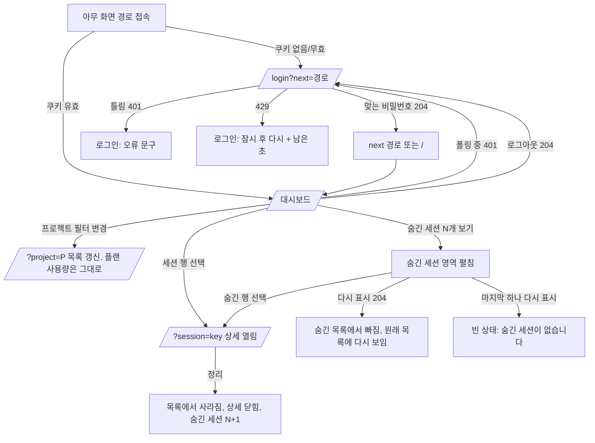

# 화면 명세: 관찰 서버 1단계

작성: designer, 2026-11-11. 갱신: 2026-11-11 사용자 디자인 결정 반영(숨긴 세션 보기 3.6.1, 로그인 각주 확정, 다크 모드 사무실 3.8, Pretendard는 DESIGN.md 3.1). 기준: 루트 `DESIGN.md`(status: approved, 단 12절 사무실 시각 방향은 초안이며 이 명세에 영향 없음). 범위: HANDOFF.md T1-4, T1-5, T1-6, T1-8(화면)과 "1단계 설계" 5·6.4·6.5·7·8절.
갱신: 2026-11-12 범위 변경 반영 — 토큰·API 환산 비용·합계 화면 삭제, 플랜 사용량 영역(3.9, **초안·사용자 승인 전**) 추가, 세션 상세 "모델" 줄 확정(3.7).
페이지 유형: 모두 **앱 화면**(마케팅 페이지 없음). 리뷰 너비: 390px, 1280px. 두 너비 모두 가로 스크롤 없음.

컴포넌트 이름은 DESIGN.md 6절 이름을 쓴다(StatusBadge, WaitingBanner, Button, TextField, Select, Panel, SessionRow, HiddenSessions, AgentRow, DataTable, Chip, Note, PlanUsagePanel/PlanUsageMeter, ErrorBar, SyncIndicator, OfficeFloor/OfficeAvatar).

## 1. 화면 흐름



## 2. 로그인 화면 `/login`

목적: 비밀번호 하나로 로그인한다. 사용자 이름 칸은 없다(D-13).

레이아웃(390, 1280 공통. 카드 폭 = min(100% - 32px, 360px), 화면 가운데, 위 여백 15vh)
```
+------------------------------------+
| agent-observer            (h1)     |
| 관찰 화면에 들어가려면 비밀번호를   |
| 입력하세요.            (small,muted)|
|                                    |
| 비밀번호                 (라벨)    |
| [••••••••••••••••••••]  TextField  |
|  (오류 문구 자리, 평소 비어 있음)   |
|                                    |
| [         로그인         ] primary |
+------------------------------------+
 (i) 서버에 OBSERVER_PASSWORD가 설정되어
     있어야 로그인할 수 있습니다.  (Note, 항상)
```
- Panel 하나. 헤더·내비게이션 없음.
- 입력: `<input type="password" name="password" autocomplete="current-password" required autofocus>`. 라벨 `<label for>` 연결.
- `<form>`의 submit(Enter 포함)으로 `POST /api/auth/login` (JSON). 성공 204 → `next` 쿼리(`/`로 시작하는 내부 경로만, 아니면 `/`)로 `location.replace`.

상태
| 상태 | 표시 |
|---|---|
| 기본 | 위 그림. 버튼 활성 |
| 제출 중 | 버튼 "로그인 중…" + 비활성, 입력 readOnly |
| 401 invalid_password | 입력 아래 danger: "비밀번호가 맞지 않습니다." 입력값 지우고 포커스 다시 입력창. `aria-invalid` |
| 429 too_many_attempts | 입력 아래 danger: "시도가 너무 많습니다. {N}초 후에 다시 시도하세요." N은 `Retry-After`. 0이 될 때까지 1초마다 줄이고 그동안 버튼 비활성. 0이 되면 문구 지우고 버튼 활성 |
| 403(Origin 불일치)·500·네트워크 오류 | 카드 위 ErrorBar: "로그인 요청을 처리하지 못했습니다. 잠시 후 다시 시도하세요." |
| 빈 입력 제출 | 브라우저 required 검사에 맡긴다 |

- 서버 비밀번호 미설정도 401로 오므로 화면은 "맞지 않습니다"와 같게 보인다(설계상 구분 없음).
- **비밀번호 안내 각주 — 확정(2026-11-11 사용자 결정)**: Note를 카드 아래 12px에 **항상** 둔다(오류가 없어도, 어떤 상태에서도 숨기지 않는다). 문구 고정: "서버에 OBSERVER_PASSWORD가 설정되어 있어야 로그인할 수 있습니다." Note 형식(small, ink-muted, 앞에 "i" 아이콘 aria-hidden). `OBSERVER_PASSWORD`는 font-mono. 페이지 배경(canvas) 위라 ink-muted / canvas 6.30(라이트)·7.58(다크). 포커스 대상이 아니며 Tab 순서에 들어가지 않는다. 입력창의 `aria-describedby`에 이 각주 id를 함께 연결한다(오류 문구가 있으면 "오류 문구 id 각주 id" 순).
- 키보드: Tab 순서 = 비밀번호 → 로그인 버튼. Enter로 제출.

## 3. 대시보드 `/`

목적: 플랜 사용량(5시간·주간 한도 사용률)과 세션의 상태(특히 승인 대기)를 먼저 보고, 세션을 골라 BOT별 상태·스킬을 본다.

### 3.1 영역 구성

| ID | 영역 | 데이터 |
|---|---|---|
| H | 헤더: 제목, SyncIndicator, 로그아웃 | 폴링 결과 시각 |
| P | 플랜 사용량 Panel(계정 단위, 필터와 무관) | `GET /api/plan-usage` |
| F | 프로젝트 필터 | `GET /api/projects` |
| W | WaitingBanner (승인 대기 1개 이상일 때만) | sessions의 `status=waiting` |
| S | 세션 목록 Panel | `GET /api/sessions?project=` |
| E | 종료 세션 접기 (S 안) | 같은 응답에서 `status=ended` |
| HS | 숨긴 세션 접기 (S 안, E 아래) | `GET /api/sessions?hidden=only&project=` |
| DT | 세션 상세 Panel | `GET /api/sessions/[key]` |
| O | 임시 사무실 Panel (선택 세션의 BOT) | 상세의 `agents` + `GET /api/characters` |

### 3.2 1280px 레이아웃

컨테이너 최대 1440px, 좌우 24px, 열 간격 16px. 3열 grid: `360px | minmax(0,1fr) | 360px`.
```
+--------------------------------------------------------------------------------------------+
| H  agent-observer                          3초마다 갱신 · 방금        [로그아웃]   (56px) |
+--------------------------------------------------------------------------------------------+
| W  (!) 승인 대기 2개 세션  (응답 없음 1개 포함)                    (있을 때만, 전체 폭)  > |
+--------------------------------------------------------------------------------------------+
| P  플랜 사용량                                          계정 전체 · 프로젝트 필터와 무관   |
|  5시간                          (!) 한도 가까움  84% | 주간                            13% |
|  [██████████████████████████████████████░░░░░░░░]    | [██████░░░░░░░░░░░░░░░░░░░░░░░░░░]  |
|  18:00 초기화 · 2시간 13분 후 · 마지막 측정 3분 전   | 11월 15일(토) 09:00 초기화 ·        |
|                                                      | 2일 21시간 후 · 마지막 측정 3분 전  |
+--------------------------------------------------------------------------------------------+
| F  프로젝트 [ 전체 (5)            v]                                                       |
+-------------------------+------------------------------------------+-----------------------+
| S  세션 목록  (활성 3)  |  DT  세션 상세                    [정리] |  O  임시 사무실        |
|                         |  winterairy/epub-editor  · main · 클라우드|  승인 대기             |
|                         |  (!) 승인 대기 · 2시간째                  |  [!] 책임자            |
|  |(!)epub-editor   [정리]|  모델 claude-haiku-5-5                    |  - - - - - - - - - -  |
|  | 승인대기·2시간째 main |  세션 0c09ab12 · 마지막 이벤트 방금       |  책상                  |
|  | BOT 3 · 방금          |  ---------------------------------------  |  [>] QA    [..] 설계   |
|  |-----------------------|  BOT (3)                                  |  ====      ====        |
|  | agent-observer  [정리]|  표: BOT | 상태                           |  - - - - - - - - - -  |
|  | 작업 중·Bash  feature/ |  책임자 lead | (!) 승인 대기 · 2시간째    |  쉬는 곳               |
|  | BOT 2 · 3분 전        |   스킬: [playwright-cli ×2] 부른 BOT qa×1 |  [v] 개발              |
|  |-----------------------|  QA qa | > 작업 중 · Bash                 +-----------------------+
|  v 종료된 세션 (2) 펼치기|  ...                                      |                       |
|  v 숨긴 세션 3개 보기   |                                           |                       |
+-------------------------+------------------------------------------+-----------------------+
```
- W(있을 때): 헤더 바로 아래 전체 폭(3열 grid 밖, 1440 컨테이너 안). P 위. 390과 같은 순서(3.9 "위치").
- P: W 아래(W가 없으면 헤더 바로 아래) 전체 폭. F 위. 3.9.
- 1열: S. 2열: DT. 3열: O.
- 세션이 선택되지 않았으면 DT에 안내(3.6 빈 상태 "세션을 고르세요"), O는 "세션을 고르면 BOT이 보입니다".
- 처음 진입 시 `?session=`이 없으면 목록 첫 세션을 자동 선택한다(1280에서만. 정렬상 승인 대기 세션이 먼저 열린다). URL은 `replaceState`로 `?session=` 갱신.
- 각 열은 독립 스크롤 없이 페이지 스크롤. 1열 S는 길어지면 그대로 늘어난다.
- 1024~1279px도 같은 3열(가운데 열이 줄어듦). 가운데 열이 560px보다 좁아지면 BOT 표 대신 모바일 AgentRow 카드로 바꾼다(컨테이너 쿼리 `@container (max-width: 560px)` 권장).

### 3.3 390px 레이아웃

한 열, 좌우 16px, 패널 간격 12px. 순서: H → W(있을 때) → P → F → S → DT → O. 승인 대기가 없으면 H → P → F → S → DT → O.
```
+----------------------------------+
| agent-observer        [로그아웃] |
| 3초마다 갱신 · 방금   (caption)  |
+----------------------------------+
| (!) 승인 대기 2개 세션          > |
+----------------------------------+
| 플랜 사용량                       |
| 계정 전체 · 프로젝트 필터와 무관  |
| 5시간    (!) 한도 가까움     84% |
| [████████████████████████░░░░░]  |
| 18:00 초기화 · 2시간 13분 후      |
| 마지막 측정 3분 전                |
| -------------------------------- |
| 주간                         13% |
| [████░░░░░░░░░░░░░░░░░░░░░░░░░]  |
| 11월 15일(토) 09:00 초기화 ·      |
| 2일 21시간 후 · 마지막 측정 3분 전|
+----------------------------------+
| 프로젝트                          |
| [ 전체 (5)                   v ] |
+----------------------------------+
| 세션 목록 (활성 3)                |
| |epub-editor            클라우드 |
| |(!) 승인 대기 · 2시간째          |
| |main · BOT 3 · 방금      [정리] |
| |--------------------------------|
| | ...                            |
| v 종료된 세션 (2)                 |
| v 숨긴 세션 3개 보기              |
+----------------------------------+
| 세션 상세                  [정리] |
| epub-editor · main               |
| (!) 승인 대기 · 2시간째           |
| 모델 claude-haiku-5-5             |
| 세션 0c09ab12 · 마지막 이벤트 방금|
| ------------------------------   |
| 책임자  lead                      |
| (!) 승인 대기 · 2시간째           |
|  [playwright-cli ×2]  qa ×1       |
| ------------------------------   |
| QA  qa                            |
| ...                              |
+----------------------------------+
| 임시 사무실                        |
| 승인 대기: [!]책임자              |
| 책상: [>]QA [..]설계  (줄바꿈)     |
| 쉬는 곳: [v]개발                  |
+----------------------------------+
```
- 헤더: 1줄 제목 + 로그아웃, 2줄 SyncIndicator(높이 자동, sticky).
- 세션 행을 누르면 `?session=` 갱신 후 DT로 스크롤(`scrollIntoView({block:'start'})`, reduced-motion이면 즉시)하고 DT 제목에 포커스(`tabIndex=-1`).
- DT 머리 옆에 ghost 버튼 "목록으로"(390에서만). 누르면 선택한 세션 행으로 스크롤·포커스.
- 1280과 달리 자동 선택하지 않는다(목록이 먼저 보여야 함). DT·O는 선택 전 숨기지 않고 짧은 안내 한 줄만 보인다.
- BOT 목록은 AgentRow 목록(표 대신).
- 승인 대기 띠(W)는 헤더 바로 아래라 첫 화면에서 항상 보인다. P는 약 200px를 차지하며 그만큼 필터·목록이 아래로 간다. 3.9 "위치" 참고.
- 사무실 아바타는 flex-wrap, 칸 80px → 한 줄 4개(390 - 32 - 24 = 334px).

### 3.4 헤더 (H)
- 제목 "agent-observer"(h1, 링크 아님).
- SyncIndicator: 마지막 성공 폴링 기준 "3초마다 갱신 · 방금" / 탭이 숨겨졌다 돌아오면 즉시 1회 갱신. 연속 실패 시 "갱신 실패 · {N}초 전 데이터"(warning 색 + 삼각형 아이콘). `aria-live` 넣지 않는다(3초마다 읽히는 것 방지).
- 로그아웃: secondary 버튼. `POST /api/auth/logout` → 결과와 무관하게 `/login`으로 이동.

### 3.5 프로젝트 필터 (F)
- 라벨 "프로젝트" + Select. 옵션: "전체 ({프로젝트 수})", 그다음 각 프로젝트 "{project} — 활성 {active}/{sessions}". 프로젝트 이름 그대로(말줄임은 네이티브 select에 맡김).
- 1280: 라벨과 select 한 줄, select 폭 320px. 390: 라벨 위, select 100%.
- 변경 즉시 `?project=` 갱신(`replaceState`) + `localStorage['obs.project']` 저장 + 목록 즉시 재조회(플랜 사용량은 다시 부르지 않는다 — 필터와 무관). 선택 세션이 새 필터에 없으면 상세 닫음(`?session=` 제거).
- 진입 시 우선순위: URL `?project=` → localStorage → 전체. 저장된 프로젝트가 목록에 없으면 전체로 바꾼다.
- 프로젝트가 0개면 select는 "전체 (0)"만 있고 비활성이 아니라 그대로 둔다.

### 3.6 세션 목록 (S, E, W)
- Panel 제목 "세션 목록" + 보조 문구 "활성 {N}".
- 정렬은 API 순서 그대로 쓴다(승인 대기 먼저·기다린 시간 긴 순 → 다른 활성 → lastEventTs 내림차순). 클라이언트에서 다시 정렬하지 않는다.
- `status !== 'ended'`인 세션은 위 목록, `ended`는 아래 "종료된 세션 ({N})" 접기(ghost 버튼, `aria-expanded`, 기본 접힘, 펼침 상태는 세션 동안 메모리에만). 종료 세션은 API `ended=recent`(24시간) 결과만.
- SessionRow 내용(DESIGN.md 6절):
  - 프로젝트 이름(전체 필터일 때) / 필터가 걸려 있으면 세션 ID 앞 8자(mono)를 제목으로.
  - StatusBadge(세션 상태). waiting이면 "승인 대기 · {기다린 시간}", stale이면 "승인 대기 (응답 없음) · {N}시간째". `waitingCount > 1`이면 뒤에 "· BOT {waitingCount}개"를 덧붙인다.
  - 브랜치, "BOT {agentCount}", 마지막 이벤트 상대 시간, 클라우드 배지.
  - "정리" 버튼: secondary. `aria-label="{project} 세션 정리"`. 누르면 확인 없이 `POST /api/sessions/[key]/dismiss`. 204 → 목록에서 즉시 제거, 선택 중이었으면 상세 닫고 포커스를 다음 행(없으면 이전 행, 없으면 목록 제목)으로. 실패 → 행 아래 small danger "정리하지 못했습니다" + 행 유지. 정리 후 목록 하단에 Note 1회: "정리한 세션은 새 이벤트가 오면 다시 보입니다."(다음 폴링 때 사라짐)
  - 정리 버튼은 모든 상태 행에 있다(종료 세션 포함).
- 정리 후 Note 문구(숨긴 세션 보기 도입으로 바꿈): "정리한 세션은 새 이벤트가 오면 다시 보입니다. 아래 '숨긴 세션 보기'에서 바로 되돌릴 수도 있습니다." 숨긴 세션 수 N은 정리 204 직후 1 늘리고, 다음 폴링 값으로 맞춘다.
- WaitingBanner: 목록 응답에서 waiting 세션 수. 문구 "승인 대기 {N}개 세션"(+ "(응답 없음 {M}개 포함)"). 누르면 첫 waiting 세션 선택.

### 3.6.1 숨긴 세션 (HS) — 확정 2026-11-11

목적: "정리"로 숨긴 세션(이미 끝나 새 이벤트가 오지 않는 세션 포함)을 다시 보고, "다시 표시"로 원래 목록에 되돌린다(HANDOFF T1-2, T1-5 수용 기준). 컴포넌트: DESIGN.md 6절 HiddenSessions, SessionRow `variant="hidden"`.

데이터
- `GET /api/sessions?hidden=only&project={필터}` — 숨긴 세션만, 종료 세션 24시간 제한 없음, 정렬은 API 순서 그대로. 3초 폴링에 함께 넣는다(접기 버튼의 N이 필요하므로 펼치지 않았어도 부른다. 9절 간극 참고).
- `POST /api/sessions/[key]/restore` — 204 성공, 404 없는 키. Origin 검사는 dismiss와 같다.
- 숨긴 세션은 위 목록 응답(`GET /api/sessions`)에 없으므로 WaitingBanner 개수, "활성 N"에 들어가지 않는다.

위치와 모양
- 세션 목록 Panel 안 맨 아래, 종료 세션 접기(E) 다음. 1px border 구분선 아래 ghost 접기 버튼 "숨긴 세션 {N}개 보기"(펼치면 "숨긴 세션 {N}개 접기"). 기본 접힘. 펼침 상태는 세션 동안 메모리에만(새로고침하면 접힘).
- N = `hidden=only` 응답 길이. **N이 0이고 접혀 있으면 접기 버튼을 그리지 않는다.** 응답이 오기 전(첫 로딩)에도 그리지 않는다(스켈레톤 없음).
- 펼친 영역(`id`를 버튼 `aria-controls`로 연결, `<ul aria-label="숨긴 세션">`): SessionRow `variant="hidden"`을 구분선으로 나열.

숨긴 세션 행
- 내용은 일반 SessionRow와 같다: 제목(프로젝트 이름 또는 세션 ID 앞 8자), StatusBadge(기다린 시간·응답 없음 포함), 브랜치, "BOT N", 마지막 이벤트 상대 시간, 클라우드 배지.
- 다른 점: 왼쪽 상태 막대 없음, 오른쪽 버튼이 "다시 표시"(secondary, `aria-label="{project} 세션 다시 표시"`, 필터가 걸려 있으면 "{세션 ID 앞 8자} 세션 다시 표시").
- 행 링크(`<a href="?session={key}">`)는 일반 행과 같게 동작한다 — 숨긴 세션의 상세를 열 수 있다. 숨긴 세션 상세를 열면 상세 머리 오른쪽 버튼이 "정리" 대신 "다시 표시"다(세션 키가 숨긴 목록에 있는지로 판단).

"다시 표시" 동작
| 단계 | 표시 |
|---|---|
| 누름 | 버튼 "다시 표시 중…" + 비활성. 행은 그대로 |
| 204 | 숨긴 목록에서 그 행을 즉시 뺀다(N - 1). 이어서 위 목록을 즉시 1회 다시 조회해 원래 정렬 자리에 보이게 한다. 펼친 영역 위에 Note(`role="status"`): "{project} 세션을 다시 표시했습니다." 다음 폴링 때 사라진다 |
| 204인데 다시 조회한 위 목록에 없음 | (24시간이 지난 종료 세션, 또는 필터 밖) Note 문구를 바꾼다: "다시 표시했습니다. 24시간이 지난 종료 세션이라 목록에는 보이지 않습니다." 숨긴 목록에서는 그대로 빠진다 |
| 404 | 행 아래 small danger: "이 세션을 찾을 수 없습니다. 보관 기간이 지났을 수 있습니다." 다음 폴링 결과로 행이 사라진다 |
| 그 밖의 실패(403·500·네트워크) | 행 아래 small danger: "다시 표시하지 못했습니다." 행과 버튼을 원래대로(다시 누를 수 있게) |
| 상세에서 다시 표시(204) | 상세는 닫지 않는다. 머리 버튼이 "정리"로 바뀌고 포커스는 그 "정리" 버튼으로 |

빈 상태·특수 상태
| 상황 | 표시 |
|---|---|
| N = 0, 접힘 | 접기 버튼 없음 |
| 펼친 채로 마지막 하나를 다시 표시 | 버튼은 "숨긴 세션 0개 접기"로 남고, 영역 안에 small ink-muted "숨긴 세션이 없습니다." 접으면 버튼이 사라진다 |
| 위 목록 0개, 숨긴 세션 N > 0 | 4.2의 "아직 받은 세션이 없습니다" 대신: 제목 "보이는 세션이 없습니다" + 본문 "정리한 세션 {N}개는 아래 '숨긴 세션 보기'에서 다시 표시할 수 있습니다." W·E 숨김, HS는 보임 |
| 펼침 중 `hidden=only` 조회 실패 | 마지막으로 받은 행을 그대로 둔다. 연속 실패 처리는 4.3(SyncIndicator, ErrorBar)과 같다 |
| 정리 직후 | N을 1 늘린다. 펼쳐져 있으면 다음 폴링에서 행이 나타난다 |

키보드와 포커스
- Tab 순서: … 종료 세션 행들 → "숨긴 세션 N개 보기" → (펼쳤으면) 숨긴 행마다 [세션 링크 → 다시 표시] 반복.
- 접기 버튼은 Enter·Space로 토글. 펼친 뒤 포커스는 버튼에 그대로 둔다(내용은 바로 다음 Tab).
- **다시 표시 후 포커스**: 숨긴 목록의 **다음 행의 "다시 표시" 버튼** → 없으면 이전 행의 "다시 표시" 버튼 → 없으면 접기 버튼("숨긴 세션 0개 접기"). 여러 개를 연달아 되돌리기 쉽게 하고, 포커스가 사라진 요소에 남지 않게 한다. 위 목록에 다시 나타난 행으로 포커스를 옮기지 않는다(목록 위쪽으로 튀지 않게).
- 실패 시 포커스는 누른 버튼에 그대로.
- 스크린 리더: 다시 표시 결과 Note는 `role="status"`(polite)로 한 번 읽힌다. 접기 버튼 문구의 N 변화는 따로 알리지 않는다.

크기별 배치
- 1280(1열 360px): 접기 버튼 높이 32px, 패널 안쪽 폭 전체, 글자 왼쪽. 숨긴 행은 일반 행과 같은 2줄 + 오른쪽 "다시 표시" 버튼(32px). 버튼 폭 때문에 제목이 줄면 말줄임.
```
|  v 숨긴 세션 2개 접기        |
|  ------------------------    |
|  old-project   [다시 표시]   |
|  o 종료 · feature/x · 3일 전 |
|  ------------------------    |
|  epub-editor   [다시 표시]   |
|  /!\ 승인 대기 (응답 없음) · |
|  26시간째 · main             |
```
- 390: 접기 버튼 높이 44px, 폭 100%. 숨긴 행은 일반 행처럼 3줄(제목 / 배지 / 브랜치·시간 + 오른쪽 "다시 표시" 44px). 가로 스크롤 없음.
```
| v 숨긴 세션 2개 접기              |
| -------------------------------- |
| old-project                      |
| o 종료                            |
| feature/x · 3일 전   [다시 표시] |
| -------------------------------- |
```

### 3.7 세션 상세 (DT)
머리
- 제목(h2) "세션 상세" + 오른쪽 "정리" secondary 버튼(목록과 같은 동작). 숨긴 세션이면 "다시 표시"(3.6.1).
- 1줄: 프로젝트 이름(h3) · 브랜치(mono) · 클라우드 배지
- 2줄: StatusBadge(세션 상태, 기다린 시간 포함)
- 3줄 **모델**(small): 라벨 "모델"(ink-muted) + 값 `{model}`(font-mono, ink). 한 줄 말줄임 + `title`에 전체 이름. `model`이 null이면 값 자리에 "알 수 없음"(본문 글꼴, ink-muted) — 줄을 숨기지 않아 위치가 흔들리지 않게 한다. 마크업 `<dl>`(라벨 `<dt>`, 값 `<dd>`) 한 쌍.
- 4줄(small, muted): "세션 {sessionId 앞 8자} · 마지막 이벤트 {상대 시간}"
- 모델을 따로 한 줄로 둔 이유: 세션 ID·시각과 섞으면 390에서 줄바꿈 위치가 모델 이름 중간에 걸리고, 모델은 세션 단위 고정 값이라 BOT 표 열로 반복할 필요가 없다(값은 `GET /api/sessions/[key]`의 `session.model`, BOT별 모델은 없다).

BOT 목록 (h3 "BOT ({N})")
- 순서는 API 그대로(lead 먼저, 이후 처음 본 순). 종료된 BOT도 남긴다(상태 "종료", 스킬 기록 유지).
- 1280(가운데 열 ≥ 560px): DataTable
  | 열 | 내용 | 정렬 |
  |---|---|---|
  | BOT | 표시 이름(h3) + 역할 키(caption mono). 매핑 없는 역할은 `agentType` 원문이 표시 이름 | 왼쪽 |
  | 상태 | StatusBadge(working이면 "작업 중 · {currentTool}") | 왼쪽 |
  - 각 BOT 행 바로 아래에 한 칸 합친 보조 행(스킬·부른 BOT이 있을 때만): "스킬" 라벨 + Chip("{skill} ×{count}") 목록, "부른 BOT" + "qa ×1" 텍스트.
- 390 또는 좁은 열: AgentRow 목록(1줄 이름·역할 키·배지, 2줄 스킬·부른 BOT).
- 스킬이 하나도 없으면 스킬 줄을 감춘다(빈 라벨 남기지 않음).

### 3.8 임시 사무실 (O)
- Panel 제목 "임시 사무실" + caption "임시 그림". 대상: 선택된 세션의 BOT.
- OfficeFloor 세 구역(DESIGN.md 6절). 상태 → 구역·동작:
  | 상태 | 구역 | 사각형 표현 | 캐릭터 동작(설정 있을 때) |
  |---|---|---|---|
  | waiting | 승인 대기 | 상태색 사각형 + (!) | `alert` |
  | waiting + stale | 승인 대기 | stale 색 + 삼각형 (!) + 문구 "응답 없음" | `alert` |
  | working | 책상(책상에 붙음) | 재생 아이콘, 아이콘 opacity 왕복 | `sit_work` |
  | thinking | 책상(8px 떨어짐) | 점 세 개 | `sit` |
  | done | 쉬는 곳 | 체크 | `idle`(또는 `done`) |
  | ended | 표시 안 함 | — | — |
- 아바타 아래: 표시 이름, 상태 문구(waiting은 "승인 대기 · 2시간째").
- **플랜 미니 막대(2026-11-12 사용자 결정, DESIGN.md 6절 PlanUsageMini)**: 바닥 맨 위, "승인 대기" 구역 위에 한 줄. 세션 선택과 무관하게(계정 값) 같은 `GET /api/plan-usage` 응답을 쓴다. 세션을 고르지 않아 바닥을 그리지 않을 때는 띠도 없다(상단 띠가 있으므로).
  ```
  5h [██████████░░░░] 84% (!)   7d [██░░░░░░░░░░░░] 13%
  - - - - - - - - - - - - - - - - - - - - - - - - - - -
  승인 대기 ...
  ```
  - 1280(바닥 안쪽 약 336px): 두 막대 한 줄 나란히, 각 막대 폭 = 남은 공간. 390(안쪽 약 334px): 같은 한 줄. 300px 미만이면 위아래 두 줄.
  - 상태: normal 아이콘 없음 / near 원 안 ! + meter-near / reached 삼각형 안 ! + meter-reached / expired 빈 막대 + 속 빈 원 / none 빈 막대 + "–" / 두 창 모두 none이면 띠 없음 / 첫 로딩은 띠 없음.
  - 접근성: `aria-hidden="true"`. 이유: 상단 띠(3.9)에 같은 값이 텍스트와 `role="meter"`로 이미 있어 다시 읽으면 중복이고, 사무실 목록(`<ul aria-label="임시 사무실">`)은 BOT 정보만 담는다. 포커스 대상 아님(Tab 순서 변화 없음).
- 빈 구역은 구역 이름 옆에 "없음"(caption, muted). 세 구역이 모두 비면(모두 종료) "모든 BOT이 종료되었습니다".
- 캐릭터: `characters[characterId].ok === true`면 그림 프레임, 아니면 사각형. 그림 로딩 실패(`onerror`)도 사각형으로. 프레임은 `frameWidth×frameHeight`를 40px 높이에 맞춰 정수 배율로 축소/확대(`image-rendering: pixelated`), 칸 너비는 80px 고정.
- 1280: 3열에서 폭 360px, 한 줄에 4칸. 390: 한 줄 4칸, 넘치면 줄바꿈.
- **다크 모드(확정 2026-11-11)**: 바닥(OfficeFloor)과 그 안(구역 이름, 점선, 아바타 사각형·테두리·아이콘, 이름, 상태 문구, "없음", 책상 막대)은 라이트 화면과 똑같다. 바닥 요소에 `data-office-scope`를 달면 `tokens.css`가 안쪽에 라이트 값을 준다(DESIGN.md 2.1). 바닥 바깥 2px office-edge 테두리(다크만). Panel 배경·제목 "임시 사무실"·caption "임시 그림"과 빈 상태 문구("세션을 고르면 BOT이 보입니다", "모든 BOT이 종료되었습니다")는 바닥을 그리지 않고 패널 표면에 다크 토큰으로 쓴다. 사무실을 어둡게 하는 filter·opacity는 쓰지 않는다.
- 다크 모드에서 같은 BOT의 상태 배지가 세션 상세(다크 값)와 사무실(라이트 값)에서 다른 톤으로 보이는 것은 의도한 차이다(아이콘·문구는 같음).

### 3.9 플랜 사용량 (P) — 승인됨(2026-11-12)

컴포넌트: DESIGN.md 6절 PlanUsagePanel/PlanUsageMeter(모양·색·상태 표·시간 문구·접근성은 거기가 기준). 데이터: `GET /api/plan-usage`(설계 6.4), 3초 폴링에 포함(설계 8절). 프로젝트 필터 인자 없음.

위치 결정: **헤더 아래 전체 폭 띠, 단 승인 대기 띠(W)가 있으면 W 바로 아래**(사라진 "합계" 자리 아님). 2026-11-12 사용자 결정.
- 계정 단위 값이라 필터 아래·필터 영향 패널 사이(옛 합계 자리 = 3열 사무실 아래)에 두면 필터가 걸리는 값처럼 읽힌다. 필터 위에 두면 범위가 다르다는 게 배치로 드러난다.
- 옛 합계 자리는 390에서 맨 아래(사무실 다음)라 스크롤해야 보인다. 한도 가까움·도달은 작업을 멈출지 정하는 정보라 첫 화면에 있어야 한다.
- 설계 6.5 "대시보드 상단(프로젝트 필터와 별개 영역)"과 같다.
- 승인 대기 띠를 P 위로(H → W → P → F → S): 승인 대기는 지금 사람이 손대야 하는 일이라 390 첫 화면에서 P(약 200px)에 밀려 내려가면 안 된다(사용자 결정). W는 이미 누르면 첫 대기 세션을 선택하는 버튼이라 목록에 붙어 있지 않아도 동작이 이어진다. W가 없으면 P가 헤더 바로 아래다. 390에서 P 높이를 줄이려고 meter 사이 구분선만 두고 패널 머리 보조 문구를 제목 아래 한 줄(caption)로 둔다.
- **1280도 같은 순서**(H → W → P → F → 3열): 판단 근거는 일관성. (1) 너비마다 DOM 순서가 같아야 Tab 순서·스크린 리더 읽기 순서가 하나로 유지된다(CSS 순서 바꾸기는 시각 순서와 포커스 순서를 어긋나게 한다). (2) "승인 대기가 가장 먼저"라는 규칙이 화면 크기와 무관해진다. 대가: 1280에서 W가 1열 세션 목록 위가 아니라 전체 폭 띠가 된다. W 모양(배경 status-waiting-bg, 왼쪽 4px 막대, 아이콘 + 문구)은 그대로이고 폭만 넓어진다. 1280은 첫 화면이 넉넉해 W가 세션 목록과 떨어져도 바로 아래 보인다.

1280 배치
- 컨테이너 1440 안 전체 폭 Panel, 여백 12/16px. 머리 한 줄: h2 "플랜 사용량" 왼쪽, caption "계정 전체 · 프로젝트 필터와 무관" 오른쪽.
- meter 2열 grid `1fr 1fr`, 열 간격 24px, 열 사이 1px border 세로 구분선(가운데). 왼쪽 5시간, 오른쪽 주간.
- 메타 줄이 열 폭을 넘으면 " · " 단위로 줄바꿈(위 와이어프레임 주간 예).
- 768~1279도 같은 2열.

390 배치
- 한 열. 머리: h2 "플랜 사용량" 다음 줄 caption 보조 문구. meter 두 개를 위아래로, 사이 1px border(위아래 8px).
- meter 1줄: 창 이름 | (수준 배지) | 사용률. 배지와 사용률이 같은 줄에 안 들어가면(좁은 폭) 배지를 사용률 아래 줄 오른쪽으로 내린다. 문구는 줄이지 않는다.
- 메타는 "초기화 · 남은 시간" 한 줄, "마지막 측정 …" 다음 줄.

상태별 화면(창마다, 서버 `status`·`level` 그대로)
| 상태 | 화면 |
|---|---|
| 첫 로딩 | meter 자리 스켈레톤 2개(이름·막대·메타) |
| `ok` normal | "42%" + meter-normal 채움 + 메타 |
| `ok` near (80~99) | [원 안 !] "한도 가까움" 배지(status-waiting 쌍) + "84%" + meter-near 채움 + 메타 |
| `ok` reached (100) | [삼각형 안 !] "한도 도달" 배지(status-stale 쌍, 테두리) + "100%" + meter-reached(= danger) 채움(가득) + 메타 |
| `expired` | 사용률 숫자 없음, [속 빈 원] "초기화됨", 빈 트랙, 메타 "초기화됨 — 다음 작업 때 갱신 · 마지막 측정 {N}분 전" |
| 한 창만 `none` | 그 창: "정보 없음", 빈 트랙, 메타 없음. 다른 창은 평소대로 |
| 두 창 모두 `none` | meter 대신 h3 "플랜 사용량 정보 없음" + Note 2줄: "Claude 구독 계정(Pro·Max 로그인)에서만 값이 있습니다. API 키로 쓰는 세션에는 이 정보가 없습니다." / "dev-team-kit의 `statusLine` 스크립트를 설치하면 세션의 첫 응답 이후에 5시간·주간 사용률이 나타납니다." |
| 조회 실패 | 마지막 값 유지. 알림은 SyncIndicator·ErrorBar(4.3). 영역 안 오류 문구 없음 |

- "마지막 측정 N분 전"은 `none`이 아닌 창에서 항상 보이고, 오래돼도 색·문구가 바뀌지 않는다(D-24).
- 남은 시간·마지막 측정·만료는 응답 `now` 기준. 폴링 사이에 따로 시계를 돌리지 않는다(3초마다 갱신되므로 충분).
- 사용률은 정수 버림(DESIGN.md 3절). `aria-valuenow`는 서버 값.
- 막대 채움 색(2026-11-12 사용자 결정, DESIGN.md 2절): 정상 #8B8570 / #ACA794, 한도 가까움 #B86E00 / #E6A23C, 한도 도달 #AE1F40 / #FF8EA4(라이트 / 다크). surface-sunken 바탕 대비 3.01·7.83 / 3.25·8.63 / 5.58·8.69. 상태끼리는 색만이 아니라 배지 아이콘·문구로도 구분한다(정상은 배지 없음).

접근성: `<section aria-labelledby>`, 막대 `role="meter"` + `aria-valuenow`·`aria-valuetext`("84%, 한도 가까움, 18:00 초기화, 2시간 13분 후"), expired·none 막대는 `aria-hidden`. `aria-live` 없음. 포커스 대상 없음.

## 4. 상태별 화면

### 4.1 로딩
- 첫 진입: 각 Panel에 스켈레톤(플랜 사용량 meter 2개, 목록 3행, 상세 머리 3줄 + 표 3행). 헤더·필터는 즉시 그린다(필터는 프로젝트 응답 전까지 "전체" 하나만).
- 세션 선택 직후 상세 응답 전: 이전 세션 내용을 지우고 상세 스켈레톤. `aria-busy="true"`.
- 폴링 갱신: 스켈레톤·스피너 없이 값만 바꾼다.

### 4.2 빈 상태
| 상황 | 위치 | 문구 |
|---|---|---|
| 세션 0개(전체), 숨긴 세션도 0개 | S | 제목 "아직 받은 세션이 없습니다" + 본문 "Claude Code의 observe hook이 이 서버(`/api/events`)로 이벤트를 보내면 여기에 세션이 나타납니다. hook의 `AGENT_OBSERVER_URL`과 토큰 설정을 확인하세요." W·E 숨김 |
| 필터 프로젝트에 활성 세션 0개, 종료만 있음 | S | "활성 세션이 없습니다." + 종료 접기는 그대로 |
| 필터 프로젝트에 세션 0개 | S | "이 프로젝트에 최근 24시간 세션이 없습니다." + ghost 버튼 "전체 보기"(필터를 전체로) |
| 세션 미선택 | DT | "왼쪽 목록에서 세션을 고르세요."(390: "위 목록에서 세션을 고르세요.") |
| 세션 미선택 | O | "세션을 고르면 BOT이 보입니다." |
| 보이는 세션 0개, 숨긴 세션 N > 0 | S | "보이는 세션이 없습니다" + 숨긴 세션 안내(3.6.1). HS 보임 |
| 숨긴 세션 0개 | HS | 접혀 있으면 접기 버튼 없음, 펼친 채 0이 되면 "숨긴 세션이 없습니다."(3.6.1) |
| 플랜 사용량 받은 값 없음 | P | "플랜 사용량 정보 없음" + 설정 안내 Note 2줄(3.9) |
| 플랜 사용량 한 창만 없음 | P | 그 창 "정보 없음"(3.9) |
| 세션에 모델 값 없음 | DT | "모델 알 수 없음"(3.7) |
| BOT에 스킬 없음 | DT | 스킬 줄 숨김 |

### 4.3 오류
| 상황 | 동작·표시 |
|---|---|
| 폴링 중 401(어느 API든) | 즉시 `/login?next={현재 경로+쿼리}`로 `location.assign`. 폴링 중지. 화면에 문구 없음 |
| 상세 404 `not_found` | DT에 "이 세션을 찾을 수 없습니다. 정리되었거나 보관 기간이 지났을 수 있습니다." + ghost "닫기"(`?session=` 제거). 폴링에서 상세 요청 중지 |
| 네트워크 오류·500(1회) | 화면 유지, SyncIndicator만 "갱신 실패 · N초 전 데이터" |
| 연속 3회 실패(약 9초) | 헤더 아래 ErrorBar: "서버에서 데이터를 가져오지 못하고 있습니다. 마지막으로 받은 데이터를 보여 주는 중입니다." + "다시 시도"(즉시 1회 폴링). 성공하면 띠 사라짐. 마지막 데이터는 지우지 않는다 |
| 정리 실패 | 해당 행 아래 danger 문구(3.6) |
| 다시 표시 실패·404 | 해당 숨긴 행 아래 danger 문구(3.6.1) |
| 로그아웃 실패 | 무시하고 `/login`으로 이동 |
| 캐릭터 설정 오류 | 사용자에게 오류 문구 없이 사각형으로 보인다(원인은 서버 로그, 설계 7절) |

### 4.4 특수 상태
- 승인 대기: WaitingBanner, 행 왼쪽 막대, StatusBadge 기다린 시간, 사무실 승인 대기 구역. 승인 대기 세션은 항상 목록 맨 위(API 정렬).
- 승인 대기 (응답 없음, `stale: true`): 색을 waiting(머스터드)에서 stale(진홍)으로, 아이콘을 원 → 삼각형으로, 문구를 "승인 대기 (응답 없음)"으로 셋 다 바꾼다. 정렬·정리 동작은 동일. 자동으로 사라지지 않으며 정리 버튼으로만 숨긴다.
- 응답 없음 후 재개(S-11c): 다음 폴링에서 일반 상태 배지로 돌아간다(별도 알림 없음).
- 플랜 한도 가까움(80% 이상)·한도 도달(100%): 3.9. 색 + 아이콘 + 문구. 알림·소리·깜박임 없음.
- 플랜 창 초기화됨(`resets_at` 지남): "초기화됨 — 다음 작업 때 갱신"(3.9).
- 정리한 세션에 새 이벤트: 다음 폴링에서 목록에 다시 나타나고 숨긴 세션 목록에서 빠진다(별도 표시 없음. 포커스가 그 숨긴 행에 있었으면 접기 버튼으로).

## 5. 크기별 차이 요약

| 항목 | 390px | 1280px |
|---|---|---|
| 배치 | 한 열: H, W(있을 때), P, F, S, DT, O | W(있을 때)·P 전체 폭 띠 + 3열 `360 | 1fr | 360`: S | DT | O |
| 헤더 | 2줄(동기화 문구 아래로) | 1줄 |
| 필터 | 라벨 위, 폭 100% | 한 줄, 320px |
| 세션 자동 선택 | 안 함 | 첫 세션 자동 선택 |
| 세션 선택 후 | 상세로 스크롤 + 포커스, "목록으로" 버튼 | 가운데 열 갱신, 포커스는 행에 유지 |
| BOT 목록 | AgentRow 목록 | DataTable(가운데 열 < 560px면 AgentRow) |
| 플랜 사용량 | meter 위아래, 메타 2줄 | meter 2열 |
| 숨긴 세션 | 접기 버튼 44px·폭 100%, 행 3줄 + 다시 표시 44px | 접기 버튼 32px, 행 2줄 + 다시 표시 32px |
| 사무실 | 폭 358px, 4칸/줄 | 폭 360px, 4칸/줄 |
| 터치 영역 | 버튼·행·select ≥ 44px | 버튼 32px 허용 |
| 가로 스크롤 | 없음(긴 문자열 말줄임·줄바꿈) | 없음 |

## 6. 키보드 조작과 포커스

공통: 모든 동작은 Tab/Shift+Tab, Enter, Space로 가능. 포커스 링 항상 보임(DESIGN.md 6절). 마우스 전용 동작 없음. 화면 맨 앞에 "본문으로 건너뛰기" 링크(포커스될 때만 보임, 대상 = 세션 목록 제목).

로그인 Tab 순서: 비밀번호 → 로그인. 진입 시 비밀번호에 포커스.

대시보드 Tab 순서(1280, DOM 순서와 같게 마크업)
1. 본문으로 건너뛰기
2. 로그아웃
3. WaitingBanner 버튼(있을 때)
4. 프로젝트 Select (화살표로 옵션 이동 — 네이티브 동작. 변경은 `change` 이벤트로 즉시 반영)
5. 세션 목록: 각 행마다 [세션 링크 → 정리 버튼] 반복 → "종료된 세션" 펼치기 → (펼쳤으면) 종료 세션 행들 → "숨긴 세션 N개 보기"(N > 0일 때) → (펼쳤으면) 숨긴 행마다 [세션 링크 → 다시 표시]
6. 세션 상세: 정리(숨긴 세션이면 다시 표시) → (404일 때 닫기)
7. 임시 사무실: 포커스 대상 없음(건너뜀)

플랜 사용량(P)은 WaitingBanner(없으면 로그아웃)와 프로젝트 Select 사이에 있지만 포커스 대상이 없어 Tab 순서에 들어가지 않는다(스크린 리더 가상 커서로 읽힌다).

390 순서는 DOM 순서가 같으므로 동일. 추가로 상세 머리의 "목록으로"가 정리 앞에 온다.

세부 규칙
- 세션 행은 `<a href="?session={key}">`(새 탭 열기 가능). Enter로 선택. 클라이언트 라우팅으로 처리하고 페이지 전체를 다시 읽지 않는다.
- 세션 목록 안 화살표 키 이동은 넣지 않는다(일반 Tab 이동으로 충분, 단순하게).
- 선택 후 포커스: 1280은 누른 행에 유지, 390은 상세 제목으로 이동(3.3).
- 정리 후 포커스: 다음 행 → 이전 행 → 목록 제목(3.6).
- 다시 표시 후 포커스: 다음 숨긴 행의 "다시 표시" → 이전 숨긴 행의 "다시 표시" → 숨긴 세션 접기 버튼(3.6.1). 상세 머리에서 다시 표시했으면 바뀐 "정리" 버튼.
- 폴링으로 목록이 다시 그려져도 포커스가 있던 행·버튼은 `key`를 세션 키로 유지해 포커스를 잃지 않게 한다. 포커스된 행이 목록에서 사라지면 목록 제목으로.
- 401 이동, 404 닫기 후: 닫기면 선택했던 행(없으면 목록 제목)에 포커스.
- 스크린 리더: WaitingBanner만 `aria-live="polite"`. 오류 띠 `role="alert"`. 상태 배지는 문구가 읽힌다(아이콘 숨김). BOT 표는 `<caption>`("BOT 목록과 상태"). 플랜 사용량 막대는 `role="meter"`의 `aria-valuetext`로 읽힌다(3.9).

## 7. 새 컴포넌트

이 명세에서 쓰는 컴포넌트는 모두 DESIGN.md 6절에 정의했다(WaitingBanner, SessionRow(`variant="hidden"` 포함), HiddenSessions, AgentRow, Note, ErrorBar, SyncIndicator, OfficeFloor/OfficeAvatar, 그리고 2026-11-12 추가한 PlanUsagePanel/PlanUsageMeter(2026-11-12 승인)). EstimateTag는 삭제했다.
- 탭(Tabs)은 합계 패널에만 쓰였으므로 1단계에서 쓰지 않는다(정의 삭제). DESIGN.md의 "탭 선택 막대" primary 용도는 이후 단계를 위해 남겨 둔다.

## 8. 화면에 보이지 않는 것(확인용)
- 프롬프트·응답·도구 입력·명령 인자. UserPromptExpansion의 `command`도 화면에 쓰지 않는다(설계상 원본 이벤트에만 저장).
- 인증 토큰·비밀번호·쿠키 값, 서버 내부 경로, 캐릭터 설정 오류 메시지.
- 토큰 수(사용량)와 금액(API 환산 비용). 플랜 사용량 응답의 `remote`·`resetsAtEpoch`도 화면에 쓰지 않는다.

## 9. 개발 시 확인할 점(설계와의 간극)
- BOT 단위 기다린 시간·응답 없음: `GET /api/sessions/[key]`의 `agents[]` 예시에 `waitingSince`·`stale`이 없다. 이 명세는 BOT 배지에도 "승인 대기 · N시간째"와 응답 없음을 보이므로, 에이전트 DTO에 `waitingSince`, `stale`을 추가해야 한다. 추가되지 않으면 BOT 배지는 세션의 값을 쓰는 대신 "승인 대기"만 보인다(시간 생략).
- 숨긴 세션 개수(N): 설계 8절이 `GET /api/sessions`의 `hiddenCount`를 쓰고 펼칠 때만 `?hidden=only`를 부르기로 정했다. 3.6.1의 "폴링마다 hidden=only" 문구보다 설계 8절을 따른다.
- `hidden=only`와 `project` 필터를 함께 쓸 수 있는지 설계에 적혀 있지 않다. 이 명세는 함께 쓴다고 가정한다(필터를 걸면 그 프로젝트의 숨긴 세션만).
- 숨긴 행 항목 형식은 위 목록 항목과 같다고 가정한다. `dismissedAt`(숨긴 시각)은 화면에 쓰지 않으므로 없어도 된다.
- 24시간이 지난 종료 세션을 다시 표시하면 `ended=recent` 목록에 보이지 않는다. 이 명세는 안내 문구로 처리했다(3.6.1). 목록에 보여야 한다면 설계(restore 시 표시 기간을 다시 셀지)를 바꿔야 한다.
- 폰트: `app/fonts/PretendardVariable.woff2`, `app/fonts/OFL.txt`, THIRD_PARTY_NOTICES.md 항목을 개발 BOT이 넣는다(DESIGN.md 3.1). 설계 12절 의존성 표에는 새 패키지가 없다(`next/font`는 Next.js 내장).
- `/api/summary`는 설계에서 삭제됐다. 화면은 부르지 않는다.
- 플랜 사용량 `level`이 `ok`일 때만 오고 `expired`면 null이다. 화면은 `level`로만 경고를 정하고 `usedPercentage`로 다시 판정하지 않는다(서버 `planWarnPercent` 한곳).
