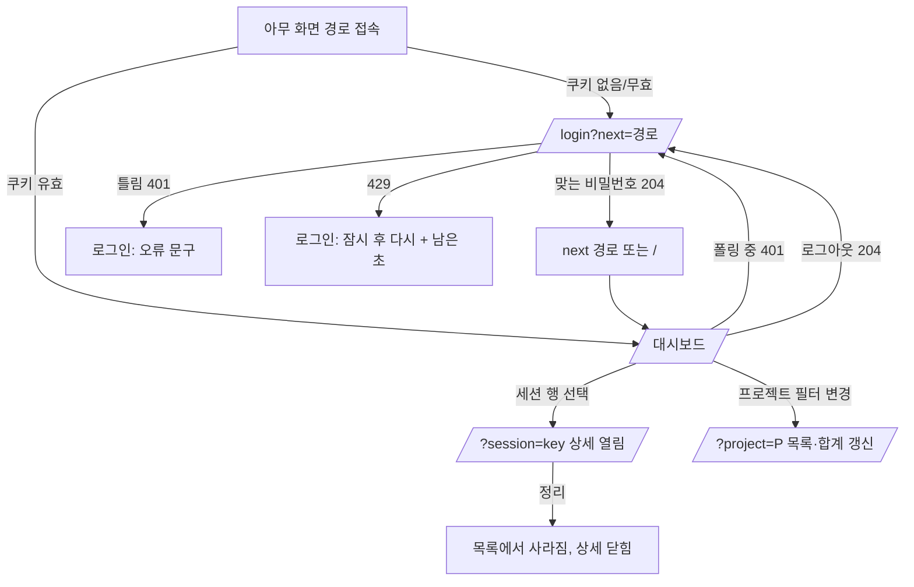

# 화면 명세: 관찰 서버 1단계

작성: designer, 2026-11-11. 기준: 루트 `DESIGN.md`(status: draft). 범위: HANDOFF.md T1-4, T1-5, T1-6과 "1단계 설계" 5·7·8절.
페이지 유형: 모두 **앱 화면**(마케팅 페이지 없음). 리뷰 너비: 390px, 1280px. 두 너비 모두 가로 스크롤 없음.

컴포넌트 이름은 DESIGN.md 6절 이름을 쓴다(StatusBadge, WaitingBanner, Button, TextField, Select, Panel, SessionRow, AgentRow, DataTable, Chip, EstimateTag, Note, ErrorBar, SyncIndicator, OfficeFloor/OfficeAvatar).

## 1. 화면 흐름



## 2. 로그인 화면 `/login`

목적: 비밀번호 하나로 로그인한다. 사용자 이름 칸은 없다(D-13).

레이아웃(390, 1280 공통. 카드 폭 = min(100% - 32px, 360px), 화면 가운데, 위 여백 15vh)
```
+------------------------------------+
| agent-observer            (h1)     |
| 관찰 화면에 들어가려면 비밀번호를   |
| 입력하세요.            (small,muted)|
|                                    |
| 비밀번호                 (라벨)    |
| [••••••••••••••••••••]  TextField  |
|  (오류 문구 자리, 평소 비어 있음)   |
|                                    |
| [         로그인         ] primary |
+------------------------------------+
```
- Panel 하나. 헤더·내비게이션 없음.
- 입력: `<input type="password" name="password" autocomplete="current-password" required autofocus>`. 라벨 `<label for>` 연결.
- `<form>`의 submit(Enter 포함)으로 `POST /api/auth/login` (JSON). 성공 204 → `next` 쿼리(`/`로 시작하는 내부 경로만, 아니면 `/`)로 `location.replace`.

상태
| 상태 | 표시 |
|---|---|
| 기본 | 위 그림. 버튼 활성 |
| 제출 중 | 버튼 "로그인 중…" + 비활성, 입력 readOnly |
| 401 invalid_password | 입력 아래 danger: "비밀번호가 맞지 않습니다." 입력값 지우고 포커스 다시 입력창. `aria-invalid` |
| 429 too_many_attempts | 입력 아래 danger: "시도가 너무 많습니다. {N}초 후에 다시 시도하세요." N은 `Retry-After`. 0이 될 때까지 1초마다 줄이고 그동안 버튼 비활성. 0이 되면 문구 지우고 버튼 활성 |
| 403(Origin 불일치)·500·네트워크 오류 | 카드 위 ErrorBar: "로그인 요청을 처리하지 못했습니다. 잠시 후 다시 시도하세요." |
| 빈 입력 제출 | 브라우저 required 검사에 맡긴다 |

- 서버 비밀번호 미설정도 401로 오므로 화면은 "맞지 않습니다"와 같게 보인다(설계상 구분 없음). Note를 카드 아래에 항상 둔다: "서버에 OBSERVER_PASSWORD가 설정되어 있어야 로그인할 수 있습니다." (small, muted)
- 키보드: Tab 순서 = 비밀번호 → 로그인 버튼. Enter로 제출.

## 3. 대시보드 `/`

목적: 세션의 상태(특히 승인 대기)를 먼저 보고, 세션을 골라 BOT별 토큰·비용·스킬을 본다.

### 3.1 영역 구성

| ID | 영역 | 데이터 |
|---|---|---|
| H | 헤더: 제목, SyncIndicator, 로그아웃 | 폴링 결과 시각 |
| F | 프로젝트 필터 | `GET /api/projects` |
| W | WaitingBanner (승인 대기 1개 이상일 때만) | sessions의 `status=waiting` |
| S | 세션 목록 Panel | `GET /api/sessions?project=` |
| E | 종료 세션 접기 (S 안) | 같은 응답에서 `status=ended` |
| DT | 세션 상세 Panel | `GET /api/sessions/[key]` |
| O | 임시 사무실 Panel (선택 세션의 BOT) | 상세의 `agents` + `GET /api/characters` |
| T | 합계 Panel: 역할별·프로젝트별 | `GET /api/summary?project=` |

### 3.2 1280px 레이아웃

컨테이너 최대 1440px, 좌우 24px, 열 간격 16px. 3열 grid: `360px | minmax(0,1fr) | 360px`.
```
+--------------------------------------------------------------------------------------------+
| H  agent-observer                          3초마다 갱신 · 방금        [로그아웃]   (56px) |
+--------------------------------------------------------------------------------------------+
| F  프로젝트 [ 전체 (5)            v]                                                       |
+-------------------------+------------------------------------------+-----------------------+
| W  (!) 승인 대기 2개 세션|  DT  세션 상세                    [정리] |  O  임시 사무실        |
|-------------------------|  winterairy/epub-editor  · main · 클라우드|  승인 대기             |
| S  세션 목록  (활성 3)  |  (!) 승인 대기 · 2시간째                  |  [!] 책임자            |
|  |(!)epub-editor   [정리]|  세션 0c09ab12 · 모델 claude-haiku-5-5   |  - - - - - - - - - -  |
|  | 승인대기·2시간째 main |  ---------------------------------------  |  책상                  |
|  | BOT 3 · 방금          |  BOT (3)                                  |  [>] QA    [..] 설계   |
|  |-----------------------|  표: 이름|상태|입력|출력|캐시쓰기|캐시읽기|  ====      ====        |
|  | agent-observer  [정리]|       |API 환산 비용                      |  - - - - - - - - - -  |
|  | 작업 중·Bash  feature/ |  책임자 lead |(!)승인대기·2시간째| 6 |398 |  쉬는 곳               |
|  | BOT 2 · 3분 전        |   ...|12.3K|100.2K|$0.0123                |  [v] 개발              |
|  |-----------------------|   스킬: [playwright-cli ×2] 부른 BOT qa×1 +-----------------------+
|  v 종료된 세션 (2) 펼치기|  QA qa | > 작업 중·Bash | ...            |  T  합계               |
|                         |  ---------------------------------------  |  [역할별][프로젝트별]  |
|                         |  세션 합계: 입력 … 출력 … $0.0456         |  표(역할|토큰|비용)    |
|                         |  (i) API 환산 비용은 … 실제 청구액이      |  합계 행               |
|                         |  아닙니다. 단가 기준일 2026-11-11 단가출처|  (i) 비용 안내 각주    |
+-------------------------+------------------------------------------+-----------------------+
```
- 1열: W, S. 2열: DT. 3열: O 위, T 아래.
- 세션이 선택되지 않았으면 DT에 안내(3.6 빈 상태 "세션을 고르세요"), O는 "세션을 고르면 BOT이 보입니다".
- 처음 진입 시 `?session=`이 없으면 목록 첫 세션을 자동 선택한다(1280에서만. 정렬상 승인 대기 세션이 먼저 열린다). URL은 `replaceState`로 `?session=` 갱신.
- 각 열은 독립 스크롤 없이 페이지 스크롤. 1열 S는 길어지면 그대로 늘어난다.
- 1024~1279px도 같은 3열(가운데 열이 줄어듦). 가운데 열이 560px보다 좁아지면 BOT 표 대신 모바일 AgentRow 카드로 바꾼다(컨테이너 쿼리 `@container (max-width: 560px)` 권장).

### 3.3 390px 레이아웃

한 열, 좌우 16px, 패널 간격 12px. 순서: H → F → W → S → DT → O → T.
```
+----------------------------------+
| agent-observer        [로그아웃] |
| 3초마다 갱신 · 방금   (caption)  |
+----------------------------------+
| 프로젝트                          |
| [ 전체 (5)                   v ] |
+----------------------------------+
| (!) 승인 대기 2개 세션          > |
+----------------------------------+
| 세션 목록 (활성 3)                |
| |epub-editor            클라우드 |
| |(!) 승인 대기 · 2시간째          |
| |main · BOT 3 · 방금      [정리] |
| |--------------------------------|
| | ...                            |
| v 종료된 세션 (2)                 |
+----------------------------------+
| 세션 상세                  [정리] |
| epub-editor · main               |
| (!) 승인 대기 · 2시간째           |
| ------------------------------   |
| 책임자  lead                      |
| (!) 승인 대기 · 2시간째           |
|  입력      6   출력      398      |
|  캐시쓰기 12.3K 캐시읽기 100.2K   |
|  API 환산 비용  $0.0123           |
|  [playwright-cli ×2]  qa ×1       |
| ------------------------------   |
| QA  qa                            |
| ...                              |
| 세션 합계 …                       |
| (i) API 환산 비용은 … 기준일 …    |
+----------------------------------+
| 임시 사무실                        |
| 승인 대기: [!]책임자              |
| 책상: [>]QA [..]설계  (줄바꿈)     |
| 쉬는 곳: [v]개발                  |
+----------------------------------+
| 합계  [역할별][프로젝트별]         |
| QA  qa · BOT 2                    |
|  출력 300 · 비용 $0.0045          |
| ...                               |
| (i) 비용 안내                      |
+----------------------------------+
```
- 헤더: 1줄 제목 + 로그아웃, 2줄 SyncIndicator(높이 자동, sticky).
- 세션 행을 누르면 `?session=` 갱신 후 DT로 스크롤(`scrollIntoView({block:'start'})`, reduced-motion이면 즉시)하고 DT 제목에 포커스(`tabIndex=-1`).
- DT 머리 옆에 ghost 버튼 "목록으로"(390에서만). 누르면 선택한 세션 행으로 스크롤·포커스.
- 1280과 달리 자동 선택하지 않는다(목록이 먼저 보여야 함). DT·O는 선택 전 숨기지 않고 짧은 안내 한 줄만 보인다.
- 토큰 표는 AgentRow 정의 목록(2열 grid: 이름 / 값 오른쪽 정렬).
- 사무실 아바타는 flex-wrap, 칸 80px → 한 줄 4개(390 - 32 - 24 = 334px).

### 3.4 헤더 (H)
- 제목 "agent-observer"(h1, 링크 아님).
- SyncIndicator: 마지막 성공 폴링 기준 "3초마다 갱신 · 방금" / 탭이 숨겨졌다 돌아오면 즉시 1회 갱신. 연속 실패 시 "갱신 실패 · {N}초 전 데이터"(warning 색 + 삼각형 아이콘). `aria-live` 넣지 않는다(3초마다 읽히는 것 방지).
- 로그아웃: secondary 버튼. `POST /api/auth/logout` → 결과와 무관하게 `/login`으로 이동.

### 3.5 프로젝트 필터 (F)
- 라벨 "프로젝트" + Select. 옵션: "전체 ({프로젝트 수})", 그다음 각 프로젝트 "{project} — 활성 {active}/{sessions}". 프로젝트 이름 그대로(말줄임은 네이티브 select에 맡김).
- 1280: 라벨과 select 한 줄, select 폭 320px. 390: 라벨 위, select 100%.
- 변경 즉시 `?project=` 갱신(`replaceState`) + `localStorage['obs.project']` 저장 + 목록·합계 즉시 재조회. 선택 세션이 새 필터에 없으면 상세 닫음(`?session=` 제거).
- 진입 시 우선순위: URL `?project=` → localStorage → 전체. 저장된 프로젝트가 목록에 없으면 전체로 바꾼다.
- 프로젝트가 0개면 select는 "전체 (0)"만 있고 비활성이 아니라 그대로 둔다.

### 3.6 세션 목록 (S, E, W)
- Panel 제목 "세션 목록" + 보조 문구 "활성 {N}".
- 정렬은 API 순서 그대로 쓴다(승인 대기 먼저·기다린 시간 긴 순 → 다른 활성 → lastEventTs 내림차순). 클라이언트에서 다시 정렬하지 않는다.
- `status !== 'ended'`인 세션은 위 목록, `ended`는 아래 "종료된 세션 ({N})" 접기(ghost 버튼, `aria-expanded`, 기본 접힘, 펼침 상태는 세션 동안 메모리에만). 종료 세션은 API `ended=recent`(24시간) 결과만.
- SessionRow 내용(DESIGN.md 6절):
  - 프로젝트 이름(전체 필터일 때) / 필터가 걸려 있으면 세션 ID 앞 8자(mono)를 제목으로.
  - StatusBadge(세션 상태). waiting이면 "승인 대기 · {기다린 시간}", stale이면 "승인 대기 (응답 없음) · {N}시간째". `waitingCount > 1`이면 뒤에 "· BOT {waitingCount}개"를 덧붙인다.
  - 브랜치, "BOT {agentCount}", 마지막 이벤트 상대 시간, 클라우드 배지.
  - "정리" 버튼: secondary. `aria-label="{project} 세션 정리"`. 누르면 확인 없이 `POST /api/sessions/[key]/dismiss`. 204 → 목록에서 즉시 제거, 선택 중이었으면 상세 닫고 포커스를 다음 행(없으면 이전 행, 없으면 목록 제목)으로. 실패 → 행 아래 small danger "정리하지 못했습니다" + 행 유지. 정리 후 목록 하단에 Note 1회: "정리한 세션은 새 이벤트가 오면 다시 보입니다."(다음 폴링 때 사라짐)
  - 정리 버튼은 모든 상태 행에 있다(종료 세션 포함).
- WaitingBanner: 목록 응답에서 waiting 세션 수. 문구 "승인 대기 {N}개 세션"(+ "(응답 없음 {M}개 포함)"). 누르면 첫 waiting 세션 선택.

### 3.7 세션 상세 (DT)
머리
- 제목(h2) "세션 상세" + 오른쪽 "정리" secondary 버튼(목록과 같은 동작).
- 1줄: 프로젝트 이름(h3) · 브랜치(mono) · 클라우드 배지
- 2줄: StatusBadge(세션 상태, 기다린 시간 포함)
- 3줄(small, muted): "세션 {sessionId 앞 8자} · 모델 {model 또는 '알 수 없음'} · 마지막 이벤트 {상대 시간}"

BOT 목록 (h3 "BOT ({N})")
- 순서는 API 그대로(lead 먼저, 이후 처음 본 순). 종료된 BOT도 남긴다(상태 "종료", 토큰 유지).
- 1280(가운데 열 ≥ 560px): DataTable
  | 열 | 내용 | 정렬 |
  |---|---|---|
  | BOT | 표시 이름(h3) + 역할 키(caption mono). 매핑 없는 역할은 `agentType` 원문이 표시 이름 | 왼쪽 |
  | 상태 | StatusBadge(working이면 "작업 중 · {currentTool}") | 왼쪽 |
  | 입력 / 출력 / 캐시 쓰기 / 캐시 읽기 | 토큰 축약값, `title`에 전체 | 오른쪽 |
  | API 환산 비용 | `$0.0123` + 추정이면 EstimateTag. `title`에 "단가 모델 {pricingModel}" | 오른쪽 |
  - 각 BOT 행 바로 아래에 한 칸 합친 보조 행(스킬·부른 BOT이 있을 때만): "스킬" 라벨 + Chip("{skill} ×{count}") 목록, "부른 BOT" + "qa ×1" 텍스트.
- 390 또는 좁은 열: AgentRow 카드(정의 목록). 라벨은 "입력, 출력, 캐시 쓰기, 캐시 읽기, API 환산 비용".
- 열 머리 "API 환산 비용"에는 Note 아이콘 버튼(i)을 붙이지 않는다. 안내는 아래 고정 각주로 항상 보인다(툴팁만으로 두지 않음 — 터치 기기 대응).

세션 합계와 각주
- 표 아래 한 줄: "세션 합계 · 입력 {…} · 출력 {…} · 캐시 쓰기 {…} · 캐시 읽기 {…} · API 환산 비용 {$…}"(+EstimateTag). 값은 `session.totals`.
- Note(고정 문구): "API 환산 비용은 같은 사용량을 API로 썼을 때의 금액입니다. 실제 청구액이 아닙니다. 단가 기준일 {pricing.asOf} · [단가 출처]". `pricing`은 `/api/summary` 응답에서 가져온다.
- 스킬이 하나도 없으면 스킬 줄을 감춘다(빈 라벨 남기지 않음).

### 3.8 임시 사무실 (O)
- Panel 제목 "임시 사무실" + caption "임시 그림". 대상: 선택된 세션의 BOT.
- OfficeFloor 세 구역(DESIGN.md 6절). 상태 → 구역·동작:
  | 상태 | 구역 | 사각형 표현 | 캐릭터 동작(설정 있을 때) |
  |---|---|---|---|
  | waiting | 승인 대기 | 상태색 사각형 + (!) | `alert` |
  | waiting + stale | 승인 대기 | stale 색 + 삼각형 (!) + 문구 "응답 없음" | `alert` |
  | working | 책상(책상에 붙음) | 재생 아이콘, 아이콘 opacity 왕복 | `sit_work` |
  | thinking | 책상(8px 떨어짐) | 점 세 개 | `sit` |
  | done | 쉬는 곳 | 체크 | `idle`(또는 `done`) |
  | ended | 표시 안 함 | — | — |
- 아바타 아래: 표시 이름, 상태 문구(waiting은 "승인 대기 · 2시간째").
- 빈 구역은 구역 이름 옆에 "없음"(caption, muted). 세 구역이 모두 비면(모두 종료) "모든 BOT이 종료되었습니다".
- 캐릭터: `characters[characterId].ok === true`면 그림 프레임, 아니면 사각형. 그림 로딩 실패(`onerror`)도 사각형으로. 프레임은 `frameWidth×frameHeight`를 40px 높이에 맞춰 정수 배율로 축소/확대(`image-rendering: pixelated`), 칸 너비는 80px 고정.
- 1280: 3열에서 폭 360px, 한 줄에 4칸. 390: 한 줄 4칸, 넘치면 줄바꿈.

### 3.9 합계 (T)
- Panel 제목 "합계"(필터가 있으면 "합계 · {project}").
- 탭 두 개: "역할별" | "프로젝트별". `role="tablist"`, 각 탭 `role="tab" aria-selected`, 패널 `role="tabpanel"`. 기본 역할별. 화살표 좌우로 탭 이동(자동 활성).
- 역할별 표(1280, 열 폭 360px라 열을 줄인다): 역할(표시 이름 + 역할 키, BOT 수 "×2") | 토큰(입력+출력+캐시 합 축약, `title`에 네 항목 각각) | API 환산 비용. 마지막 행 "전체"(`total`, 굵게).
  - 네 항목 전체를 보고 싶은 경우를 위해 행에 `<details>`(ghost "자세히")로 입력·출력·캐시 쓰기·캐시 읽기를 펼친다.
- 프로젝트별 표: 프로젝트 | 세션 수 | 토큰 합 | API 환산 비용. 필터가 있으면 한 줄.
- 390: 표 대신 행마다 정의 목록 카드(네 항목 모두 보임, `<details>` 불필요).
- 하단 Note: 3.7과 같은 비용 안내 문구(기준일·출처 포함). 합계 값은 API 값을 그대로 보인다(클라이언트에서 다시 더하지 않음 — 수용 기준 "API 값과 같다").
- 숫자 의미: "토큰 합"은 네 항목의 단순 합임을 열 머리 `title`로 밝힌다.

## 4. 상태별 화면

### 4.1 로딩
- 첫 진입: 각 Panel에 스켈레톤(목록 3행, 상세 머리 2줄 + 표 3행, 합계 4행). 헤더·필터는 즉시 그린다(필터는 프로젝트 응답 전까지 "전체" 하나만).
- 세션 선택 직후 상세 응답 전: 이전 세션 내용을 지우고 상세 스켈레톤. `aria-busy="true"`.
- 폴링 갱신: 스켈레톤·스피너 없이 값만 바꾼다.

### 4.2 빈 상태
| 상황 | 위치 | 문구 |
|---|---|---|
| 세션 0개(전체) | S | 제목 "아직 받은 세션이 없습니다" + 본문 "Claude Code의 observe hook이 이 서버(`/api/events`)로 이벤트를 보내면 여기에 세션이 나타납니다. hook의 `AGENT_OBSERVER_URL`과 토큰 설정을 확인하세요." W·E 숨김 |
| 필터 프로젝트에 활성 세션 0개, 종료만 있음 | S | "활성 세션이 없습니다." + 종료 접기는 그대로 |
| 필터 프로젝트에 세션 0개 | S | "이 프로젝트에 최근 24시간 세션이 없습니다." + ghost 버튼 "전체 보기"(필터를 전체로) |
| 세션 미선택 | DT | "왼쪽 목록에서 세션을 고르세요."(390: "위 목록에서 세션을 고르세요.") |
| 세션 미선택 | O | "세션을 고르면 BOT이 보입니다." |
| 합계 0 | T | 표 대신 "집계할 토큰이 아직 없습니다." 각주는 유지 |
| BOT에 스킬 없음 | DT | 스킬 줄 숨김 |

### 4.3 오류
| 상황 | 동작·표시 |
|---|---|
| 폴링 중 401(어느 API든) | 즉시 `/login?next={현재 경로+쿼리}`로 `location.assign`. 폴링 중지. 화면에 문구 없음 |
| 상세 404 `not_found` | DT에 "이 세션을 찾을 수 없습니다. 정리되었거나 보관 기간이 지났을 수 있습니다." + ghost "닫기"(`?session=` 제거). 폴링에서 상세 요청 중지 |
| 네트워크 오류·500(1회) | 화면 유지, SyncIndicator만 "갱신 실패 · N초 전 데이터" |
| 연속 3회 실패(약 9초) | 헤더 아래 ErrorBar: "서버에서 데이터를 가져오지 못하고 있습니다. 마지막으로 받은 데이터를 보여 주는 중입니다." + "다시 시도"(즉시 1회 폴링). 성공하면 띠 사라짐. 마지막 데이터는 지우지 않는다 |
| 정리 실패 | 해당 행 아래 danger 문구(3.6) |
| 로그아웃 실패 | 무시하고 `/login`으로 이동 |
| 캐릭터 설정 오류 | 사용자에게 오류 문구 없이 사각형으로 보인다(원인은 서버 로그, 설계 7절) |

### 4.4 특수 상태
- 승인 대기: WaitingBanner, 행 왼쪽 막대, StatusBadge 기다린 시간, 사무실 승인 대기 구역. 승인 대기 세션은 항상 목록 맨 위(API 정렬).
- 승인 대기 (응답 없음, `stale: true`): 색을 waiting(머스터드)에서 stale(진홍)으로, 아이콘을 원 → 삼각형으로, 문구를 "승인 대기 (응답 없음)"으로 셋 다 바꾼다. 정렬·정리 동작은 동일. 자동으로 사라지지 않으며 정리 버튼으로만 숨긴다.
- 응답 없음 후 재개(S-11c): 다음 폴링에서 일반 상태 배지로 돌아간다(별도 알림 없음).
- 단가 없는 모델: 비용 옆 EstimateTag "추정"(BOT 행, 세션 합계, 합계 표 모두. `estimated`가 true인 곳).
- 정리한 세션에 새 이벤트: 다음 폴링에서 목록에 다시 나타난다(별도 표시 없음).

## 5. 크기별 차이 요약

| 항목 | 390px | 1280px |
|---|---|---|
| 배치 | 한 열: H, F, W, S, DT, O, T | 3열 `360 | 1fr | 360`: (W,S) | DT | (O,T) |
| 헤더 | 2줄(동기화 문구 아래로) | 1줄 |
| 필터 | 라벨 위, 폭 100% | 한 줄, 320px |
| 세션 자동 선택 | 안 함 | 첫 세션 자동 선택 |
| 세션 선택 후 | 상세로 스크롤 + 포커스, "목록으로" 버튼 | 가운데 열 갱신, 포커스는 행에 유지 |
| BOT 토큰 | AgentRow 정의 목록 | DataTable(가운데 열 < 560px면 정의 목록) |
| 합계 | 정의 목록 카드 | 축약 표 + `<details>` |
| 사무실 | 폭 358px, 4칸/줄 | 폭 360px, 4칸/줄 |
| 터치 영역 | 버튼·행·select ≥ 44px | 버튼 32px 허용 |
| 가로 스크롤 | 없음(긴 문자열 말줄임·줄바꿈) | 없음 |

## 6. 키보드 조작과 포커스

공통: 모든 동작은 Tab/Shift+Tab, Enter, Space로 가능. 포커스 링 항상 보임(DESIGN.md 6절). 마우스 전용 동작 없음. 화면 맨 앞에 "본문으로 건너뛰기" 링크(포커스될 때만 보임, 대상 = 세션 목록 제목).

로그인 Tab 순서: 비밀번호 → 로그인. 진입 시 비밀번호에 포커스.

대시보드 Tab 순서(1280, DOM 순서와 같게 마크업)
1. 본문으로 건너뛰기
2. 로그아웃
3. 프로젝트 Select (화살표로 옵션 이동 — 네이티브 동작. 변경은 `change` 이벤트로 즉시 반영)
4. WaitingBanner 버튼(있을 때)
5. 세션 목록: 각 행마다 [세션 링크 → 정리 버튼] 반복 → "종료된 세션" 펼치기 → (펼쳤으면) 종료 세션 행들
6. 세션 상세: 정리 → (404일 때 닫기) → 단가 출처 링크 → `<details>` 없음
7. 임시 사무실: 포커스 대상 없음(건너뜀)
8. 합계: 탭 목록(활성 탭 하나만 Tab 대상, 좌우 화살표로 전환, Home/End) → 탭 패널 안 "자세히" `<details>` → 단가 출처 링크

390 순서는 DOM 순서가 같으므로 동일. 추가로 상세 머리의 "목록으로"가 정리 앞에 온다.

세부 규칙
- 세션 행은 `<a href="?session={key}">`(새 탭 열기 가능). Enter로 선택. 클라이언트 라우팅으로 처리하고 페이지 전체를 다시 읽지 않는다.
- 세션 목록 안 화살표 키 이동은 넣지 않는다(일반 Tab 이동으로 충분, 단순하게).
- 선택 후 포커스: 1280은 누른 행에 유지, 390은 상세 제목으로 이동(3.3).
- 정리 후 포커스: 다음 행 → 이전 행 → 목록 제목(3.6).
- 폴링으로 목록이 다시 그려져도 포커스가 있던 행·버튼은 `key`를 세션 키로 유지해 포커스를 잃지 않게 한다. 포커스된 행이 목록에서 사라지면 목록 제목으로.
- 401 이동, 404 닫기 후: 닫기면 선택했던 행(없으면 목록 제목)에 포커스.
- 스크린 리더: WaitingBanner만 `aria-live="polite"`. 오류 띠 `role="alert"`. 상태 배지는 문구가 읽힌다(아이콘 숨김). 표는 `<caption>`("BOT별 토큰과 API 환산 비용", "역할별 합계").

## 7. 새 컴포넌트

이 명세에서 쓰는 컴포넌트는 모두 DESIGN.md 6절에 정의했다(WaitingBanner, SessionRow, AgentRow, EstimateTag, Note, ErrorBar, SyncIndicator, OfficeFloor/OfficeAvatar 포함). 추가로 필요한 것: 탭(Tabs) — DESIGN.md에 없으므로 여기서 정의한다.
- Tabs: 높이 36px(모바일 44px), 글자 small 600. 비선택 ink-muted, 선택 ink 600 + 아래 2px primary(테라코타) 막대. 탭 목록 아래 1px border. 호버 시 ink.

## 8. 화면에 보이지 않는 것(확인용)
- 프롬프트·응답·도구 입력·명령 인자. UserPromptExpansion의 `command`도 화면에 쓰지 않는다(설계상 원본 이벤트에만 저장).
- 토큰·비밀번호·쿠키 값, 서버 내부 경로, 캐릭터 설정 오류 메시지.

## 9. 개발 시 확인할 점(설계와의 간극)
- BOT 단위 기다린 시간·응답 없음: `GET /api/sessions/[key]`의 `agents[]` 예시에 `waitingSince`·`stale`이 없다. 이 명세는 BOT 배지에도 "승인 대기 · N시간째"와 응답 없음을 보이므로, 에이전트 DTO에 `waitingSince`, `stale`을 추가해야 한다. 추가되지 않으면 BOT 배지는 세션의 값을 쓰는 대신 "승인 대기"만 보인다(시간 생략).
- 세션 상세에도 비용 각주의 기준일이 필요하므로 상세 화면은 `/api/summary`의 `pricing`을 함께 쓴다(이미 폴링 대상).
